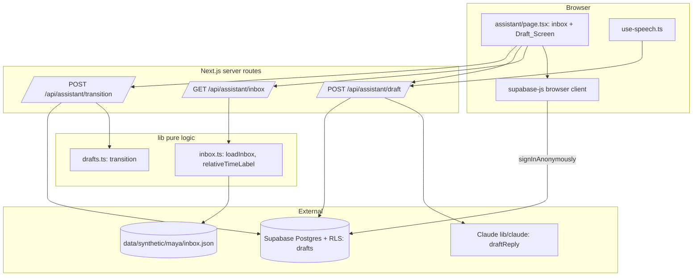
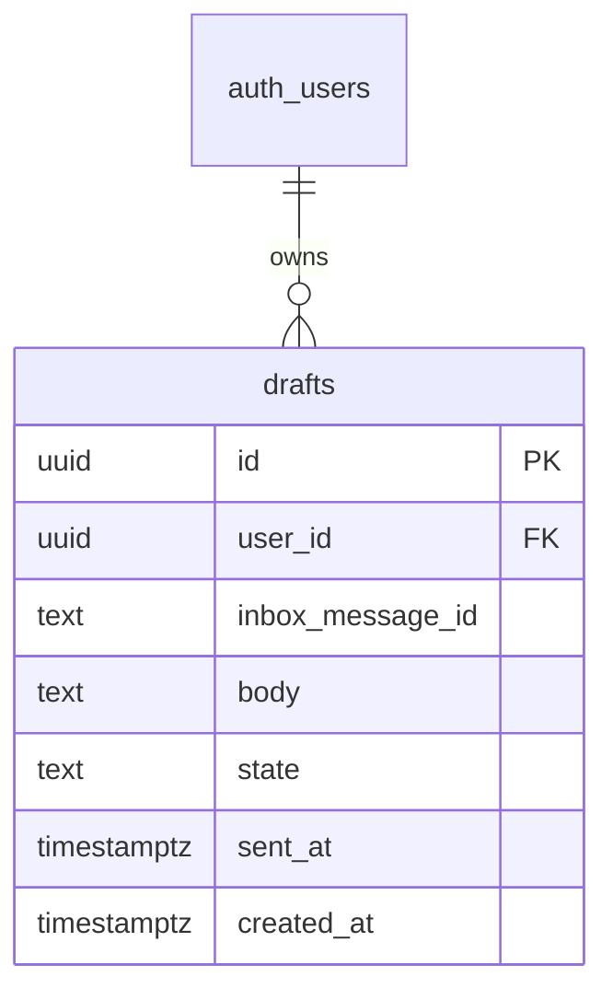
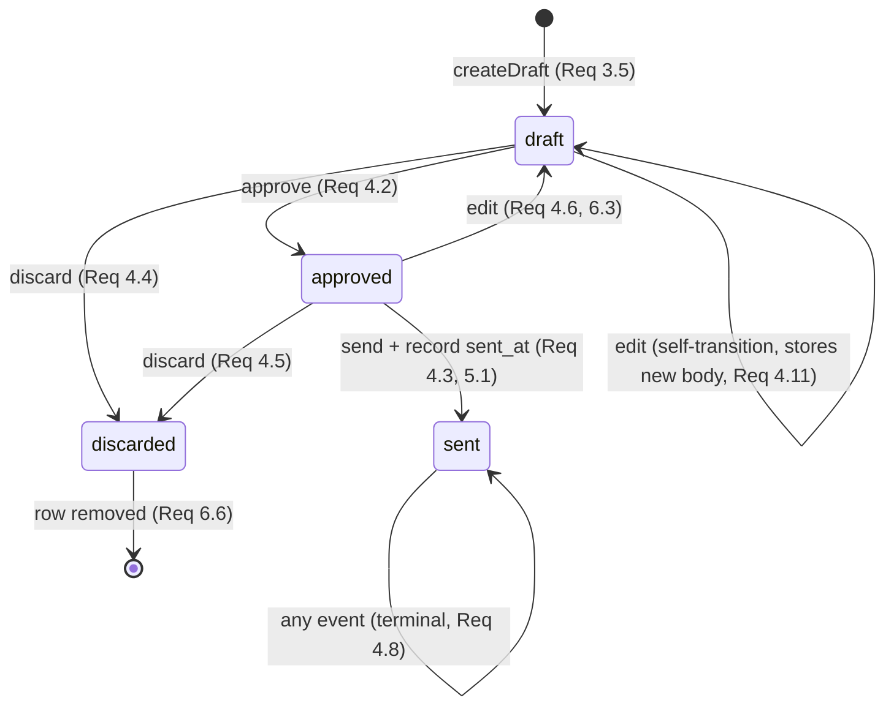

# Design Document

## Overview

`assistant-tasks` is the "second self" of iamyou: the twin acts as an assistant that
reads a synthetic sample inbox and drafts replies in the user's voice. For a chosen
Inbox_Message, the user asks the twin — by voice or by button — to draft a reply; the
server route grounds that draft in up to five of the user's `style_example` vault
entries, validates it for safety, and returns a Draft in the `draft` state. From there a
small, explicit state machine governs the Draft's life: `draft` → `approved` →
`sent`, with `discarded` reachable from `draft` or `approved`, and `edit` taking an
`approved` Draft back to `draft` (and leaving a `draft` Draft in `draft`). An `edit`
event MAY carry a new `body`; when it does, the user's edited text is stored on the Draft
**as written** — because the user wrote it themselves, it is never run through
`validateDraftSafety` (safety validation applies only to Claude-generated drafts). "Send"
is **simulated** — it records a `sent_at` timestamp on the server clock and never opens an
outbound connection.

The non-negotiable rule for this feature is rule 4 in `AGENTS.md`: **nothing is sent
without approval.** The assistant only drafts; a Draft reaches `sent` only via
`approved`. This is enforced structurally by the pure `transition` function in
`lib/drafts.ts` and verified by property P1.

The system is a Next.js (App Router, TypeScript) PWA on Vercel, matching the `twin-loop`
conventions exactly:

- Pure state-machine logic lives in `lib/drafts.ts` with **no I/O and no mutation of
  inputs**, as the primary target of fast-check property tests.
- Claude is called **only** from a server route, through the server-only `lib/claude/`
  layer. The `draftReply` prompt and its builder live in `lib/claude/prompts.ts`; the
  draft output schema lives in `lib/claude/schemas.ts`.
- Request/response zod schemas live in the client-safe `lib/api-schemas.ts` (zod only, no
  server-only imports), re-exported by `lib/claude/schemas.ts` for server use.
- Each route's logic lives in an **exported function that takes the repository and the
  Claude functions as arguments**, so tests run it against `InMemoryVaultRepository` with
  mocked Claude functions — the same pattern as `submitAnswer` in
  `app/api/checkin/answer/route.ts`.
- Persistence is Supabase Postgres with row-level security. A new `drafts` table is added
  in `supabase/migrations/0002_assistant.sql`.
- Tailwind theme utilities (`bg-accent`, `text-muted`, …) are used throughout; no
  arbitrary values such as `bg-[--var]`.

This design obeys the non-negotiable rules in `AGENTS.md` and `.kiro/steering/`:
synthetic data only, never diagnose, nothing sent without approval, labelled synthetic
screens, and server-side secrets.

### Scope note

UI pages are built separately by Claude Code. This design covers the **logic, database,
routes, prompts, schemas, and the state machine**. It does not prescribe React page
component internals beyond naming the Draft_Screen labels and controls that the routes and
state must support (the Approval_Notice, the Synthetic_Label, and the approve / discard /
edit / send controls, each mapped to a `draft_event`).

### Design goals mapped to the feature

| Step | Design element | Requirements |
| --- | --- | --- |
| Read inbox | `GET /api/assistant/inbox` + `lib/inbox.ts` (`loadInbox`, `relativeTimeLabel`) | 1, 2 |
| Draft a reply | `POST /api/assistant/draft` + `createDraft` + `draftReply` | 3, 7 |
| Govern state | `lib/drafts.ts` `transition(state, event)` | 4 |
| Approve / edit (optional body) / discard / send | `POST /api/assistant/transition` + `applyTransition` | 4, 5, 6 |
| Simulated send | `applyTransition` records `sent_at`, no network | 5 |
| Screen labels & controls | Draft_Screen (built by Claude Code) consuming route + state | 6 |

## Architecture

The code follows `.kiro/steering/structure.md`. The `assistant-tasks` additions are shown
in bold below; `[claude-code]` marks the UI pages built separately.

```
app/
  assistant/page.tsx           # [claude-code] inbox + Draft_Screen
  api/
    assistant/
      inbox/route.ts           # **GET: read-only synthetic inbox + labels**
      draft/route.ts           # **POST: createDraft (Claude + style grounding + safety)**
      transition/route.ts      # **POST: applyTransition (state machine + simulated send)**
    vault/route.ts             # **DELETE: deleteVaultForUser now also deletes the caller's drafts (P4)**
lib/
  drafts.ts                    # **transition(state, event): pure state machine (no I/O)**
  inbox.ts                     # **loadInbox, relativeTimeLabel (pure rendering + read)**
  claude/
    index.ts                   # **+ draftReply (server-only Claude call)**
    prompts.ts                 # **+ DRAFT_REPLY_SYSTEM, buildDraftReplyUserMessage, DRAFT_SAFETY_FALLBACK**
    schemas.ts                 # **+ DraftSchema (re-exports lib/api-schemas)**
  api-schemas.ts               # **+ Assistant draft/transition request & response schemas**
  db/
    draft-repository.ts        # **DraftRepository + Supabase/InMemory impls**
supabase/migrations/
  0002_assistant.sql           # **drafts table + RLS**
tests/
  pbt/                         # **P1, P2, P3 over lib/drafts.ts**
  unit/                        # route + inbox unit tests
```

### Layering rules (identical to `twin-loop`)

- **Pure logic (`lib/drafts.ts`, `lib/inbox.ts`)** has no I/O and is the primary target of
  property tests. `transition` is the pure state machine; `relativeTimeLabel` is a pure
  string function. `loadInbox` reads and parses a file but performs no database writes.
- **Server-only code** — the Claude call (`lib/claude/`) — never ships to the client. The
  Anthropic key is read only in server code (Req 3.6).
- **Data access** goes through the `DraftRepository` interface. Routes depend on the
  interface; tests inject `InMemoryDraftRepository`; production uses
  `SupabaseDraftRepository`.

### Boundary diagram



## Components and Interfaces

### Pure modules

#### `lib/drafts.ts` — the draft state machine

The heart of the feature. A **pure** `transition(state, event)` function with no I/O and
no mutation of its inputs, matching Requirement 4 exactly. The module owns the
`draft_state` and `draft_event` types and the full transition table.

```ts
/** A Draft's state; one of exactly these four values. (Req 4.1) */
export type DraftState = 'draft' | 'approved' | 'sent' | 'discarded';

/** An input to the state machine; one of exactly these four values. (Req 4) */
export type DraftEvent = 'approve' | 'send' | 'discard' | 'edit';

/** The valid states and events, exported for validation and generators. */
export const DRAFT_STATES: readonly DraftState[] =
  ['draft', 'approved', 'sent', 'discarded'] as const;
export const DRAFT_EVENTS: readonly DraftEvent[] =
  ['approve', 'send', 'discard', 'edit'] as const;

/** The two terminal states, from which every event returns the same state. (Req 4.8, 4.9) */
export const TERMINAL_STATES: readonly DraftState[] = ['sent', 'discarded'] as const;

export function isDraftState(value: unknown): value is DraftState;
export function isDraftEvent(value: unknown): value is DraftEvent;

/** Returned by `transition` when either input is not a valid state/event. (Req 4.12 / P2) */
export type TransitionError = { error: 'invalid_state' | 'invalid_event' };

/**
 * The pure draft state machine. Maps a current `DraftState` and a `DraftEvent`
 * to the next `DraftState`, with NO I/O and NO mutation of its inputs. (Req 4 / P1, P2, P3)
 *
 * Defined transitions (Req 4.2–4.6):
 *   draft    + approve  -> approved
 *   approved + send     -> sent
 *   draft    + discard  -> discarded
 *   approved + discard  -> discarded
 *   approved + edit     -> draft
 *   draft    + edit     -> draft   (self-transition; still stores a new body)
 *
 * Every other (valid state, valid event) pair returns the received state
 * unchanged (Req 4.7, 4.8, 4.9, 4.11). In particular `draft + send -> draft`
 * (Req 4.7), `draft + edit -> draft` (a self-transition — the state is
 * unchanged but the edit still stores a new body on the edit path, handled by
 * `applyTransition`), and both terminal states are absorbing (Req 4.8, 4.9).
 *
 * When either argument is not a valid state/event, returns a `TransitionError`
 * and mutates nothing (Req 4.12).
 */
export function transition(
  state: DraftState,
  event: DraftEvent,
): DraftState;
export function transition(
  state: unknown,
  event: unknown,
): DraftState | TransitionError;
```

The transition table, written as a total function over the valid domain:

| state \ event | `approve` | `send` | `discard` | `edit` |
| --- | --- | --- | --- | --- |
| `draft` | `approved` | `draft` *(P1)* | `discarded` | `draft` |
| `approved` | `approved` | `sent` | `discarded` | `draft` |
| `sent` | `sent` | `sent` | `sent` | `sent` |
| `discarded` | `discarded` | `discarded` | `discarded` | `discarded` |

Implementation shape (illustrative):

```ts
export function transition(state: unknown, event: unknown) {
  if (!isDraftState(state)) return { error: 'invalid_state' as const };
  if (!isDraftEvent(event)) return { error: 'invalid_event' as const };

  // Terminal states absorb every event. (Req 4.8, 4.9 / P3)
  if (state === 'sent' || state === 'discarded') return state;

  switch (`${state}:${event}`) {
    case 'draft:approve':    return 'approved';   // Req 4.2
    case 'approved:send':    return 'sent';       // Req 4.3
    case 'draft:discard':    return 'discarded';  // Req 4.4
    case 'approved:discard': return 'discarded';  // Req 4.5
    case 'approved:edit':    return 'draft';      // Req 4.6
    default:                 return state;         // Req 4.7, 4.11 (e.g. draft:send -> draft)
  }
}
```

`transition` concerns only the `draft_state`; it is unaware of the Draft's `body`. The
optional edit `body` is a persistence concern threaded by `applyTransition` (see below):
the pure function maps `draft + edit -> draft` and `approved + edit -> draft`, while the
route is responsible for writing the new body to the Draft on the edit path. Because
`draft + edit` is a self-transition, an `edit` with a body in the `draft` state keeps the
state at `draft` yet still stores the new text.

Three structural facts make the properties hold by construction:

- `transition` reads its arguments and returns a value; it never assigns to `state`,
  `event`, or any outer variable, so it cannot mutate its inputs or the inbox (P2).
- `sent` is reachable only through the single case `approved:send`; no other case
  produces `sent`, so a Draft reaches `sent` only on `send` from `approved` (P1).
- The explicit terminal guard returns the same state for `sent` and `discarded` across
  all four events (P3).

#### `lib/inbox.ts` — read-only inbox and relative-time rendering

```ts
/** A single read-only synthetic inbox message. (Req 1.3) */
export type InboxMessage = {
  id: string;
  from: string;
  subject: string;
  body: string;
  received_days_ago: number;
  synthetic: true;
};

/** The outcome of loading the inbox: the messages, or an unavailable signal. (Req 1.6) */
export type InboxResult =
  | { ok: true; messages: InboxMessage[] }
  | { ok: false; error: 'inbox_unavailable' };

/**
 * Reads and parses the Inbox_Message collection from
 * `data/synthetic/maya/inbox.json` at request time and returns every message.
 * Performs NO database write (Req 1.1, 1.2). On a read or parse failure, returns
 * `{ ok: false, error: 'inbox_unavailable' }` and writes nothing. (Req 1.6)
 */
export function loadInbox(
  filePath?: string,
): InboxResult;

/**
 * Pure rendering of the relative-time label from `received_days_ago`. (Req 2 / P? — see note)
 *   0                              -> "Today"            (Req 2.1)
 *   1                              -> "1 day ago"        (Req 2.2)
 *   integer N in [2, 3650]         -> "N days ago"       (Req 2.3)
 *   absent | null | non-integer |  -> ""                 (Req 2.4)
 *     negative | > 3650
 */
export function relativeTimeLabel(receivedDaysAgo: unknown): string;
```

`relativeTimeLabel` is a pure total function: any value outside the integer range
`[0, 3650]` — including `null`, `undefined`, non-integers, and negatives — maps to the
empty string, and rendering never throws (Req 2.4). `loadInbox` is kept thin so the route
stays a pass-through; the file read is the only I/O and it never touches the database
(Req 1.2, 1.6).

### `lib/db/draft-repository.ts`

A dedicated repository for the `drafts` table, following the `VaultRepository` pattern:
an interface the routes depend on, a Supabase implementation for production, and an
in-memory implementation for property and unit tests. Field names are camelCase at the
TypeScript boundary; SQL columns are snake_case, mapped in the Supabase implementation.

```ts
import type { DraftState } from '../drafts';

/** A stored Draft (`drafts` table). `sent_at` is null until the Draft is sent. (Req 4, 5) */
export type Draft = {
  id: string;
  inboxMessageId: string;   // the Inbox_Message this Draft replies to
  body: string;             // the draft text
  state: DraftState;
  sentAt: string | null;    // ISO timestamp, null unless state === 'sent' (Req 5.3)
  createdAt: string;
};

/** Input for creating a Draft; the repository assigns the `id`. State starts at 'draft'. */
export type NewDraft = {
  inboxMessageId: string;
  body: string;
};

/**
 * A patch applied by the transition route: the new state and sent_at, plus an
 * optional new `body` for the edit path. When `body` is present it replaces the
 * stored draft text (used by `edit` with a user-supplied body); when it is
 * omitted the stored body is left unchanged. (Req 4.6, 4.11, 6.3)
 */
export type DraftPatch = {
  state: DraftState;
  sentAt: string | null;
  body?: string;
};

export interface DraftRepository {
  /** Creates a Draft in the `draft` state with `sent_at` null. (Req 3.5, 5.3) */
  createDraft(userId: string, draft: NewDraft): Promise<Draft>;

  /** Loads a Draft owned by the caller, or null. */
  getDraft(userId: string, draftId: string): Promise<Draft | null>;

  /**
   * Applies the new state, sent_at, and — when `patch.body` is present — the new
   * body to the caller's Draft; returns the updated row. The edit path threads
   * the user's edited text through `patch.body`. (Req 4.6, 4.11, 6.3)
   */
  updateDraft(userId: string, draftId: string, patch: DraftPatch): Promise<Draft>;

  /** Removes the caller's Draft row entirely. Used by the discard path. (Req 6.6) */
  deleteDraft(userId: string, draftId: string): Promise<void>;

  /**
   * Removes EVERY Draft owned by the caller. Used by the "delete my vault" path
   * so that clearing a user's vault also clears their drafts (twin-loop
   * property P4, extended here). Implemented on both InMemory and Supabase
   * repositories.
   */
  deleteAllDrafts(userId: string): Promise<void>;
}
```

Two implementations, mirroring `vault-repository.ts`:

- **`SupabaseDraftRepository`** — runs on the request-scoped `@supabase/ssr` server
  client, so every statement executes under the caller's `auth.uid()` and RLS enforces
  per-user isolation. Every method additionally filters by `user_id = userId`.
  `updateDraft` writes the `body` column only when `patch.body` is present, and
  `deleteAllDrafts` issues a single `delete … where user_id = userId` over the `drafts`
  table.
- **`InMemoryDraftRepository`** — a `Map<string, Draft[]>` keyed by `userId`, returning
  copies so callers cannot mutate stored rows by reference. This is the implementation
  exercised by the route unit tests. `updateDraft` replaces the stored `body` when
  `patch.body` is supplied, and `deleteAllDrafts(userId)` empties that user's entry in the
  map.

### Server routes

All request and response bodies are validated with zod schemas from `lib/api-schemas.ts`
(re-exported through `lib/claude/schemas.ts` for server use). Each route keeps a **thin**
HTTP handler that resolves the caller, validates the body, wires the production
collaborators, and delegates to an **exported function that takes the repository and the
Claude functions as arguments** — exactly as `submitAnswer` does in `twin-loop`.

#### `GET /api/assistant/inbox` (Req 1, 2)

1. Call `loadInbox()` (reads `data/synthetic/maya/inbox.json` at request time).
2. On `{ ok: false }`, respond 503 `{ error: 'inbox_unavailable' }`, writing nothing
   (Req 1.6).
3. On success, map each message to `{ ...message, relative_time_label }` using
   `relativeTimeLabel(message.received_days_ago)` (Req 2), and respond
   `{ synthetic_label: 'Synthetic data', messages }`. The `synthetic_label` field carries
   the fixed label text the Draft_Screen / inbox screen must display (Req 1.5).

This route reads only; it never writes to the database (Req 1.2).

#### `POST /api/assistant/draft` (Req 3, 7) — `createDraft`

Request: `{ inbox_message_id: string }`. (Voice and button both resolve to the same POST;
the request is identical whether triggered by a spoken command or a button, satisfying
Req 3.1 and 3.2.)

Exported, injectable logic:

```ts
export interface DraftClaude {
  draftReply(input: {
    message: { from: string; subject: string; body: string };
    styleExamples: string[]; // up to 5 style_example texts
  }): Promise<string>;
}

export async function createDraft(
  drafts: DraftRepository,
  vault: VaultRepository,   // to read the user's style_example entries
  claude: DraftClaude,
  userId: string,
  body: { inbox_message_id: string },
): Promise<CreateDraftOutcome>;
```

Flow (design "POST /api/assistant/draft", Req 3, 7):

1. Load the inbox with `loadInbox()`; find the message whose `id` equals
   `inbox_message_id`. If absent (or inbox unavailable), return 404 / 503 and create no
   Draft.
2. Read the caller's vault entries via `vault.listVaultEntries(userId)`, keep those whose
   `kind` equals `style_example`, and take **at most 5** (the most recent by `createdAt`)
   as style grounding (Req 3.3). When none exist, pass an empty list; the draft is still
   generated without style grounding and still created (Req 3.4).
3. Call `claude.draftReply({ message, styleExamples })` (Claude is reached only here, in
   the server route — Req 3.6). The Claude layer enforces the 30-second timeout and the
   safety validation-with-one-retry described below; if it cannot return a safe draft, it
   signals failure and **no Draft is created** (Req 3.7, 7.5).
4. On a safe draft, `drafts.createDraft(userId, { inboxMessageId, body: text })`, which
   stores it with `state = 'draft'` and `sent_at = null` (Req 3.5, 5.3), and respond
   `{ draft: { id, inbox_message_id, body, state, sent_at } }`.

Outcomes map to HTTP status by the thin handler:

```ts
export type CreateDraftOutcome =
  | { status: 404; body: { error: string } }           // unknown message
  | { status: 503; body: { error: 'inbox_unavailable' } }
  | { status: 502; body: { error: 'draft_generation_failed' } } // Req 3.7 / 7.5
  | { status: 200; body: { draft: DraftResponse } };
```

##### Requirement 7 safety check (validation with one retry)

Requirement 7 says a draft must be screened for added or diagnostic health claims before
it is ever shown, and if it fails, a safe replacement must be produced before any draft is
presented (Req 7.4, 7.5). This design places that check inside the `draftReply` Claude
function (`lib/claude/index.ts`), so no unsafe text ever leaves the server-only layer:

1. Generate the draft text.
2. Validate it against Req 7.1–7.3 with `validateDraftSafety(text)` (a pure check in
   `lib/drafts.ts`, see below). If it passes, return it.
3. If it fails, retry **once**: generate a second draft with a reinforced instruction to
   add no health content. Validate again.
4. If the retry also passes, return it. If the retry **also fails validation**, return a
   failure signal — the route then responds with `draft_generation_failed` and creates no
   Draft (Req 7.5). The user is shown an error message, never the failing text (Req 7.4).

The pure validator lives beside the state machine so it is unit- and property-testable
without the model. It is driven by two documented, exported constants in `lib/drafts.ts`:

```ts
/**
 * Health terms whose APPEARANCE in a draft is a safety violation *only when the
 * term was not already present in the source message*. `diagnos` is a prefix
 * that matches "diagnose", "diagnosis", and "diagnostic"; matching is
 * case-insensitive. (Req 7.1, 7.2)
 */
export const HEALTH_TERMS: readonly string[] = [
  'diagnos', // prefix: diagnose / diagnosis / diagnostic
  'disease',
  'condition',
  'symptom',
  'risk',
  'dementia',
  "Alzheimer's",
  "Huntington's",
  'ALS',
  'memory loss',
  'genetic',
  'gene',
  'carrier',
  'test result',
  'medication',
  'prescription',
] as const;

/**
 * Scheduling / logistics words that are NEVER treated as health terms. These
 * routinely appear in appointment replies and MUST NOT trigger a violation even
 * when absent from the source message. (Req 7.2)
 */
export const SCHEDULING_WORDS: readonly string[] = [
  'appointment',
  'visit',
  'doctor',
  'Dr.',
  'clinic',
  'office',
  'confirm',
  'reschedule',
] as const;

/** A conservative, pure safety screen for draft text. (Req 7.1–7.3) */
export function validateDraftSafety(
  draftText: string,
  sourceMessageBody: string,
): { ok: true } | { ok: false; reason: string };
```

It rejects any draft that introduces health content not present in
`sourceMessageBody`, that states or implies a diagnosis or risk, or that gives
health-related guidance stronger than the single allowed sentence
`"You might want to talk to your doctor about this."` (Req 7.1, 7.2, 7.3).

The "introduces health content" rule is defined precisely in terms of the two constants:

- A term in `HEALTH_TERMS` counts as **introduced** — and therefore a violation — only
  when it is **absent from `sourceMessageBody`**, matched **case-insensitively**. If the
  source message already contains the term, the draft is free to repeat it; echoing the
  patient's or sender's own wording is never a violation.
- No word in `SCHEDULING_WORDS` is ever treated as a health term. These appointment and
  logistics words (`appointment`, `visit`, `doctor`, `Dr.`, `clinic`, `office`, `confirm`,
  `reschedule`) must not trigger a violation even when they do not appear in the source
  message, so an ordinary reply to an appointment reminder — e.g. confirming a visit with
  the doctor's office — stays safe.

Keeping the validator pure means the "fails validation" path in Req 7.5 is exercised
directly in tests. A plain confirmation reply to **every** message in
`data/synthetic/maya/inbox.json` (ids `m1`–`m5`, including `m1`, the Dr. Lee's office
appointment reminder) must pass `validateDraftSafety` — for example,
`"Thursday at 9:40 works for me. See you then. Maya"` — because it introduces no
`HEALTH_TERMS` absent from the source and uses only `SCHEDULING_WORDS` for its logistics.
A unit test asserts exactly this for all five inbox messages.

#### `POST /api/assistant/transition` (Req 4, 5, 6) — `applyTransition`

Request: `{ draft_id: string, event: draft_event, body?: string }`. The optional `body`
carries the user's edited draft text. It is validated by the request schema in
`lib/api-schemas.ts`:

```ts
// lib/api-schemas.ts (client-safe, zod only — re-exported via lib/claude/schemas.ts)
export const TransitionRequestSchema = z
  .object({
    draft_id: z.string().min(1),
    event: DraftEventSchema, // z.enum(['approve', 'send', 'discard', 'edit'])
    // The edited draft text. Optional, 1–2000 chars, and allowed ONLY with `edit`.
    body: z.string().min(1).max(2000).optional(),
  })
  // A body may accompany only an `edit` event; reject it with any other event.
  .refine((r) => r.body === undefined || r.event === 'edit', {
    path: ['body'],
    message: 'body is only allowed with the edit event',
  });
export type TransitionRequest = z.infer<typeof TransitionRequestSchema>;
```

So `body` is optional; when present it must be 1–2000 characters; and supplying a `body`
with any event other than `edit` is a validation error (400). The schema lives in the
client-safe `lib/api-schemas.ts` (zod only, no server imports) and is re-exported through
`lib/claude/schemas.ts` for the route.

Exported, injectable logic:

```ts
export async function applyTransition(
  drafts: DraftRepository,
  userId: string,
  body: { draft_id: string; event: string; body?: string },
): Promise<ApplyTransitionOutcome>;
```

Flow (design "POST /api/assistant/transition", Req 4, 5, 6):

1. Load the caller's Draft via `drafts.getDraft(userId, draft_id)`; 404 if not found /
   not owned.
2. Validate `event` with `isDraftEvent`; 400 on an invalid event (mirrors Req 4.12 at the
   HTTP boundary).
3. Compute `next = transition(draft.state, event)` — the pure state machine. (A
   `TransitionError` here would indicate a corrupt stored state; treat as 500.)
4. **Discard** (`next === 'discarded'`): perform the state transition to `discarded`
   (Req 4.4, 4.5) and **remove** the Draft — see the reconciliation definition below.
5. **Simulated send** (`next === 'sent'`, only reachable from `approved + send`): record
   `sent_at` as the server clock time at the moment the transition completes, with
   millisecond precision, using only in-application state and **no outbound connection**
   (Req 5.1, 5.2). Persist `{ state: 'sent', sentAt }`. If recording `sent_at` fails,
   reject the transition, retain the prior state, keep `sent_at` null, and respond with an
   error (Req 5.4).
6. **Edit with a body** (`event === 'edit'` and `body` present): the edited text is the
   user's own writing, so it is stored **as written** — `validateDraftSafety` is **not**
   run on it (that screen guards only Claude-generated drafts, never text the user typed).
   Persist both the new `body` and the new `state` from `transition`. This covers both
   states that accept `edit`: `approved + edit -> draft` (Req 4.6, 6.3) and the
   self-transition `draft + edit -> draft` (Req 4.11) — in both cases the stored body is
   replaced and `sent_at` stays null (Req 5.3). An `edit` **without** a body leaves the
   body unchanged and only applies the state transition.
7. **Any other transition** (`approve`, an `edit` with no body, or a no-op such as
   `draft + send`): persist `{ state: next, sentAt: next === 'sent' ? sentAt : null }`.
   For every state other than `sent`, `sent_at` stays null (Req 5.3).
8. Respond `{ draft: { id, inbox_message_id, body, state, sent_at } }` (for discard, a
   `{ discarded: true }` acknowledgement — see below).

The approve / discard / edit / send controls on the Draft_Screen (Req 6.4, 6.5) each map
to one `draft_event` sent to this route; the route is the single place that moves a Draft
between states, and it does so only through `transition`.

##### Reconciling "discard"/"remove" (Req 6.6) with the `discarded` state

Requirement 6.6 says the discard control SHALL "remove the Draft and SHALL NOT send its
contents," while Requirement 4 models discard as a transition to the `discarded`
terminal state. This design reconciles the two with one explicit definition:

> **Discard** applies the `discard` event through `transition`, moving the Draft to the
> `discarded` state (the state-machine view, Req 4.4/4.5). The route then **removes** the
> Draft by deleting its row via `drafts.deleteDraft` (the persistence view, Req 6.6).
> "Remove" therefore means the Draft no longer exists in storage and is gone from the
> Draft_Screen; the `discarded` state is the transient result of the transition that
> authorizes the removal. Because `discarded` is terminal and the row is deleted, the
> Draft's contents are never sent (Req 6.6), consistent with P1 (only `approved + send`
> reaches `sent`).

Operationally: `applyTransition` computes `transition(state, 'discard') === 'discarded'`,
then calls `deleteDraft`. A discarded Draft is thus both "in the `discarded` state" for
the instant of the transition and "removed" from the user's view and storage — the two
requirements describe the same single action.

```ts
export type ApplyTransitionOutcome =
  | { status: 404; body: { error: string } }
  | { status: 400; body: { error: string } }        // invalid event
  | { status: 500; body: { error: string } }        // sent_at record failure (Req 5.4)
  | { status: 200; body: { draft: DraftResponse } | { discarded: true } };
```

#### `DELETE /api/vault` — `deleteVaultForUser` now also deletes drafts

The existing `twin-loop` "delete my vault" route (`app/api/vault/route.ts`) deletes every
row the caller owns across the vault tables via `repo.deleteVault(userId)`. Because
`assistant-tasks` adds a per-user `drafts` table, deleting a user's vault MUST also delete
their drafts, so no draft reply survives a vault wipe.

`deleteVaultForUser` therefore gains a `DraftRepository` parameter and clears both stores:

```ts
export async function deleteVaultForUser(
  repo: VaultRepository,
  draftRepo: DraftRepository,
  userId: string,
): Promise<VaultDeleteResponse> {
  await repo.deleteVault(userId);          // existing: profiles/vault_entries/predictions/answers
  await draftRepo.deleteAllDrafts(userId); // new: every Draft owned by the caller
  return VaultDeleteResponseSchema.parse({ ok: true });
}
```

The thin `DELETE` handler constructs a `SupabaseDraftRepository` alongside the existing
`SupabaseVaultRepository` (both on the same request-scoped server client) and passes it in.
RLS keyed on `user_id = auth.uid()` scopes the drafts delete to the caller, and
`deleteAllDrafts` is the repository method that performs it. This extends the twin-loop
"delete my vault" guarantee (property P4) to cover drafts — see Property 7 below.

### Claude call (`lib/claude/`, server-only)

One function is added to the existing server-only layer, following every rule already in
`lib/claude/index.ts`: model `"claude-opus-5-5"`, no `temperature`/`top_p`/`top_k`, no
assistant prefill, and a `stop_reason === 'refusal'` check before reading content.

| Function | API | effort | Output | Notes |
| --- | --- | --- | --- | --- |
| `draftReply` | `messages.create` | medium | draft text | grounds in up to 5 `style_example` texts; validates with one retry; 30s timeout |

```ts
/** The result of drafting: a safe draft, or a failure the route turns into an error. */
export type DraftReplyResult =
  | { ok: true; text: string }
  | { ok: false; reason: 'timeout' | 'refusal' | 'unsafe' };

/**
 * Drafts a reply to an Inbox_Message in the user's voice, grounded in up to five
 * `style_example` texts, and validates it against the Req 7 safety rules with one
 * retry before returning. (Req 3.3, 3.4, 3.6, 3.7, 7.4, 7.5)
 *
 *  - Wraps the model call in a 30s timeout; on timeout returns
 *    `{ ok: false, reason: 'timeout' }` and no draft. (Req 3.7)
 *  - On refusal returns `{ ok: false, reason: 'refusal' }`. (Req 3.7)
 *  - Validates with `validateDraftSafety`; on failure retries ONCE with a
 *    reinforced no-health-content instruction; if the retry also fails validation
 *    returns `{ ok: false, reason: 'unsafe' }`. (Req 7.5)
 */
export async function draftReply(
  input: {
    message: { from: string; subject: string; body: string };
    styleExamples: string[];
  },
  client?: Anthropic,
): Promise<DraftReplyResult>;
```

Prompt strings live in `lib/claude/prompts.ts`:

- `DRAFT_REPLY_SYSTEM` — instructs the model to write a short reply **in the user's
  voice**, using the provided style examples only as a guide to tone and phrasing, and
  carries the non-negotiable safety rules: add no health information beyond what the
  Inbox_Message already contains, never state or imply any condition/diagnosis/risk, and
  use no health guidance stronger than `"You might want to talk to your doctor about
  this."` (Req 3.3, 7.1–7.3).
- `buildDraftReplyUserMessage({ message, styleExamples })` — formats the message being
  replied to and lists the up-to-five style examples (or notes "no style examples
  available" when empty, so the model still drafts — Req 3.4).
- `DRAFT_SAFETY_RETRY_SUFFIX` — the reinforced instruction appended on the single retry.
- `DRAFT_GENERATION_ERROR` — the fixed user-facing message shown when generation fails or
  the retry is still unsafe (Req 3.7, 7.5).

The draft output schema is `DraftSchema = z.object({ draft: z.string() })` in
`lib/claude/schemas.ts`.

### Voice and the Draft_Screen (built by Claude Code)

The existing `components/use-speech.ts` hook supplies the voice command that triggers
`POST /api/assistant/draft` (Req 3.1); a button triggers the same POST (Req 3.2). The
Draft_Screen (a React page under `app/assistant/`) is **out of scope for this design**
beyond the contract the routes and state require:

- It always shows the **Approval_Notice** "Nothing is sent without your approval."
  (Req 6.1) and the **Synthetic_Label** "Synthetic data" (Req 6.2, 1.5), both rendered
  with Tailwind theme utilities (e.g. `text-muted`), never arbitrary values.
- While a Draft is in `draft`, it offers an **approve** control and a **discard** control
  (Req 6.4), each posting the corresponding `draft_event` to
  `POST /api/assistant/transition` (Req 6.5, 6.6).
- An **edit** action posts the `edit` event and MAY include the edited `body` (1–2000
  chars). From `approved` it returns the Draft to `draft` (Req 6.3); from `draft` it is a
  self-transition that still saves the edited text. The user's edited text is stored as
  written and is not safety-validated. A **send** action on an `approved` Draft posts
  `send`.
- It reflects the Draft's `state` returned by the transition route (e.g. an "approved"
  indication, Req 6.5) and shows `sent_at` once sent.

## Data Models

Migration `supabase/migrations/0002_assistant.sql` adds a single `drafts` table. It does
not alter the `twin-loop` tables.

```sql
-- Migration: 0002_assistant
-- Feature: assistant-tasks
-- Adds the per-user `drafts` table for the assistant's reply drafts and enables
-- row-level security with per-user select/insert/update/delete policies keyed on
-- user_id = auth.uid(). The inbox is read-only synthetic data and is never stored.
-- Requirements: 4.1, 5.1, 5.3, 6.6

create table drafts (
  id uuid primary key default gen_random_uuid(),
  user_id uuid not null references auth.users on delete cascade,
  inbox_message_id text not null,
  body text not null,
  state text not null default 'draft'
    check (state in ('draft','approved','sent','discarded')),
  sent_at timestamptz,
  created_at timestamptz not null default now(),
  -- sent_at is set only in the `sent` state and null otherwise. (Req 5.3)
  constraint drafts_sent_at_iff_sent
    check ((state = 'sent') = (sent_at is not null))
);

-- Row-level security --------------------------------------------------------

alter table drafts enable row level security;

create policy drafts_select on drafts for select using (user_id = auth.uid());
create policy drafts_insert on drafts for insert with check (user_id = auth.uid());
create policy drafts_update on drafts for update using (user_id = auth.uid())
  with check (user_id = auth.uid());
create policy drafts_delete on drafts for delete using (user_id = auth.uid());
```

Notes on the schema:

- `state` carries a CHECK constraint matching the four `DraftState` values, so the
  database and `lib/drafts.ts` agree on the state set (Req 4.1).
- `sent_at` is nullable, and the `drafts_sent_at_iff_sent` CHECK makes the invariant
  "`sent_at` is non-null **iff** the state is `sent`" a database guarantee, backstopping
  Req 5.1 and 5.3.
- The inbox has **no table**: Inbox_Messages are read from the file at request time and
  never copied into the database (Req 1.2). This table stores only Drafts.
- Discard deletes the row (Req 6.6), so the `discarded` state is transient in storage; the
  CHECK still permits it for the instant the state is written if an implementation chooses
  to persist before deleting.

### Row-level security

Enabled on `drafts` with select / insert / update / delete policies keyed on
`user_id = auth.uid()`, identical in shape to the `twin-loop` policies, so a user can only
read and modify their own Drafts.

### Entity relationship



`inbox_message_id` references a synthetic Inbox_Message by id; it is a plain text column,
not a foreign key, because the inbox lives in a file and is never a database table
(Req 1.2).

### Draft lifecycle



## Correctness Properties

*A property is a characteristic or behavior that should hold true across all valid
executions of a system — essentially, a formal statement about what the system should do.
Properties serve as the bridge between human-readable specifications and
machine-verifiable correctness guarantees.*

The pure logic of `assistant-tasks` — the `transition` state machine, `relativeTimeLabel`,
the style-example selection, and the Req 7 safety pipeline — has clear input/output
behavior and universal invariants, so property-based testing with fast-check applies. The
remaining criteria — the file read, Supabase/RLS, the Claude call, the timestamp side
effect, the never-diagnose copy, and UI rendering — are not universally quantifiable and
are covered by unit, integration, snapshot, and smoke tests in the Testing Strategy.

The three headline properties P1, P2, and P3 are carried forward verbatim in intent from
the requirements document and each governs Requirement 4 (the state machine); three
supporting properties cover Requirements 2, 3.3, and 7. Property 7 restates the twin-loop
"delete my vault" property (P4 in `tests/pbt/delete-vault.test.ts`), **extended** so that
deleting a user's vault now also empties their drafts.

### Property 1: Send only from approved

*For all* sequences of `draft_event` values applied through `transition` starting from the
`draft` state, a Draft reaches the `sent` state only on a `send` event applied to the
`approved` state; no other path produces `sent`. In particular, `transition('draft',
'send')` returns `draft` unchanged, and any `draft_event` for which no transition is
defined returns the received state unchanged.

**Validates: Requirements 4.3, 4.7, 4.11**

### Property 2: transition is pure and does not mutate the inbox

*For all* values `state` and `event` — valid or invalid — `transition(state, event)`
returns a `draft_state` (for valid inputs) or a `TransitionError` (for invalid inputs)
without mutating its inputs, the inbox, or any Inbox_Message. For every valid
`draft_state` and valid `draft_event` the returned value is one of the four valid
`draft_state` values, and for any value that is not a valid state or not a valid event the
result is an error indication with no input mutated.

**Validates: Requirements 4.1, 4.10, 4.12, 1.2**

### Property 3: Terminal states are terminal

*For all* `draft_event` values, `transition('sent', event)` returns `sent` and
`transition('discarded', event)` returns `discarded`.

**Validates: Requirements 4.8, 4.9**

### Property 4: Relative-time label is a total mapping

*For all* inputs `x`, `relativeTimeLabel(x)` returns exactly: `"Today"` when `x` is the
integer `0`; `"1 day ago"` when `x` is the integer `1`; `"N days ago"` (with the decimal
value substituted) when `x` is an integer `N` in `[2, 3650]`; and the empty string for
every other value — absent, null, non-integer, negative, or greater than `3650` — never
raising an error.

**Validates: Requirements 2.1, 2.2, 2.3, 2.4**

### Property 5: Style grounding uses at most five style examples

*For all* sets of vault entries belonging to a user, the style examples the
`createDraft` logic passes to `draftReply` are all entries whose `kind` equals
`style_example`, number **at most 5**, and are a subset of that user's `style_example`
entries; when the user has no `style_example` entry the selection is empty and drafting
still proceeds.

**Validates: Requirements 3.3, 3.4**

### Property 6: No unsafe draft is ever presented

*For all* draft texts a generator may produce, the `draftReply` safety pipeline makes at
most two generation attempts and either returns `{ ok: true, text }` where `text` passes
`validateDraftSafety`, or returns `{ ok: false, … }` and no draft text at all; it never
returns a text that fails `validateDraftSafety`. Equivalently: a draft is presented only
after it has passed validation, and a draft that fails validation on both the initial
attempt and the single retry yields an error rather than any draft.

**Validates: Requirements 7.4, 7.5**

### Property 7: Deleting a vault also deletes the caller's drafts

This property restates the twin-loop "delete my vault" property P4
(`tests/pbt/delete-vault.test.ts`), **extended** to the `drafts` table.

*For all* users and all sets of Drafts that user owns, after `deleteVaultForUser` runs the
caller's vault is empty **and** the caller has no remaining Drafts: for every `draftId`
previously owned by the user, `getDraft(userId, draftId)` returns `null`. The existing
vault-empty assertion from P4 is retained and a drafts-empty assertion is added for the
same caller.

**Validates: Requirements 6.6**

## Error Handling

| Failure | Handling | Requirement |
| --- | --- | --- |
| No authenticated caller on a protected route | Return 401; client routes to landing | 3, 4, 5, 6 |
| `data/synthetic/maya/inbox.json` missing or unparsable | `loadInbox` returns `{ ok: false }`; route responds 503 `inbox_unavailable`, writes nothing | 1.6 |
| `inbox_message_id` not found in the inbox | Return 404; create no Draft | 3.1, 3.2 |
| Claude draft call times out (>30s) or refuses | `draftReply` returns `{ ok: false, reason }`; route responds 502 `draft_generation_failed`, creates no Draft | 3.7 |
| Draft fails safety validation twice (initial + one retry) | `draftReply` returns `{ ok: false, reason: 'unsafe' }`; route responds 502, shows the error message, presents no draft | 7.4, 7.5 |
| Invalid request body (zod parse fails) | Return 400 with a validation error | all routes |
| `body` supplied with a non-`edit` event, or a `body` outside 1–2000 chars | Return 400; the `TransitionRequestSchema` refinement rejects it | 4, 6 |
| Invalid `event` on the transition route | Return 400 (mirrors `transition`'s `TransitionError`) | 4.12 |
| Draft not found / not owned by caller | Return 404 (RLS also prevents cross-user access) | 4, 6 |
| Recording `sent_at` fails during a `send` transition | Reject the transition, retain the prior state, keep `sent_at` null, return 500 | 5.4 |
| Invalid state/event passed to `transition` | Returns a `TransitionError`; no input mutated | 4.12 |
| `received_days_ago` absent, null, non-integer, negative, or > 3650 | `relativeTimeLabel` returns `""`, other fields still render | 2.4 |

All safety fallbacks respect `safety.md`: no draft, error message, or prompt states or
implies a condition, and the discard/send paths never send a Draft that was not approved.

## Testing Strategy

### Dual approach

- **Property tests (`tests/pbt/`, fast-check, min. 100 iterations each)** verify the six
  universals above. Each test is tagged
  `// Feature: assistant-tasks, Property {n}: {property text}` and references the design
  property and its requirement(s).
- **Unit tests (`tests/unit/`)** verify specific examples, enum/boundary edge cases,
  error paths, and route behavior using `InMemoryDraftRepository` /
  `InMemoryVaultRepository` and mocked Claude functions. No unit test calls the real
  Anthropic API or a live Supabase instance.

A property-based testing library (fast-check, already used by `twin-loop`) is used — not
implemented from scratch — with a minimum of 100 iterations per property test.

The verified behavior spans four example/edge/integration surfaces in addition to the
properties: the **inbox** (`loadInbox` / `GET /api/assistant/inbox` over all five
synthetic messages and the unavailable path), the **repository** (`DraftRepository`
methods, including the new `updateDraft` body path and `deleteAllDrafts`), the
**Claude fallback** (timeout / refusal / twice-unsafe results from a mocked `draftReply`
that create no Draft), and the **route paths** (`createDraft`, `applyTransition`, and the
drafts-aware `deleteVaultForUser`, each run against in-memory repositories with mocked
Claude functions).

### Property tests

| Test | Property | Generator sketch | Requirements |
| --- | --- | --- | --- |
| send only from approved | P1 | arbitrary sequences of `draft_event`, folded through `transition` from `draft` | 4.3, 4.7, 4.11 |
| transition purity & validity | P2 | arbitrary (valid & invalid) `state`/`event` values; deep-frozen inputs + an inbox fixture | 4.1, 4.10, 4.12, 1 |
| terminal states absorbing | P3 | `sent`/`discarded` × every `draft_event` | 4.8, 4.9 |
| relative-time total mapping | P4 | integers in/out of `[0, 3650]`, plus `null`, `undefined`, floats, negatives, non-numbers | 2.1–2.4 |
| style grounding ≤ 5 | P5 | arbitrary vault entry sets across all five kinds | 3.3, 3.4 |
| no unsafe draft presented | P6 | a stubbed generator producing arbitrary safe/unsafe texts with controllable per-attempt pass/fail | 7.4, 7.5 |
| delete vault empties drafts | P7 | arbitrary sets of a user's drafts in `InMemoryDraftRepository` + `InMemoryVaultRepository`, run through `deleteVaultForUser` | twin-loop P4 (extended), 6.6 |

### Unit / integration / snapshot / smoke tests

- **State machine examples (unit):** each defined transition cell —
  `draft+approve→approved` (4.2), `approved+send→sent` (4.3), `draft+discard→discarded`
  (4.4), `approved+discard→discarded` (4.5), `approved+edit→draft` (4.6) — as concrete
  assertions complementing P1/P3.
- **`relativeTimeLabel` boundaries (unit):** `0`, `1`, `2`, `3650`, `3651`, `-1`, `1.5`,
  `null` as named examples (2.1–2.4).
- **`validateDraftSafety` (unit):** rejects texts with diagnosis/risk phrasing (7.1),
  rejects a `HEALTH_TERMS` term that is absent from the source message (7.2) while
  accepting the same term when the source already contains it (case-insensitive), never
  treats a `SCHEDULING_WORDS` word as a violation even when it is absent from the source,
  rejects guidance stronger than the single allowed sentence while accepting that exact
  sentence (7.3), and accepts a clean reply. A dedicated assertion runs a plain
  confirmation reply (e.g. `"Thursday at 9:40 works for me. See you then. Maya"`) against
  **every** message in `data/synthetic/maya/inbox.json` (ids `m1`–`m5`, including the
  Dr. Lee's office reminder `m1`) and expects each to pass `validateDraftSafety`.
- **`inbox` route / `loadInbox` (unit + edge):** returns all five messages with the six
  fields populated and validates against the `InboxMessage` schema (1.1, 1.3); includes
  the Dr. Lee's office confirm/reschedule message (1.4); performs no database write (1.2);
  a missing path and malformed JSON both yield `inbox_unavailable` with no write (1.6).
- **`draft` route `createDraft` (unit, in-memory repos + mocked `draftReply`):** voice and
  button both create a Draft addressed to the chosen message (3.1, 3.2); the created Draft
  has `state === 'draft'` and `sent_at === null` (3.5, 5.3); with zero `style_example`
  entries a Draft is still created (3.4); a mocked timeout/refusal/unsafe result creates
  no Draft and returns an error (3.7, 7.5).
- **`transition` route `applyTransition` (unit, in-memory repo):** `approve` moves `draft`
  to `approved` (6.5); `edit` moves `approved` back to `draft` (6.3); an `edit` **with a
  body** in the `approved` state returns the Draft to `draft` **and** stores the new body
  as written (no safety validation run on it) (4.6, 6.3); an `edit` **with a body** in the
  `draft` state keeps the state at `draft` (self-transition) **and** stores the new body
  (4.11); a `body` supplied with any non-`edit` event is rejected at the schema boundary
  with 400; `send` from `approved` records a non-null `sent_at` near the mocked clock and
  opens no outbound connection (5.1, 5.2); `approve`/`edit`/invalid no-op transitions keep
  `sent_at` null (5.3); `discard` removes the Draft so `getDraft` returns null and no send
  ever occurs (6.6); a repo whose `update` throws during `send` retains the prior state,
  keeps `sent_at` null, and returns an error (5.4); an invalid `event` returns 400 (4.12).
- **`deleteVaultForUser` drafts extension (unit, in-memory repos):** after seeding a user
  with both vault rows and several drafts, calling `deleteVaultForUser(vaultRepo,
  draftRepo, userId)` leaves the vault empty (existing twin-loop assertion) and leaves the
  caller with no drafts — `getDraft` returns `null` for each previously created draft and
  another user's drafts are untouched (P7; twin-loop P4 extended, 6.6).
- **`DraftRepository` methods (unit, in-memory repo):** `createDraft` yields a `draft`
  row with `sent_at` null; `getDraft` returns a copy scoped to the owner and `null` for a
  draft owned by another user; `updateDraft` applies state/`sent_at` and, when
  `patch.body` is present, replaces the stored body while leaving it unchanged when
  `patch.body` is omitted; `deleteDraft` removes a single row; `deleteAllDrafts(userId)`
  removes every row for that user and leaves other users' drafts intact. These confirm the
  repository behavior the route paths rely on is verified independently of the routes.
- **Migration (integration/snapshot):** `0002_assistant.sql` applies; the `drafts` table
  and its columns exist; the `state` CHECK rejects invalid states (4.1); the
  `drafts_sent_at_iff_sent` CHECK rejects a non-`sent` row with a `sent_at` and a `sent`
  row without one (5.1, 5.3); RLS select/insert/update/delete policies exist and a
  cross-user read/write is denied.
- **Draft_Screen (component/snapshot, built by Claude Code):** renders the Approval_Notice
  "Nothing is sent without your approval." (6.1) and the Synthetic_Label "Synthetic data"
  (6.2, 1.5); while a Draft is in `draft` it shows approve and discard controls (6.4) and
  indicates the approved state after approve (6.5); copy uses Tailwind theme utilities,
  never arbitrary values.
- **Smoke / boundary:** Claude imports and `ANTHROPIC_API_KEY` appear only in server code
  (3.6); the inbox file parses as a valid Inbox_Message collection.

### Why PBT is scoped the way it is

Property-based testing is applied to the pure, input-driven logic where many generated
inputs find edge cases: the `transition` state machine (P1–P3), the total `relativeTimeLabel`
mapping (P4), style-example selection (P5), and the safety pipeline's control flow (P6).
It is deliberately **not** applied to the file read and the inbox contents (fixed
synthetic data → example/edge tests), the Claude call (external I/O → mocked route tests),
the `sent_at` timestamp and no-network guarantee (clock- and side-effect-bound →
example/integration tests), the migration and RLS (declarative DB config → integration +
CHECK-constraint tests), the never-diagnose copy (fixed strings → example assertions), or
the Draft_Screen (UI → component/snapshot tests), per `tech.md` and the workflow's PBT
guidance.
