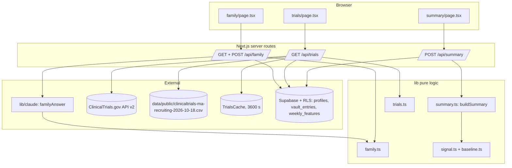

# Design Document

## Overview

`care-outputs` turns a person's baseline and vault into three outward-facing surfaces:

- a printable **clinician summary** (`/summary`) built by the pure `buildSummary` in
  `lib/summary.ts`, following the 14 fields in `docs/clinician-summary-fields.md`;
- a **trial finder** (`/trials`) that lists recruiting studies with a Massachusetts site
  for the family condition, from the ClinicalTrials.gov API v2 with a 10-second timeout,
  a 3600-second cache and the saved CSV slice as fallback, normalized and filtered by the
  pure `normalizeTrial` and `filterTrials` in `lib/trials.ts`;
- **family mode** (`/family`), where a relative named in the profile's
  `digital_will.family_mode_access` list asks a question and gets an answer grounded only
  in vault entries, with citations, or "I don't know how {first_name} would answer that."
  The Claude call is the server-only `familyAnswer` in `lib/claude/`; citation checks are
  the pure `validateFamilyAnswer` in `lib/family.ts`.

It is the last spec in the build order (`twin-loop` → `assistant-tasks` →
`health-baseline` → `care-outputs`). It consumes `health-baseline` and never
reimplements it: `gate(signal, rtk_setting)` and `detectSignal` come from
`lib/signal.ts`, `computeBaseline` and `zScores` from `lib/baseline.ts` (Req 2.5, 3.4).

The design matches the `twin-loop` and `assistant-tasks` conventions exactly:

- Pure logic in `lib/` has no I/O and no input mutation, and is the target of the
  fast-check properties P1, P2 and P3.
- Route request and response zod schemas live in the client-safe `lib/api-schemas.ts`
  (zod only), re-exported by `lib/claude/schemas.ts` for server use.
- Each route keeps a thin HTTP handler and delegates to an **exported function that takes
  its dependencies as arguments** (repositories, Claude functions, fetch, cache, clock), so
  unit tests run it against in-memory repositories with mocks, like `submitAnswer` and
  `createDraft`.
- Claude runs only in `lib/claude/` with model `"claude-opus-5-5"`, a refusal check before
  reading content, and no `temperature`/`top_p`/`top_k` or prefill.
- Screens use Tailwind theme utilities only (`bg-accent`, `text-muted`, …), never arbitrary
  values such as `bg-[--var]`.

### Scope note

Claude Code builds the summary page, the trial list and the family mode screen. This
design covers logic, routes, prompts, schemas, one migration and tests. It names only the
contract the screens consume (fields, labels, links, empty states).

### Design goals mapped to requirements

| Surface | Design element | Requirements |
| --- | --- | --- |
| Summary fields | `lib/summary.ts` `buildSummary` | 1, 2, 3, 4.4, 4.5 |
| Summary data | `POST /api/summary` + `getSummary` | 1, 2.5, 3.4, 4 |
| Trial shape, phases, filtering | `lib/trials.ts` `normalizeTrial`, `phaseLabel`, `matchesCondition`, `filterTrials` | 6.2–6.5, 7, 8.1–8.4 |
| Trial sourcing | `GET /api/trials` + `getTrials` (live, cache, slice) | 5, 6.1, 6.5 |
| Family access and entry selection | `lib/family.ts` `familyModeAccess`, `selectFamilyEntries` | 9.1, 9.2, 9.4 |
| Family answer | `lib/claude` `familyAnswer` + `lib/family.ts` `validateFamilyAnswer` | 9.3, 9.5–9.7, 10 |
| Family route | `GET`/`POST /api/family` + `answerFamilyQuestion` | 9, 10 |

## Architecture

New files are in bold; `[claude-code]` marks screens built separately.

```
app/
  summary/page.tsx             # [claude-code] printable clinician summary
  trials/page.tsx              # [claude-code] trial list
  family/page.tsx              # [claude-code] family mode screen
  api/
    summary/route.ts           # **POST: getSummary**
    trials/route.ts            # **GET: getTrials (live → cache → slice)**
    family/route.ts            # **GET: askers; POST: answerFamilyQuestion**
lib/
  summary.ts                   # **buildSummary + fixed texts (pure)**
  trials.ts                    # **normalizeTrial, phaseLabel, matchesCondition, filterTrials, parseSliceCsv, URLs (pure)**
  family.ts                    # **familyModeAccess, selectFamilyEntries, validateFamilyAnswer, dontKnowAnswer (pure)**
  trials-cache.ts              # **TrialsCache interface + InMemoryTrialsCache**
  signal.ts                    # (health-baseline) detectSignal, gate
  baseline.ts                  # (health-baseline) computeBaseline, zScores
  api-schemas.ts               # **+ summary, trials, family request/response schemas**
  claude/
    index.ts                   # **+ familyAnswer**
    prompts.ts                 # **+ FAMILY_ANSWER_SYSTEM, buildFamilyAnswerUserMessage**
    schemas.ts                 # **+ familyAnswerSchemaFor(ids)**
  db/
    vault-repository.ts        # **Profile gains familyHistoryRelation**
    weekly-feature-repository.ts # (health-baseline) WeeklyFeatureRepository + InMemory impl
supabase/migrations/
  0004_care_outputs.sql        # **profiles.family_history_relation**
tests/
  pbt/                         # **P1–P5**
  unit/                        # **summary, trials, family, routes**
```

### Layering rules

- **Pure (`lib/summary.ts`, `lib/trials.ts`, `lib/family.ts`)**: no I/O, no model call, no
  input mutation (Req 1.7, 7.7, 10.8). `buildSummary` calls the `health-baseline`
  functions, which are pure too, so it stays pure. `lib/trials.ts` and `lib/family.ts`
  import nothing server-only, so screens may import their display constants.
- **Server-only**: the HTTP fetch to ClinicalTrials.gov, the CSV file read and the cache
  live in `app/api/trials/route.ts` (Req 5.8); the Claude call lives in `lib/claude/`
  (Req 9.7).
- **Data access**: routes depend on `VaultRepository` and `WeeklyFeatureRepository`;
  tests inject the in-memory implementations.

### Boundary diagram



## health-baseline contract

`health-baseline`'s design is being written in parallel. `care-outputs` relies only on the
names below. Task 1 compares them with `health-baseline/design.md` and the implemented
modules and updates this design and its imports if they differ; it never copies the logic
here.

```ts
// lib/baseline.ts (health-baseline)
export type Feature =
  | 'vocabulary_diversity' | 'mean_sentence_length' | 'filler_rate'
  | 'sleep_hours' | 'active_minutes' | 'twin_accuracy';
export const MIN_BASELINE_WEEKS: 12;

/** One weekly_features row at the TypeScript boundary. */
export type WeeklyFeatureRow = { weekStart: string; synthetic: boolean } &
  Record<Feature, number | null>;

/**
 * Mean and standard deviation of `feature` over the weeks with data among the
 * `windowWeeks` weeks before `beforeWeek` (default BASELINE_WEEKS = 26).
 * Returns null only when no week in the window has data.
 */
export function computeBaseline(
  rows: readonly WeeklyFeatureRow[], feature: Feature, beforeWeek: string,
  windowWeeks?: number,
): { mean: number; sd: number; weeks: number } | null;

/** Per-week z-scores for `feature`; z is null while fewer than MIN_BASELINE_WEEKS prior weeks exist. */
export function zScores(
  rows: readonly WeeklyFeatureRow[], feature: Feature,
): Array<{ weekStart: string; z: number | null }>;

// lib/signal.ts (health-baseline)
export type ChangeSignal = { features: Feature[]; firstWeek: string };
export function detectSignal(rows: readonly WeeklyFeatureRow[]): ChangeSignal | null;
export function gate(
  signal: ChangeSignal | null, rtk_setting: unknown,
): { showToUser: boolean; includeInSummary: boolean };

// lib/db/weekly-feature-repository.ts (health-baseline)
export interface WeeklyFeatureRepository {
  listWeeklyFeatures(userId: string): Promise<WeeklyFeatureRow[]>;
}
export class InMemoryWeeklyFeatureRepository implements WeeklyFeatureRepository { /* … */ }
```

Two alignment points are known now:

- **Gate module path.** `gate(signal, rtk_setting)` and `detectSignal` live in
  `lib/signal.ts`, as `health-baseline`'s requirements and this spec's RTK_Gate glossary
  entry state. This design imports both from `lib/signal.ts`.
- **Recent 4-week mean.** Requirement 2.5 forbids recomputing means here, so the recent
  mean is `computeBaseline(rows, feature, weekAfterLatest, 4).mean`. If
  `computeBaseline` has no `windowWeeks` parameter, the gap is closed in `health-baseline`
  (a parameter or a `recentMean` export), not with local arithmetic.

## Components and Interfaces

### `lib/summary.ts`: the clinician summary

```ts
import type { Feature, WeeklyFeatureRow } from './baseline';
import type { ChangeSignal } from './signal';
import type { Profile } from './db/vault-repository';

export const SUMMARY_INTRO_TEXT =
  "This summary was prepared by iamyou at the person's request, from their own " +
  'conversations and wearable data. It is not a diagnosis and no clinician has reviewed it.';
export const NOT_A_DIAGNOSIS_FOOTER = 'This is not a diagnosis.';
export const NO_CHANGE_TEXT = 'No change to report.';
export const FOCUS_TEXT = 'Personal baseline: language, sleep and activity';
export const NOT_AVAILABLE_TEXT = 'Not available';
export const SYNTHETIC_LABEL = 'Synthetic data';

/** Field 8 row order. (Req 2.1) */
export const SUMMARY_FEATURE_ORDER: readonly Feature[] = [
  'vocabulary_diversity', 'mean_sentence_length', 'filler_rate',
  'sleep_hours', 'active_minutes', 'twin_accuracy',
];

export type SummaryInput = {
  profile: Pick<Profile, 'firstName' | 'lastName' | 'dateOfBirth' | 'familyHistory'
    | 'familyHistoryRelation' | 'rtkSetting' | 'synthetic'>;
  rows: readonly WeeklyFeatureRow[];
  summaryDate: string;      // ISO date, supplied by the route's clock
  discussText: string | null; // field 11, the person's own words
  contact: string | null;     // fields 4 and 13
};

/** The health-baseline functions, injectable for tests. Defaults to the real modules. */
export type SummaryDeps = {
  detectSignal: typeof detectSignal;
  gate: typeof gate;
  computeBaseline: typeof computeBaseline;
  zScores: typeof zScores;
};

export type MeasureRow = {
  feature: Feature;
  label: string;               // e.g. "Vocabulary diversity"
  baselineMean: number | null;
  recentMean: number | null;
  z: number | null;            // null renders NOT_AVAILABLE_TEXT (Req 2.3)
};

export type SummaryField =
  | { n: 8; key: 'measures'; label: 'Measures'; rows: MeasureRow[] }
  | { n: Exclude<SummaryFieldNumber, 8>; key: TextFieldKey; label: string; text: string };

export type ClinicianSummary = {
  fields: SummaryField[];  // exactly 14, ordered n = 1..14 (Req 1.2)
  synthetic: boolean;      // drives the Synthetic_Label (Req 4.1–4.3)
};

export function buildSummary(input: SummaryInput, deps?: SummaryDeps): ClinicianSummary;
```

`buildSummary` is a pure function of `input` (and `deps`, which default to the real
`health-baseline` modules). It produces the same output for the same input (Req 1.7). It
first computes:

- `latest`: the greatest `weekStart` in `rows`; `recentStart` = `latest` minus 21 days;
  `weekAfterLatest` = `latest` plus 7 days; `baselineStart`: the smallest `weekStart`.
- `signal = deps.detectSignal(rows)`.
- `open`: `true` only when `signal` is non-null, `deps.gate(signal, profile.rtkSetting)`
  returns without throwing, and its `includeInSummary` is exactly `true`. A thrown error
  or a non-boolean value counts as closed (Req 3.4, 3.5).

| n | key | label | Content | Req |
| --- | --- | --- | --- | --- |
| 1 | `subject` | Subject | `iamyou Care Summary, ${open ? 'Change noticed' : 'Update'}, ${shortName}` | 1.3, 1.4 |
| 2 | `intro` | Intro | `SUMMARY_INTRO_TEXT` | 1.5 |
| 3 | `person` | Person | `${fullName}, born ${dateOfBirth}` (date omitted when null) | 1.2 |
| 4 | `from` | From | `iamyou · iamyou.si · ${contact ?? 'No contact chosen'}` | 1.2 |
| 5 | `focus` | Focus | `FOCUS_TEXT` | 1.2 |
| 6 | `family_history` | Family history | condition label plus ` (${relation})` when known; "None reported" / "Prefers not to say" | 1.2 |
| 7 | `dates` | Baseline start and summary date | `Baseline start: ${baselineStart ?? 'No data yet'} · Summary date: ${summaryDate}` | 1.2 |
| 8 | `measures` | Measures | six `MeasureRow`s, see below | 2 |
| 9 | `data_sources` | Data sources | week count, sources, synthetic statement | 4.4 |
| 10 | `what_changed` | What changed | change description when `open`, else `NO_CHANGE_TEXT` | 3 |
| 11 | `discuss` | What the person would like to discuss | `discussText` as written, or "Nothing added." | 1.2 |
| 12 | `rtk` | Right-not-to-know setting | fixed sentence per setting | 1.2 |
| 13 | `questions` | Questions | `contact ?? 'No contact chosen'` | 1.2 |
| 14 | `footer` | Footer | `NOT_A_DIAGNOSIS_FOOTER` | 1.6 |

Name rules (Req 1.3, 1.4): `shortName` is `"M. Linden"` when both names exist, the first
initial with a period (`"M."`) when only the first name exists, the last name alone when
only the last name exists, and `"Name not provided"` when neither exists. Assembly never
throws on missing name parts.

Family history labels (field 6): `huntington` → "Huntington's disease",
`familial_alzheimers` → "Familial Alzheimer's disease", `als` → "Amyotrophic lateral
sclerosis (ALS)". This describes the relative, not the person, as the fields document
specifies; for Maya it reads "Familial Alzheimer's disease (father)".

Right-not-to-know sentences (field 12):

| `rtkSetting` | Text |
| --- | --- |
| `tell_me` | The person chose to see changes and share them with their clinician. |
| `doctor_only` | The person chose not to see changes themselves and to share them only with their clinician. |
| `record_only` | The person chose to record changes without seeing or sharing them. |
| anything else | No setting recorded. Changes are not shared. |

**Measures (field 8, Req 2).** For each feature in `SUMMARY_FEATURE_ORDER`, exactly one
row, never more:

- `baselineMean` = `deps.computeBaseline(rows, f, recentStart)?.mean ?? null` (the 26
  weeks before the recent window);
- `recentMean` = `deps.computeBaseline(rows, f, weekAfterLatest, 4)?.mean ?? null`;
- `z` = the `deps.zScores(rows, f)` entry for `latest`, or `null` when missing or null
  (fewer than `MIN_BASELINE_WEEKS` prior weeks, Req 2.3).

`MeasureRow` has no target field, so no target can be rendered (Req 2.4). No mean or z is
computed in this module (Req 2.5).

**Data sources (field 9, Req 4.4).** `${n} weeks of data from ${sources}. ${syntheticText}`
where `sources` lists "voice check-ins" when any speech feature is non-null and "a
wearable" when `sleep_hours` or `active_minutes` is non-null, and `syntheticText` is
"Includes synthetic data." when `synthetic` is true, else "No synthetic data.".
`synthetic` is `true` unless `profile.synthetic` is exactly `false` and every row's
`synthetic` is exactly `false`, so data that cannot be confirmed as real is labelled
(Req 4.2, 4.3).

**What changed (field 10, Req 3).** When `open`, the text names only the measures, the
timeframe and the change amount, in a fixed template:

```
Since the week of {signal.firstWeek}, {k} weeks after the baseline start on {baselineStart},
these measures moved away from the person's own baseline: {label} (z {z, 1 decimal}, {higher|lower}); …
```

Measures come from `signal.features`, ordered by `SUMMARY_FEATURE_ORDER`; `z` is the same
latest-week value shown in field 8 ("z not available" when null). The template holds no
interpretation, condition name or likelihood wording (Req 3.3, 4.5). When not `open`,
field 10 is exactly `NO_CHANGE_TEXT`, and no other field carries change details (the
subject only switches between "Update" and "Change noticed") (Req 3.2, 3.5 / P3).

With `doctor_only`, `gate` opens the summary but not the user view. The summary page is
the clinician summary, the one place `doctor_only` allows a change to appear (rule 3).

### `lib/trials.ts`: normalization, phases, keywords, filtering

```ts
export type FamilyCondition = 'huntington' | 'familial_alzheimers' | 'als';
export type TrialSource = 'live' | 'saved_ma_slice';
export type Trial = {
  nctId: string; title: string; phaseLabel: string; conditions: string[];
  status: string; cities: string[]; source: TrialSource;
};

export const FAMILY_CONDITIONS: readonly FamilyCondition[];
export function isFamilyCondition(value: unknown): value is FamilyCondition;

export const NO_MATCH_TEXT = 'No matching studies recruiting in Massachusetts right now.';
export const NOT_A_RECOMMENDATION_TEXT = 'Listing a study here is not a recommendation to join it.';
export const MASSACHUSETTS = 'Massachusetts';

/** query.cond term per condition (Req 5.1) and the Condition_Search_URL term (Req 6.5). */
export const CONDITION_QUERY: Record<FamilyCondition, string> = {
  huntington: 'Huntington Disease',
  familial_alzheimers: 'Alzheimer Disease',
  als: 'Amyotrophic Lateral Sclerosis',
};

export function phaseLabel(raw: unknown): string;
export function normalizeTrial(raw: unknown, source: TrialSource): Trial;
export function matchesCondition(trial: Trial, condition: unknown): boolean;
export function filterTrials(trials: readonly Trial[]): Trial[];
export function parseSliceCsv(text: string): Array<Record<string, string>>;
export function studyUrl(nctId: string): string | null;
export function conditionSearchUrl(condition: FamilyCondition): string;
```

**`phaseLabel` (Req 7.3–7.6).** Accepts a string (`"PHASE1, PHASE2"`, the CSV form) or a
string array (`["PHASE1","PHASE2"]`, the API form). Tokens are split on commas, trimmed
and upper-cased, then mapped:

| Token | Label |
| --- | --- |
| `EARLY_PHASE1` | Early phase 1: very first small tests in people |
| `PHASE1` | Phase 1: first tests in people |
| `PHASE2` | Phase 2: testing whether it works and is safe |
| `PHASE3` | Phase 3: comparing it with standard care in more people |
| `PHASE4` | Phase 4: studying it after approval |
| `NA` | Not a drug trial |
| blank, absent, or no recognized token | Phase not listed |

Recognized tokens are deduplicated and their labels joined with `" / "` in input order;
unrecognized tokens are skipped. The slice holds exactly these values: `NA`, blank,
`PHASE1`–`PHASE4`, `EARLY_PHASE1`, `PHASE1, PHASE2` and `PHASE2, PHASE3`.

**`normalizeTrial` (Req 6.3, 6.4, 7.1, 7.2).** Always returns every field. Non-string
values become `""`; missing arrays become `[]`.

- `live`: reads `protocolSection.identificationModule.{nctId, briefTitle}`,
  `statusModule.overallStatus`, `conditionsModule.conditions`, `designModule.phases` and
  `contactsLocationsModule.locations[]`. `cities` keeps only locations whose `state`,
  trimmed and case-insensitive, is "Massachusetts". Each city is trimmed (a blank city
  becomes "Massachusetts"), deduplicated and kept in order. So for a live Trial,
  "has a Massachusetts location" is the same as `cities.length > 0`.
- `saved_ma_slice`: reads `nct_id`, `title`, `phase`, `conditions` (split on commas,
  trimmed, blanks dropped); `status` is always `"RECRUITING"` and `cities` is always
  `["Massachusetts"]`, since the slice's `massachusetts_city` column is empty.

**`matchesCondition` (Req 6.2).** Case-insensitive over `conditions.join(' ') + ' ' +
title`: `huntington` matches "huntington"; `familial_alzheimers` matches "alzheimer";
`als` matches "amyotrophic lateral sclerosis", "motor neuron" or `/\bals\b/i`. Any other
condition returns `false`. On the saved slice this gives 5, 47 and 21 matches.

**`filterTrials` (Req 8.1–8.4 / P1).** Returns new objects in input order and never
mutates its input:

- drop any trial whose `status` is not exactly `"RECRUITING"`;
- `live`: keep only when `cities.length > 0`;
- `saved_ma_slice`: keep, with `cities` replaced by `["Massachusetts"]`;
- any other `source`: drop.

**`parseSliceCsv`.** A small RFC 4180 parser (quoted fields, doubled quotes, commas and
newlines inside quotes) that returns header-keyed rows. Titles in the slice contain quoted
commas, so a split on commas is not enough. It is pure: the route reads the file and
passes in the text.

**URLs (Req 6.5, 8.5, 8.6).** `studyUrl(id)` returns `https://clinicaltrials.gov/study/{id}`,
or `null` for a blank id. `conditionSearchUrl(c)` returns
`https://clinicaltrials.gov/search?cond={encodeURIComponent(CONDITION_QUERY[c])}&aggFilters=status:rec&country=United%20States&state=Massachusetts&locStr=Massachusetts`,
the website search limited to recruiting studies in Massachusetts.

### `lib/trials-cache.ts`

```ts
export const TRIALS_CACHE_TTL_MS = 3_600_000; // 3600 s (Req 5.4)
export type TrialsCacheEntry = { trials: Trial[]; storedAt: number };
export interface TrialsCache {
  get(condition: FamilyCondition): TrialsCacheEntry | undefined;
  set(condition: FamilyCondition, entry: TrialsCacheEntry): void;
}
export class InMemoryTrialsCache implements TrialsCache { /* Map, returns copies */ }
```

Production uses one module-level `InMemoryTrialsCache` in the route file. On Vercel it
lives per warm instance, so a cold instance fetches again; that is acceptable for this
demo. In this Next.js version route-handler `fetch` calls are not cached by default, so
this cache is the only one.

### `lib/family.ts`: access, selection, validation

```ts
import type { VaultEntry, VaultEntryKind } from './db/vault-repository';

export const FAMILY_ENTRY_LIMIT = 40;
export const FAMILY_ENTRY_KINDS: readonly VaultEntryKind[] =
  ['story', 'opinion', 'conversation', 'correction'];

export type FamilyAnswer = { answer: string; cited_entry_ids: string[] };

/** "I don't know how {first_name} would answer that." ("this person" when no first name). */
export function dontKnowAnswer(firstName: string | null): string;

/** digital_will.family_mode_access as trimmed, non-empty strings; [] for any other shape. */
export function familyModeAccess(digitalWill: unknown): string[];

/** True only when `asker` exactly equals an entry of familyModeAccess(digitalWill). */
export function isAllowedAsker(digitalWill: unknown, asker: string): boolean;

/** Allowed kinds only (never style_example), newest createdAt first, id as tie-break, at most 40. */
export function selectFamilyEntries(entries: readonly VaultEntry[]): VaultEntry[];

/** Req 10.1–10.4 / P2. */
export function validateFamilyAnswer(
  answer: FamilyAnswer,
  entries: readonly Pick<VaultEntry, 'id'>[],
  firstName: string | null,
): FamilyAnswer;
```

`validateFamilyAnswer` keeps the input `cited_entry_ids` that equal some entry `id`, in
input order, without duplicates and with nothing added. If none remain, it returns
`{ answer: dontKnowAnswer(firstName), cited_entry_ids: [] }`; otherwise it returns the
input `answer` unchanged with the remaining ids. Non-array or non-string input fields
count as empty. Applying it twice gives the same result as applying it once, so both
`familyAnswer` and the route can call it.

### Claude call (`lib/claude/`, server-only)

| Function | API | effort | Output |
| --- | --- | --- | --- |
| `familyAnswer` | `messages.parse` with `zodOutputFormat` | medium | `FamilyAnswer` |

```ts
export async function familyAnswer(
  input: { firstName: string | null; question: string; entries: VaultEntry[] },
  client: Anthropic = createClaudeClient(),
): Promise<FamilyAnswer>;
```

Flow (Req 9.3–9.7, 10):

1. If `entries` is empty, return the Dont_Know_Answer without calling Claude (Req 9.4).
2. Call `client.messages.parse` with model `"claude-opus-5-5"`,
   `output_config: { effort: 'medium', format: zodOutputFormat(familyAnswerSchemaFor(ids)) }`,
   `FAMILY_ANSWER_SYSTEM`, and one user message from `buildFamilyAnswerUserMessage`, which
   lists each entry as `[id] (kind) text` (Req 9.3). `familyAnswerSchemaFor(ids)` is
   `z.object({ answer: z.string(), cited_entry_ids: z.array(z.enum(ids)) })`, so the
   output format itself limits citations to the ids that were sent (Req 9.5).
3. If `stop_reason === 'refusal'`, return the Dont_Know_Answer without reading content
   (Req 9.6). Do the same on a parse failure or a 30-second timeout (the same
   `withTimeout` pattern as `draftReply`).
4. `validateFamilyAnswer(parsed, entries, firstName)` (Req 10 / P2).
5. If citations survive, screen the answer with the existing pure
   `validateDraftSafety(answer, citedEntriesText)` from `lib/drafts.ts`. The answer may
   repeat a health term that appears in the cited entries but may not add one, which
   blocks speculation about health, diagnosis or genetic status. On failure, return the
   Dont_Know_Answer (Req 10.7).

`FAMILY_ANSWER_SYSTEM` in `lib/claude/prompts.ts` says: answer the relative's question the
way {first_name} would, in the first person, briefly, using **only** the provided
entries; cite every entry used by id; when the entries do not support an answer, return
exactly the Dont_Know_Answer with no citations; never speculate about anyone's health,
diagnosis, genetic status or test results, and answer such questions with the
Dont_Know_Answer. The prompt never states or implies that the person has or may have a
condition (Req 10.7, rule 2).

### Server routes

Every route resolves the caller with `supabase.auth.getUser()` (401 when absent),
validates its body with schemas from `lib/api-schemas.ts` (400 on failure), builds the
production collaborators and delegates to an exported function.

#### `POST /api/summary`: `getSummary` (Req 1–4)

Request `SummaryRequestSchema`: `{ discuss?: string (max 500), contact?: string (max 200) }`.
Both are the person's own input for this summary. They are not stored and not sent to
any model.

```ts
export async function getSummary(
  vault: VaultRepository,
  weekly: WeeklyFeatureRepository,
  userId: string,
  body: SummaryRequest,
  today: () => string, // ISO date
  deps?: SummaryDeps,
): Promise<{ status: 404; body: { error: string } } | { status: 200; body: SummaryResponse }>;
```

1. Load the profile (404 when absent) and the caller's weekly rows.
2. Return `buildSummary({ profile, rows, summaryDate: today(), discussText, contact }, deps)`.

`SummaryResponseSchema` mirrors `ClinicianSummary` (a `fields` array of 14 entries, with
a discriminated `measures` entry) plus `synthetic_label: 'Synthetic data' | null`, set
whenever `synthetic` is true.

#### `GET /api/trials`: `getTrials` (Req 5, 6)

```ts
export type TrialsDeps = {
  vault: VaultRepository;
  cache: TrialsCache;
  fetchLiveStudies: (condition: FamilyCondition, signal: AbortSignal) => Promise<unknown>;
  readSlice: () => Promise<string>;
  now: () => number;
  timeoutMs?: number; // default TRIALS_API_TIMEOUT_MS = 10_000
};
export async function getTrials(deps: TrialsDeps, userId: string): Promise<TrialsOutcome>;
```

Flow:

1. Load the profile. If `familyHistory` is not a `FamilyCondition`, respond
   `{ status: 'no_family_condition', trials: [] }` and make no API request (Req 5.2, 5.3).
2. If the cache holds an entry younger than 3600 s for the condition, serve it with
   `origin: 'cache'` and make no request (Req 5.5).
3. Call `fetchLiveStudies` with an `AbortController` that aborts after `timeoutMs`, and
   race it against the same timeout so an injected fetch that ignores the signal still
   times out (Req 5.6, 6.1). The default implementation requests
   `GET https://clinicaltrials.gov/api/v2/studies` with `query.cond =
   CONDITION_QUERY[condition]`, `query.locn = Massachusetts`, `filter.overallStatus =
   RECRUITING`, `fields = NCTId,BriefTitle,OverallStatus,Condition,Phase,LocationCity,LocationState`
   and `pageSize = 100` (Req 5.1). It throws on a non-2xx status.
4. On success, check the body against `{ studies: unknown[] }` (a mismatch counts as an
   error), apply `normalizeTrial(s, 'live')` and `filterTrials`, and store the result in
   the cache with `storedAt = now()` (Req 5.4). Serve `origin: 'live'`, or `no_matches`
   when the list is empty (Req 5.7).
5. On error or timeout, serve any cached entry for the condition, even a stale one, with
   `origin: 'stale_cache'` (Req 5.6). Otherwise read the slice, parse it, normalize each
   row as `saved_ma_slice`, keep rows where `matchesCondition` is true, then
   `filterTrials` (Req 6.1–6.4). A non-empty result is served as
   `origin: 'saved_ma_slice'`. An empty result is `no_matches`; non-matching rows are never
   substituted (Req 6.5).
6. If the slice cannot be read, respond 503 `{ error: 'trials_unavailable' }`.

`TrialsResponseSchema` is a discriminated union on `status`:

```ts
| { status: 'ok'; origin: 'live' | 'cache' | 'stale_cache' | 'saved_ma_slice';
    trials: Trial[] /* min 1 */; search_url: string }
| { status: 'no_matches'; trials: []; message: string /* NO_MATCH_TEXT */; search_url: string }
| { status: 'no_family_condition'; trials: [] }
```

`search_url` is `conditionSearchUrl(condition)`. One empty state covers an empty live
result (Req 5.7, 8.9) and an empty fallback (Req 6.5), so the screen shows the same
No_Match_Text and search link for both. The slice comes from a public dataset, so no
Synthetic_Label is needed for the trials themselves.

#### `GET /api/family` and `POST /api/family`: `answerFamilyQuestion` (Req 9, 10)

`GET` returns `{ first_name, askers: familyModeAccess(profile.digitalWill), synthetic_label }`
so the screen can show who is asking. For Maya that is `["Ella Linden (daughter)"]`
(Req 9.1).

`POST` request `FamilyRequestSchema`: `{ asker: string (1–200), question: string (1–500) }`.

```ts
export interface FamilyClaude {
  familyAnswer(input: { firstName: string | null; question: string; entries: VaultEntry[] }):
    Promise<FamilyAnswer>;
}
export async function answerFamilyQuestion(
  vault: VaultRepository, claude: FamilyClaude, userId: string, body: FamilyRequest,
): Promise<FamilyOutcome>;
```

1. Load the profile (404 when absent).
2. If `!isAllowedAsker(profile.digitalWill, body.asker)`, respond 403
   `{ error: 'not_in_family_mode_access' }` without reading entries or calling Claude.
3. `entries = selectFamilyEntries(await vault.listVaultEntries(userId))` (Req 9.2).
4. If `entries` is empty, respond with the Dont_Know_Answer and no citations without
   calling Claude (Req 9.4).
5. `result = validateFamilyAnswer(await claude.familyAnswer(...), entries, firstName)`.
   Running the validator again in the route keeps P2 true for any injected Claude.
6. Respond `{ asker, answer, cited_entries: [{ id, kind, text }], synthetic_label }`, where
   `cited_entries` are the sent entries whose ids are in `result.cited_entry_ids`, in
   citation order, and nothing else (Req 10.5, 10.6).

**Access control note.** Family mode runs inside the person's own session, under RLS. The
asker check is a match against names in `digital_will.family_mode_access`, which enforces
the person's choice of who family mode is for. It does **not** authenticate the relative:
anyone using the person's session can pick a listed name. Real relative accounts and
authentication are outside this demo.

### Screen contract (built by Claude Code)

- **Summary**: renders `fields` in order, one printable page (Req 1.1, 1.2), with the
  measures table showing `NOT_AVAILABLE_TEXT` for null values (Req 2.3), the Footer
  always shown (Req 1.6), and the Synthetic_Label next to the data when `synthetic_label`
  is set (Req 4.1–4.3).
- **Trials**: for each trial, the title, conditions, `phaseLabel` (never the raw phase),
  cities, and a link from `studyUrl` when it is non-null (Req 7.8, 8.5, 8.6, 8.8);
  `NOT_A_RECOMMENDATION_TEXT` always (Req 8.7); for `no_matches`, `message` and a link
  to `search_url` (Req 6.5, 8.9).
- **Family**: the asker from `askers` (Req 9.1), the answer, the `cited_entries` texts
  only (Req 10.5, 10.6), and the Synthetic_Label for Maya.
- Styling uses Tailwind theme utilities only.

## Data Models

### Migration `supabase/migrations/0004_care_outputs.sql`

Field 6 needs the relation ("father"), which `profiles` does not hold yet. The number
follows `health-baseline`'s `0003`; task 1 renumbers it if needed.

```sql
-- Migration: 0004_care_outputs
-- Feature: care-outputs
-- Adds the relative's relation for the clinician summary's family-history field.
alter table profiles
  add column if not exists family_history_relation text
  check (family_history_relation is null or char_length(family_history_relation) between 1 and 40);
```

The existing RLS policies on `profiles` already cover the new column. `Profile` gains
`familyHistoryRelation?: string | null` (optional, so existing callers compile); the
Supabase repository maps the column, and `mayaDemoProfile()` reads a new
`"family_history_relation": "father"` key from `data/synthetic/maya/profile.json`.

### Shapes consumed

- `profiles`: `first_name`, `last_name`, `date_of_birth`, `family_history`,
  `family_history_relation`, `rtk_setting`, `digital_will`, `synthetic`.
- `vault_entries`: `id`, `kind`, `text`, `created_at`.
- `weekly_features` (health-baseline): `week_start`, the six features, `synthetic`.
- Saved slice CSV: `nct_id, title, phase, conditions, massachusetts_city, status`
  (3,131 rows, every one RECRUITING, `massachusetts_city` empty).

## Correctness Properties

*A property is a characteristic or behavior that should hold true across all valid
executions of a system — essentially, a formal statement about what the system should do.
Properties serve as the bridge between human-readable specifications and
machine-verifiable correctness guarantees.*

P1–P3 carry the requirements' properties forward. Properties 4 and 5 cover entry
selection and phase labels, which are pure and input-driven.

### Property 1: Filtered trials are recruiting and Massachusetts-anchored (P1)

*For any* list of raw live studies and raw slice rows, normalized with `normalizeTrial`
and passed to `filterTrials`: every returned trial has `status === "RECRUITING"`; every
returned `live` trial came from a raw study with at least one Massachusetts location, and
every raw recruiting live study with one is returned; every returned `saved_ma_slice`
trial has `cities` deep-equal to `["Massachusetts"]`; the input is not mutated, and two
calls give equal output. The same invariants hold for `filterTrials` over arbitrary
`Trial` values.

**Validates: Requirements 8.1, 8.2, 8.3, 8.4, 6.3, 6.4**

### Property 2: A family answer is cited or admits it does not know (P2)

*For any* `FamilyAnswer` (arbitrary text, cited ids mixing existing ids, unknown ids and
duplicates) and any entry set, `validateFamilyAnswer` returns either the input answer
unchanged with a non-empty, duplicate-free, order-preserving subsequence of the input ids,
each an existing entry id, or exactly the Dont_Know_Answer with no citations. *For any*
model output, including refusals and malformed output, from a fake client, `familyAnswer`
satisfies the same disjunction.

**Validates: Requirements 10.1, 10.2, 10.3, 10.4, 9.5, 9.6**

### Property 3: A closed gate hides change details (P3)

*For any* weekly rows, any non-null change signal (returned by an injected
`detectSignal`) and any gate outcome that is not exactly `includeInSummary: true` (false,
a non-boolean, or a thrown error), and also for a null signal, `buildSummary` sets field 10
to exactly "No change to report.", sets the subject to "Update", and no field contains the
"What changed" description. With the real `gate`, this holds for `record_only` and for
every value outside the three settings.

**Validates: Requirements 3.2, 3.4, 3.5**

### Property 4: Family entry selection never sends style examples

*For any* list of vault entries across all five kinds, `selectFamilyEntries` returns at
most 40 entries, none of kind `style_example`, each from the input. When the input holds
40 or fewer allowed entries, it returns all of them.

**Validates: Requirements 9.2**

### Property 5: Phase labels are total and deterministic

*For any* input (strings, string arrays, other values), `phaseLabel` returns a non-empty
string, the same one on every call. A single recognized token maps to its table label,
and a combined value maps to the recognized labels joined with " / " in input order.

**Validates: Requirements 7.3, 7.4, 7.5, 7.6**

## Error Handling

| Failure | Handling | Requirement |
| --- | --- | --- |
| No authenticated caller | 401 | all routes |
| Invalid body (zod) | 400 | all routes |
| No profile | 404 | all routes |
| `gate` throws or returns a non-boolean | Treated as closed: field 10 is `NO_CHANGE_TEXT`, subject "Update" | 3.5 |
| No weekly rows | Measures show `NOT_AVAILABLE_TEXT`; baseline start "No data yet" | 2.3 |
| Family history missing or not a family condition | `no_family_condition`, no API request | 5.3 |
| Trials API error, non-2xx status, bad shape or more than 10 s | Stale cache, else the slice | 5.6, 6.1 |
| No slice row matches | `no_matches` with `NO_MATCH_TEXT` and `search_url`, empty list | 6.5 |
| Slice unreadable and no cache | 503 `trials_unavailable` | 6.1 |
| Asker not in `family_mode_access` | 403 `not_in_family_mode_access`; no entries read, no Claude call | 9.1 |
| No allowed vault entries | Dont_Know_Answer, no Claude call | 9.4 |
| Claude refusal, parse failure or timeout | Dont_Know_Answer | 9.6 |
| Answer cites no existing entry | Dont_Know_Answer | 10.2 |
| Answer adds health content absent from the cited entries | Dont_Know_Answer | 10.7 |

## Testing Strategy

- **Property tests (`tests/pbt/`, fast-check, at least 100 runs each)**: Properties 1–5,
  each file tagged `// Feature: care-outputs, Property {n}: {text}`. All are required.
- **Unit tests (`tests/unit/`)** use `InMemoryVaultRepository`,
  `InMemoryWeeklyFeatureRepository`, `InMemoryTrialsCache`, a fake clock, a fake
  `fetchLiveStudies` and a mocked Claude client. No test calls the real Anthropic API,
  ClinicalTrials.gov or Supabase.

| Area | Unit coverage |
| --- | --- |
| `buildSummary` | 14 fields in order; exact Intro and Footer; subject for Maya ("M. Linden") and each missing-name case; six measure rows in order, no target key; null z when fewer than 12 prior weeks; open-gate text names only measures, timeframe and z; synthetic rules; no field except 6 names a condition and no field contains likelihood wording; identical output on repeat |
| `lib/trials.ts` | Phase table incl. `PHASE1` and `NA` exact labels and both combined slice values; keyword matching incl. whole-word ALS (not "also", "deals"); live normalization keeps only MA cities; slice rows get RECRUITING and `["Massachusetts"]`; missing fields normalize to `""`/`[]`; CSV parser on quoted titles and the real slice (3,131 rows; 5/47/21 matches); `studyUrl`, `conditionSearchUrl` exact strings |
| `getTrials` | No family condition skips the fetch; fresh cache skips the fetch; success caches and serves live; zero live studies yields `no_matches`; error and timeout (small `timeoutMs`) fall back to stale cache, then the slice; a condition with no slice matches yields `no_matches` with the exact text and search URL; unreadable slice yields 503 |
| `lib/family.ts` | `dontKnowAnswer` exact text; `familyModeAccess` on Maya's profile and on malformed shapes; `isAllowedAsker` exact match only |
| `familyAnswer` | Request uses the model, medium effort, schema enum of sent ids, no temperature or prefill; refusal is not read; timeout; safety screen rejects an added health term |
| `answerFamilyQuestion` | 403 for unlisted asker with no Claude call; no entries skips Claude; `style_example` never sent; cited entries returned in order; Maya asker "Ella Linden (daughter)" |
| `getSummary` | 404 without profile; discuss and contact passed through; `synthetic_label` for Maya |
| Boundary | `lib/summary.ts`, `lib/trials.ts`, `lib/family.ts` import no `fs`, `fetch`, SDK or `lib/claude`; the Claude import appears only in server code |

The HTTP fetch, file read, cache timing, Claude call and migration depend on I/O or
configuration, so they get example and integration tests rather than properties.

## Open points

- The recent-mean window: resolved in task 1.
- The summary `contact` is entered per summary and not stored; a stored contact would
  need a profile column.
- The family asker check is name-based, not authentication (see the access control note).
- Requirement 9 does not state the `family_mode_access` restriction as its own criterion;
  this design enforces it under Requirement 9.1.
