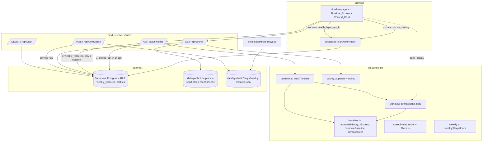
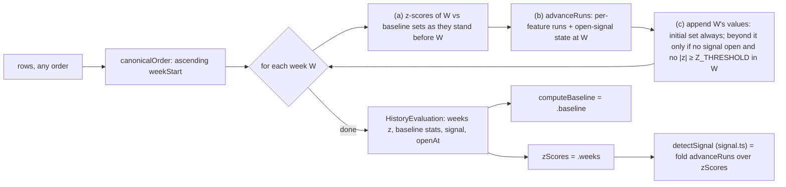
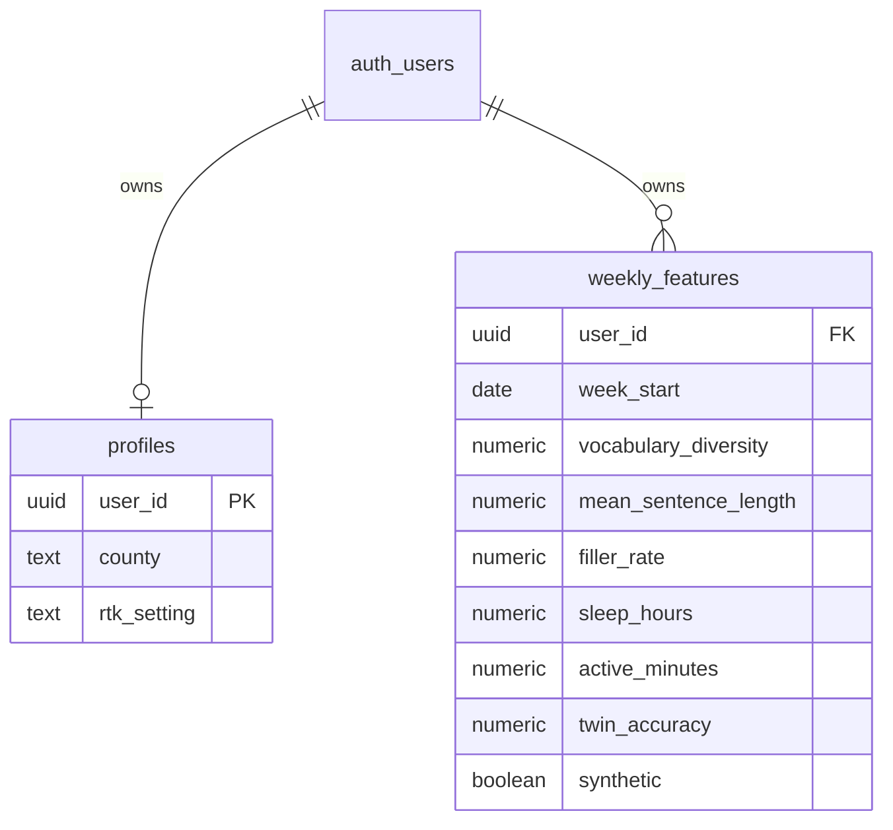

# Design Document

## Overview

`health-baseline` is the opt-in health layer of iamyou. It turns check-in speech, wearable
data and the twin-accuracy trend into weekly feature rows, measures each feature against a
**frozen personal baseline** built from the user's own early, stable weeks, raises a single
**change signal** only when a deviation persists across at least two features for at least
three consecutive weeks, and passes every signal through the user's **right-not-to-know**
setting before anything can reach the user or the clinician summary. Nothing about the
user's health history is returned before the user opts in: `GET /api/timeline` checks the
caller's `health_layer_opt_in` first and, unless it is exactly `true`, answers
`{ "opted_in": false }` without reading any weekly row.

The feature also ships Maya's reproducible synthetic history (ages 18 to 40, generated
from a fixed seed), two authenticated read routes (`GET /api/timeline`,
`GET /api/county`) whose contracts the Timeline_Screen and Context_Card consume, and the
extensions to the existing demo-seed and vault-delete routes.

The design matches the `twin-loop` and `assistant-tasks` conventions exactly:

- Pure logic lives in `lib/` with **no I/O and no mutation of inputs**:
  `lib/fillers.ts`, `lib/speech-features.ts`, `lib/baseline.ts`, `lib/signal.ts`,
  `lib/weekly.ts`, `lib/timeline.ts`, `lib/county.ts`. These are the primary targets of
  fast-check property tests.
- Route request/response zod schemas live in the client-safe `lib/api-schemas.ts` (zod
  only, no server imports), re-exported by `lib/claude/schemas.ts` for server use as the
  existing routes do.
- Each route keeps a **thin** HTTP handler that authenticates the caller, wires the
  production collaborators, and delegates to an **exported function that takes its
  repositories (and any file reader) as arguments**, so tests run it against in-memory
  repositories — the same pattern as `getScores`, `seedDemo` and `deleteVaultForUser`.
- Persistence is Supabase Postgres with row-level security keyed on `auth.uid()`. One new
  table, `weekly_features`, is added in `supabase/migrations/0003_health_baseline.sql`.
- The service-role key is read only in `POST /api/demo/start`.
- UI built elsewhere (by Claude Code) uses Tailwind theme utilities only (`bg-accent`,
  `text-muted`, …), never arbitrary values such as `bg-[--var]`.
- No Claude call is added by this spec. Speech features are computed deterministically in
  code, not by the model (`tech.md`).

This design obeys the non-negotiable rules in `AGENTS.md` and `.kiro/steering/`:
synthetic data only, never diagnose, the right-not-to-know gate, labelled synthetic
screens, pure logic without I/O, and server-side secrets.

### Scope note

The Timeline_Screen and Context_Card are built by Claude Code outside this spec's task
list. This design specifies only the API contracts they consume and the constraints they
must respect (see "UI contract notes"). Requirement 7 criteria 7–14, Requirement 8
criteria 6–11 and Requirement 9 criteria 5–6 remain their acceptance contract.

### Design goals mapped to the feature

| Step | Design element | Requirements |
| --- | --- | --- |
| Measure speech | `lib/speech-features.ts` `extractSpeechFeatures`, `lib/fillers.ts` `FILLERS` | 1 |
| Store weekly rows | `weekly_features` table + `WeeklyFeatureRepository` | 2 |
| Baseline and z-scores | `lib/baseline.ts` `evaluateHistory` → `zScores`, `computeBaseline` | 3 |
| Detect change | `lib/signal.ts` `detectSignal` over `zScores`, shared `advanceRuns` | 4 |
| Right not to know | `lib/signal.ts` `gate` (the only definition and the only import path) | 5 |
| Maya's history | `scripts/generate-maya.ts` → `data/synthetic/maya/weekly-features.json` | 6 |
| Weekly sleep | `lib/weekly.ts` `weeklySleepHours` | 6.10–6.13 |
| Seed and delete | `seedDemo` and `deleteVaultForUser` extended | 2.7–2.11 |
| Timeline | `GET /api/timeline` → `getTimeline` → pure `buildTimeline` | 7 |
| Health layer opt-in | `getTimeline` opt-in check before any weekly read; discriminated `TimelineResponseSchema` | 9 |
| County context | `GET /api/county` → `getCountyCard` → pure `lib/county.ts` | 8 |

### Key design decisions

| # | Decision | Rationale |
| --- | --- | --- |
| D1 | One chronological pass, `evaluateHistory(rows)` in `lib/baseline.ts`, computes z-scores, baseline extension and open-signal state together. `zScores` and `computeBaseline` are views over it. | Baseline extension depends on whether a signal is open (Req 3.10, 3.14) and the signal depends on z-scores (Req 4.2). A single pass removes the mutual dependency without a circular import. |
| D2 | Run detection lives in **one** pure helper, `advanceRuns`, exported from `lib/baseline.ts`. The pass and `detectSignal` both fold it over the same z-score rows. | Guarantees that `detectSignal(rows)` and the pass's open-signal state always agree (Property 10). |
| D3 | `lib/signal.ts` imports from `lib/baseline.ts`; `lib/baseline.ts` imports nothing from `lib/signal.ts`. `ChangeSignal` is defined in `baseline.ts` and re-exported by `signal.ts`. | No import cycle (Req 4.1 re-export; Req 4.2). |
| D4 | Synthetic `week_start` = profile `start_date` + 7k days (2026-10-24 is a **Saturday**), not the ISO Monday. "Consecutive" means exactly 7 days apart (Req 4.3). | The glossary's ISO_week names a Monday, but Requirement 6.3 fixes the series to start on `start_date`. The detection logic depends only on 7-day spacing, never on weekday, so a Saturday-anchored series is evaluated identically. 22 years from 2026-10-24 to 2048-10-24 is 8,036 days = exactly 1,148 weeks, so the series has 1,149 rows and ends exactly on `simulated_through`, inclusive (Req 6.3). |
| D5 | Opted-in timeline responses **always** carry a `signal` key: a signal object, or `null`. A gated signal becomes `null`. | Makes "indistinguishable from no signal" (Req 7.4) a byte-level equality that a property test can check (Property 13). |
| D6 | `gate` lives only in `lib/signal.ts`. Every consumer, including `care-outputs` and the Timeline_Screen, imports it from `lib/signal.ts`. No re-export module exists, and no other module reimplements it. | Req 5.1 forbids any other module re-exporting or reimplementing `gate`; one definition and one import path make that checkable by a boundary smoke test. |
| D7 | TypeScript boundary uses camelCase `weekStart`, `firstWeek`, `detectedWeek`; feature keys stay snake_case everywhere. SQL columns, the JSON file and API bodies use `week_start`, `first_week`, `detected_week`. | Same camelCase-at-the-boundary rule as `VaultRepository` and `DraftRepository`, and matches the contract `care-outputs` already assumes. Feature names are domain vocabulary shared byte-for-byte across JSON, SQL and API. |
| D8 | Non-finite feature values (`NaN`, `±Infinity`) are treated as missing, exactly like `null`. | Prevents a corrupted value from producing a non-finite z-score; never treated as 0 (Req 3.4, 6.12). |
| D9 | The county lookup returns `{ available: true, card }` or `{ available: false }`; both objects are zod `.strict()`. | The card carries exactly the five values and never `population` (Req 8.2); the unavailable result can never carry a number (Req 8.3). |
| D10 | `scripts/generate-maya.ts` is self-contained (imports only `node:fs`, `node:path`, `node:url`) and uses only `+ - * /`, `Math.imul`, bit shifts and `Number.prototype.toFixed`. | Runs with `node scripts/generate-maya.ts` (Node ≥ 22.18 type stripping) and stays byte-identical across machines: those operations are exactly specified by ECMAScript, unlike `Math.pow`/`Math.exp` (Req 6.1, 6.2). |
| D11 | The timeline response is a zod discriminated union on `opted_in`: `{ opted_in: false }` (`.strict()`, no other keys) or `{ opted_in: true, rtk_setting, rows, z_scores, baseline, signal }`. `getTimeline` checks opt-in after reading the profile and **before** any `weekly_features` read. Only `health_layer_opt_in === true` counts as opted in; a missing profile is `opted_in: false`; a failed profile read is the unavailable error (Req 7.16), never `opted_in: false`. | Nothing about health history leaves the server before opt-in, and the opted-out body cannot depend on whether rows or a signal exist because neither is read (Req 9.1, 9.2). One schema validates both bodies (Req 9.4). Treating a read failure as "not opted in" would hide an outage behind a plausible answer, so it is an error instead (Req 7.16). |

## Architecture

The code follows `.kiro/steering/structure.md`. The `health-baseline` additions are shown
in bold; `[claude-code]` marks UI built separately.

```
app/
  timeline/page.tsx              # [claude-code] Timeline_Screen + Context_Card
  api/
    timeline/route.ts            # **GET: getTimeline (opt-in check, then weekly rows + z + baseline + gated signal)**
    county/route.ts              # **GET: getCountyCard (CDC PLACES short-sleep card)**
    demo/start/route.ts          # **seedDemo now also upserts weekly_features**
    vault/route.ts               # **deleteVaultForUser now also deletes weekly_features**
lib/
  fillers.ts                     # **FILLERS (ordered), MULTI_WORD_FILLERS, SINGLE_WORD_FILLERS**
  speech-features.ts             # **extractSpeechFeatures, tokenize, splitSentences**
  baseline.ts                    # **constants, evaluateHistory, zScores, computeBaseline, advanceRuns, recentMean**
  signal.ts                      # **detectSignal, gate (only definition); re-exports constants + ChangeSignal**
  weekly.ts                      # **weeklySleepHours**
  timeline.ts                    # **buildTimeline (pure response shaping)**
  county.ts                      # **parseShortSleepCsv, toCountyCard, findCountyCard**
  api-schemas.ts                 # **+ timeline and county response schemas**
  db/
    weekly-feature-repository.ts # **WeeklyFeatureRepository + Supabase/InMemory impls**
supabase/migrations/
  0003_health_baseline.sql       # **weekly_features + RLS**
scripts/
  generate-maya.ts               # **seeded generator → data/synthetic/maya/weekly-features.json**
data/synthetic/maya/
  weekly-features.json           # **generated, committed (1,149 rows)**
tests/
  pbt/                           # **P1–P16, P18 + extended twin-loop P4 (P17)**
  pbt/helpers/weekly-rows.ts     # **shared fast-check arbitraries + counting weekly repo**
  unit/                          # **route, repository, calibration and determinism tests**
next.config.ts                   # **+ outputFileTracingIncludes for /api/county**
package.json                     # **+ "generate:maya": "node scripts/generate-maya.ts"**
```

### Layering rules (identical to `twin-loop`)

- **Pure logic** (`lib/*.ts` above) has no I/O, reads no environment, never mutates its
  inputs, and imports nothing server-only. `lib/baseline.ts` and `lib/signal.ts` are
  therefore also safe to import from client components (the Timeline_Screen may call
  `gate()` locally, Req 5.6) and from `care-outputs`. `gate` is imported from
  `lib/signal.ts` and nowhere else (D6, Req 5.1).
- **Server-only code** — the service-role client in `POST /api/demo/start` and the CSV
  file read in `GET /api/county` — never ships to the client (Req 2.8, 2.9).
- **Data access** goes through `WeeklyFeatureRepository` and the existing
  `VaultRepository.getProfile`. Routes depend on the interfaces; tests inject in-memory
  implementations; production uses the Supabase implementations on the request-scoped
  `@supabase/ssr` server client, so RLS applies to every statement.

### Boundary diagram



### The single chronological pass

Requirement 3 makes baseline extension depend on the open-signal state (3.10, 3.14), and
Requirement 4 makes the signal depend on z-scores (4.2), which depend on the baseline.
Evaluating these as separate functions that call each other would create both a logical
cycle and a `baseline.ts` ↔ `signal.ts` import cycle. The design breaks it by evaluating
each week once, in order, with all three steps inside one fold:



## Components and Interfaces

### `lib/fillers.ts`

```ts
/** The filler tokens, in the order given by Requirement 1.6. */
export const FILLERS = [
  'um', 'uh', 'er', 'like', 'you know', 'i mean', 'basically', 'actually',
] as const;
export type Filler = (typeof FILLERS)[number];

/** Two-word fillers, matched against consecutive tokens first. (Req 1.5) */
export const MULTI_WORD_FILLERS: ReadonlySet<string>;  // {'you know', 'i mean'}
/** One-word fillers, matched only where no multi-word filler matched. (Req 1.5) */
export const SINGLE_WORD_FILLERS: ReadonlySet<string>; // {'um','uh','er','like','basically','actually'}
```

### `lib/speech-features.ts`

```ts
export type SpeechFeatures = {
  vocabulary_diversity: number;  // [0, 1]
  mean_sentence_length: number;  // >= 0
  filler_rate: number;           // >= 0, fillers per 100 tokens
};

/** The moving-average window for vocabulary_diversity. (Req 1.2) */
export const MATTR_WINDOW = 50;

/** Whitespace-delimited, lowercased word tokens. (Req 1.1) */
export function tokenize(text: string): string[];

/** Segments from splitting on '.', '!', '?', with zero-token segments removed. (Req 1.4) */
export function splitSentences(text: string): string[][];

/** Pure, deterministic, no model, no I/O. (Req 1.1–1.9 / P4, P8) */
export function extractSpeechFeatures(transcript: string): SpeechFeatures;
```

Definitions:

- **Tokens.** `text.toLowerCase()` (locale-independent, unlike `toLocaleLowerCase`), split
  on `/\s+/`; each chunk has leading and trailing characters that are not letters or
  digits (`/^[^\p{L}\p{N}]+|[^\p{L}\p{N}]+$/gu`) trimmed; chunks that become empty are
  dropped. So `"Um, I mean... like."` → `["um", "i", "mean", "like"]`. Trimming edge
  punctuation is a design decision: without it `"um,"` would never match the filler `um`.
- **vocabulary_diversity.** For `n >= 50` tokens: the mean, over every window
  `tokens[i .. i+49]` for `i = 0 .. n-50`, of `distinct(window) / 50`, computed with a
  sliding count map in O(n). For `1 <= n < 50`: `distinct(tokens) / n` (Req 1.2, 1.3).
  Both are in `[0, 1]` by construction (Req 1.8).
- **mean_sentence_length.** Split the original transcript on `/[.!?]/`, tokenize each
  segment with `tokenize`, drop segments with zero tokens, then
  `sum(tokens per segment) / segmentCount` (Req 1.4).
- **filler_rate.** Scan `i = 0 .. n-1`: if `i + 1 < n` and
  `tokens[i] + ' ' + tokens[i+1]` is in `MULTI_WORD_FILLERS`, count 1 and advance by 2;
  else if `tokens[i]` is in `SINGLE_WORD_FILLERS`, count 1 and advance by 1; else advance
  by 1. Rate = `count / n * 100` (Req 1.5). A token sequence is counted at most once
  because a matched pair is consumed before single-word matching.
- **Empty input.** If `n === 0` or there are zero non-empty sentences, return all three as
  `0` before any division (Req 1.7).

The function reads only its argument and uses only arithmetic, so the same transcript
always yields identical values (Req 1.9).

### `lib/baseline.ts`

```ts
/** The six features, in the canonical order used for listing signals. (Req 4.9) */
export const FEATURES = [
  'vocabulary_diversity', 'mean_sentence_length', 'filler_rate',
  'sleep_hours', 'active_minutes', 'twin_accuracy',
] as const;
export type Feature = (typeof FEATURES)[number];

/** Detection constants, defined together. (Req 3.13) */
export const Z_THRESHOLD = 2.0;
export const WEEKS_REQUIRED = 3;
export const FEATURES_REQUIRED = 2;
export const MIN_BASELINE_WEEKS = 12;
/** Divisor used in place of a zero standard deviation. (Req 3.5, 3.11) */
export const SD_FLOOR = 1e-6;

/** A stored weekly_features row at the TypeScript boundary. */
export type WeeklyFeatureRow = { weekStart: string; synthetic: boolean } &
  Record<Feature, number | null>;
/** What the pure functions accept: a feature may be null or missing. (Req 3.4) */
export type WeeklyFeatureInput = { weekStart: string } &
  Partial<Record<Feature, number | null>>;

export type FeatureZ = Record<Feature, number | null>;  // explicit null = no z-score
export type WeekZScores = { weekStart: string; z: FeatureZ };
export type BaselineStats = { mean: number; sd: number; weeks: number };
export type Baseline = Record<Feature, BaselineStats | null>;

/** A detected change. `detectedWeek` is the week W of Req 4.4. */
export type ChangeSignal = {
  features: Feature[];   // canonical FEATURES order (Req 4.9)
  firstWeek: string;     // earliest run start among listed features (Req 4.9)
  detectedWeek: string;  // earliest week at which >= FEATURES_REQUIRED features qualify
};

export type RunState = {
  prevWeekStart: string | null;
  runs: Record<Feature, { length: number; start: string | null }>;
  signal: ChangeSignal | null;  // once non-null, never changes (Req 4.4)
};

export type HistoryEvaluation = {
  weeks: WeekZScores[];   // one per input row, ascending weekStart (Req 3.15)
  baseline: Baseline;     // final baseline sets (Req 3.12)
  signal: ChangeSignal | null;
  openAt: boolean[];      // openAt[i]: a change signal is open at weeks[i] (Req 3.14)
};

export function canonicalOrder<T extends WeeklyFeatureInput>(rows: readonly T[]): T[];
export function featureValue(row: WeeklyFeatureInput, f: Feature): number | null;
export function meanAndPopSd(values: readonly number[]): { mean: number; sd: number };
export function initialRunState(): RunState;
export function advanceRuns(state: RunState, week: WeekZScores): RunState;
export function signalFromZScores(weeks: readonly WeekZScores[]): ChangeSignal | null;
export function evaluateHistory(rows: readonly WeeklyFeatureInput[]): HistoryEvaluation;
export function zScores(rows: readonly WeeklyFeatureInput[]): WeekZScores[];
export function computeBaseline(rows: readonly WeeklyFeatureInput[]): Baseline;
/** care-outputs support: mean of the last `windowWeeks` weeks' non-null values, or null. */
export function recentMean(
  rows: readonly WeeklyFeatureInput[], feature: Feature, windowWeeks?: number,
): number | null;
```

Helpers:

- `canonicalOrder` returns a **copy** sorted by `weekStart` ascending (ISO `YYYY-MM-DD`
  strings sort lexically in date order). Ties, which only arise for inputs outside the
  database's unique key, are broken by the string
  `FEATURES.map(f => String(featureValue(row, f))).join('|')`. Rows that tie on both are
  interchangeable, so any permutation of the same rows yields the same evaluation
  (Req 3.2, 4.8).
- `featureValue` returns the value when it is a finite number, otherwise `null` (`null`,
  `undefined`, `NaN`, `±Infinity` → `null`; D8). It never returns 0 for a missing value.
- `meanAndPopSd` divides by `n`, not `n − 1` (glossary: population standard deviation).
- Day arithmetic uses `Date.UTC` on the parsed `YYYY-MM-DD` parts only; no local time
  zone, no locale. An unparsable `weekStart` makes the gap `NaN`, which is never 7, so it
  is never consecutive.

Run detection, the one shared helper (D2):

```ts
function advanceRuns(state: RunState, week: WeekZScores): RunState {
  // Two weeks are consecutive only when exactly 7 days apart. (Req 4.3)
  const consecutive =
    state.prevWeekStart !== null && daysBetween(state.prevWeekStart, week.weekStart) === 7;

  const runs = {} as RunState['runs'];
  for (const f of FEATURES) {
    const prev = consecutive ? state.runs[f] : { length: 0, start: null }; // gap resets
    const z = week.z[f];
    runs[f] =
      z !== null && Math.abs(z) >= Z_THRESHOLD           // either sign (Req 4.3)
        ? { length: prev.length + 1, start: prev.length === 0 ? week.weekStart : prev.start }
        : { length: 0, start: null };                    // null z or |z| < threshold resets
  }

  let signal = state.signal;
  if (signal === null) {                                  // only the earliest W (Req 4.4)
    const qualifying = FEATURES.filter((f) => runs[f].length >= WEEKS_REQUIRED);
    if (qualifying.length >= FEATURES_REQUIRED) {
      signal = {
        features: qualifying,                             // canonical order (Req 4.9)
        firstWeek: minString(qualifying.map((f) => runs[f].start!)),
        detectedWeek: week.weekStart,
      };
    }
  }
  return { prevWeekStart: week.weekStart, runs, signal };
}

export const signalFromZScores = (weeks) => weeks.reduce(advanceRuns, initialRunState()).signal;
```

A week without a z-score for a feature — a null value, a week in that feature's initial
baseline set, or a feature with fewer than 12 non-null weeks — has `z[f] === null`, so it
resets that feature's run (Req 4.3).

The single pass:

```ts
function evaluateHistory(rows: readonly WeeklyFeatureInput[]): HistoryEvaluation {
  const ordered = canonicalOrder(rows);                  // Req 3.2: input order irrelevant
  const sets = emptyPerFeature<number[]>(() => []);      // baseline set per feature
  const initialCount = emptyPerFeature(() => 0);         // size of initial set so far
  let runState = initialRunState();
  const weeks: WeekZScores[] = [];
  const openAt: boolean[] = [];

  for (const row of ordered) {
    // (a) z-scores of W against the baseline sets as they stand before W. (Req 3.5)
    const z = {} as FeatureZ;
    const inInitial = {} as Record<Feature, boolean>;
    for (const f of FEATURES) {
      const v = featureValue(row, f);
      inInitial[f] = v !== null && initialCount[f] < MIN_BASELINE_WEEKS;
      if (v === null || inInitial[f]) {
        z[f] = null;                                     // Req 3.4, 3.6, 3.7
      } else {
        const { mean, sd } = meanAndPopSd(sets[f]);       // excludes W's own value
        z[f] = (v - mean) / Math.max(sd, SD_FLOOR);       // Req 3.5, 3.11
      }
    }
    const week = { weekStart: row.weekStart, z };
    weeks.push(week);

    // (b) open-signal state at W, via the shared helper. (Req 3.14)
    runState = advanceRuns(runState, week);
    const open = runState.signal !== null;               // once open, open for all later W
    openAt.push(open);

    // (c) baseline extension. (Req 3.3, 3.8, 3.9, 3.10)
    const deviating = FEATURES.some((f) => z[f] !== null && Math.abs(z[f]!) >= Z_THRESHOLD);
    for (const f of FEATURES) {
      const v = featureValue(row, f);
      if (v === null) continue;
      if (inInitial[f]) {                                 // unconditional (Req 3.3, 3.9)
        sets[f].push(v);
        initialCount[f] += 1;
      } else if (!open && !deviating) {                   // Req 3.8; blocked by 3.9, 3.10
        sets[f].push(v);                                  // first used for W + 1
      }
    }
  }

  const baseline = {} as Baseline;
  for (const f of FEATURES) {
    baseline[f] = initialCount[f] < MIN_BASELINE_WEEKS
      ? null                                              // Req 3.7
      : { ...meanAndPopSd(sets[f]), weeks: sets[f].length }; // Req 3.12
  }
  return { weeks, baseline, signal: runState.signal, openAt };
}

export const zScores = (rows) => evaluateHistory(rows).weeks;          // Req 3.15
export const computeBaseline = (rows) => evaluateHistory(rows).baseline; // Req 3.12
```

**How agreement with `detectSignal` is guaranteed.** `detectSignal(rows)` in
`lib/signal.ts` is `signalFromZScores(zScores(rows))`: it takes every z-score from
`zScores(rows)` without recomputing it (Req 4.2) and folds `advanceRuns` over them from
`initialRunState()`. `evaluateHistory` folds the very same function over the very same
`WeekZScores` objects, in the same order, from the same initial state. `advanceRuns` is
pure, so both folds produce identical states at every step. Therefore:

- `detectSignal(rows)` deep-equals `evaluateHistory(rows).signal`, and
- `openAt[i] === (signalFromZScores(weeks.slice(0, i + 1)) !== null)` for every `i`.

Property 10 checks both. There is no second implementation of the run rule anywhere.

**Complexity.** Recomputing `meanAndPopSd` per week is O(n) per feature, O(n²) overall:
about 4 million additions for Maya's 1,149 weeks, a few milliseconds. A running
(Welford) accumulator is an allowed optimisation provided Property 11 still passes at its
`1e-9` relative tolerance.

**`recentMean` (care-outputs support).** Not required by this spec's requirements; added
because the `care-outputs` design needs a "most recent 4-week mean" without recomputing
means locally. It returns the mean of `featureValue(row, feature)` over rows whose
`weekStart` lies in `(latest − 7·windowWeeks days, latest]` (default `windowWeeks = 4`),
or `null` when none has a value.

### `lib/signal.ts`

```ts
export {
  Z_THRESHOLD, WEEKS_REQUIRED, FEATURES_REQUIRED, MIN_BASELINE_WEEKS, // same bindings (Req 4.1)
  type ChangeSignal, type Feature,
} from './baseline';

/** Pure, no I/O, no input mutation; z-scores come from zScores(rows). (Req 4.2–4.9 / P1, P5, P6) */
export function detectSignal(rows: readonly WeeklyFeatureInput[]): ChangeSignal | null {
  return signalFromZScores(zScores(rows));
}

export type GateResult = { showToUser: boolean; includeInSummary: boolean };

/** Right-not-to-know gate. Fails closed. The only definition; import from here. (Req 5.1–5.5 / P2, P3, P7) */
export function gate(signal: ChangeSignal | null, rtk_setting: unknown): GateResult {
  switch (rtk_setting) {
    case 'tell_me':     return { showToUser: true,  includeInSummary: true  }; // 5.2
    case 'doctor_only': return { showToUser: false, includeInSummary: true  }; // 5.3
    case 'record_only':                                                       // 5.4
    default:            return { showToUser: false, includeInSummary: false }; // 5.5
  }
}
```

Re-exporting with `export { … } from './baseline'` exports the same bindings, so each
constant is strictly equal to its `baseline.ts` counterpart (Req 4.1). The `gate` result
depends only on `rtk_setting`, compared with `===` (so `'TELL_ME'`, `' tell_me'`,
`null`, objects and numbers all fail closed). Callers show or summarise a change only when
they hold a non-null signal **and** the corresponding gate flag is `true`.

Why the requirement-level guarantees hold:

- **Single spike (Req 4.6 / P1).** A signal needs `WEEKS_REQUIRED = 3` consecutive
  deviating weeks in each of two features, so a series with exactly one deviating week
  can never qualify any feature.
- **Too little history (Req 4.7 / P6).** With fewer than 12 distinct `week_start`
  values, every feature has fewer than 12 non-null weeks, so every z is `null` and no run
  ever starts.
- **Order independence (Req 4.8 / P5).** `zScores` sorts first (`canonicalOrder`), so the
  fold sees the same sequence for every permutation.

`gate` and `GateResult` are exported from `lib/signal.ts` only. No re-export module
exists; `care-outputs`, the Timeline_Screen and the timeline route all import
`gate` from `lib/signal.ts` (D6, Req 5.1).

### `lib/weekly.ts`

```ts
export type DailyWearableRow = { date: string; sleep_hours?: number | null };

/** Mean of the non-null sleep_hours over one week's days; null when none. (Req 6.10–6.13 / P14) */
export function weeklySleepHours(dailyRows: readonly DailyWearableRow[]): number | null;
```

Missing, `null` and non-finite values are excluded from both the sum and the count; they
are never treated as 0 (Req 6.12). Grouping days into a week is the caller's job:
`wearable-insights` will pass the `daily_wearable` rows of one 7-day week. Until that spec
lands, `sleep_hours` comes from `data/synthetic/maya/weekly-features.json`.

### `lib/timeline.ts`

```ts
import type { TimelineOptedIn } from './api-schemas';

/**
 * Pure response shaping for the opted-in branch of GET /api/timeline.
 * (Req 7.1–7.4, 7.15, 9.3 / P13)
 * Called only after getTimeline has confirmed health_layer_opt_in === true.
 * The returned object has a fixed key order, so JSON bytes are deterministic.
 */
export function buildTimeline(
  rows: readonly WeeklyFeatureRow[], rtkSetting: unknown,
): TimelineOptedIn;
```

```ts
function buildTimeline(rows, rtkSetting) {
  const ordered = canonicalOrder(rows);
  const z = zScores(rows);                 // explicit nulls (Req 7.2)
  const baseline = computeBaseline(rows);  // null below 12 non-null weeks (Req 7.2)
  const signal = detectSignal(rows);
  const visible = signal !== null && gate(signal, rtkSetting).showToUser === true; // 7.3, 7.4
  return {
    opted_in: true,                         // first key; discriminant (D11, Req 9.3)
    rtk_setting: isRtkSetting(rtkSetting) ? rtkSetting : null,
    rows: ordered.map(toRowResponse),       // week_start, six features, synthetic
    z_scores: z.map(toZResponse),           // week_start, six features (number | null)
    baseline: perFeature((f) => baseline[f] && { mean: baseline[f].mean, sd: baseline[f].sd }),
    signal: visible
      ? { features: signal.features, first_week: signal.firstWeek, detected_week: signal.detectedWeek }
      : null,                               // D5: always present
  };
}
```

When the signal is gated, the output is constructed by exactly the same code path as a
history with no signal, so the two are byte-identical (Req 7.4). The `rtk_setting` echo is
the caller's own setting, needed by the Timeline_Screen's control (Req 7.12); it is
identical in both cases, so it leaks nothing.

### `lib/county.ts`

```ts
/** One CSV data row, cells kept as the exact source strings. */
export type ShortSleepCsvRow = {
  year: string; county: string; prevalence: string; low: string; high: string; population: string;
};
export type CountyCard = {
  county: string; year: number; prevalence: number; low: number; high: number;
};

/** Parses the CDC PLACES short-sleep CSV; null when the header lacks a required column. */
export function parseShortSleepCsv(text: string): ShortSleepCsvRow[] | null;
/** Validates and converts one row; null when any value is invalid. (Req 8.12) */
export function toCountyCard(row: ShortSleepCsvRow): CountyCard | null;
/** Exact, case-sensitive single-row match, then validation. (Req 8.1–8.3, 8.12 / P16) */
export function findCountyCard(rows: readonly ShortSleepCsvRow[], county: unknown): CountyCard | null;
```

- **Parsing.** Strip a leading BOM, split on `/\r?\n/`, drop trailing empty lines. The
  header must contain `year`, `county`, `prevalence`, `low`, `high`, `population` (any
  order; mapped by name). A data line whose comma-split cell count differs from the
  header's is skipped. Cells are kept unchanged (no trimming, no case folding). The
  shipped file has no quoted fields; quoting is not supported.
- **Validation (`toCountyCard`).** `year` must match `/^\d{4}$/`; `prevalence`, `low`,
  `high` must match `/^\d+(\.\d+)?$/`, convert with `Number` to a finite value in
  `[0, 100]`, and satisfy `low <= prevalence <= high`. Any failure → `null` (Req 8.12).
  Values are copied unchanged otherwise; `population` is never read into the card
  (Req 8.2).
- **Lookup (`findCountyCard`).** `county` must be a non-empty string. Exactly one row with
  `row.county === county` is required; zero matches or more than one (ambiguous) → `null`
  (Req 8.1, 8.3).

For Maya (`county = "Hampshire"`) the card is
`{ county: "Hampshire", year: 2022, prevalence: 31.5, low: 26.8, high: 36.4 }` (Req 8.6).

### `lib/db/weekly-feature-repository.ts`

Follows `vault-repository.ts` and `draft-repository.ts`: an interface the routes depend
on, a Supabase implementation for production, an in-memory implementation for tests.

```ts
import type { WeeklyFeatureRow } from '../baseline';

export interface WeeklyFeatureRepository {
  /** Every row owned by userId, ascending weekStart. (Req 7.1) */
  listWeeklyFeatures(userId: string): Promise<WeeklyFeatureRow[]>;
  /** Insert-or-replace on (user_id, week_start); idempotent. (Req 2.7, 2.10) */
  upsertWeeklyFeatures(userId: string, rows: readonly WeeklyFeatureRow[]): Promise<void>;
  /** Removes every row owned by userId; other users untouched. (Req 2.11) */
  deleteForUser(userId: string): Promise<void>;
}
```

- **`InMemoryWeeklyFeatureRepository`** — `Map<userId, Map<weekStart, WeeklyFeatureRow>>`.
  Upsert replaces by `weekStart`, so a repeated seed cannot duplicate rows. Returns copies
  sorted by `weekStart`. `deleteForUser` drops the user's inner map.
- **`SupabaseWeeklyFeatureRepository`** — runs on an injected `SupabaseClient` (the
  request-scoped server client in `/api/timeline` and `/api/vault`; the service-role client
  only in `/api/demo/start`). Every statement filters by `user_id = userId`.
  `upsertWeeklyFeatures` sends chunks of 500 rows with
  `upsert(rows, { onConflict: 'user_id,week_start' })` (1,149 rows → 3 requests).
  `listWeeklyFeatures` uses `.order('week_start', { ascending: true })` and selects with
  `.range()` pages of 1,000 so the PostgREST default row cap never truncates a history.
  `numeric` columns are mapped with `toNullableNumber` (accepts a number or a numeric
  string; anything else → `null`). snake_case columns map to the camelCase `weekStart`.

### Server routes

All responses are validated with zod schemas from `lib/api-schemas.ts`. Each handler
authenticates with `createSupabaseServerClient()` + `auth.getUser()` and returns 401
`{ error: 'Unauthorized' }` when there is no user, returning no data (Req 7.5, 8.4).

#### `POST /api/demo/start` — `seedDemo` extended (Req 2.7, 2.8, 2.10)

```ts
/** Maya's 1,149 weekly rows from weekly-features.json, with synthetic forced to true. */
export function mayaDemoWeeklyFeatures(): WeeklyFeatureRow[];

export async function seedDemo(
  repo: VaultRepository,
  weeklyRepo: WeeklyFeatureRepository,
  userId: string,
  profile: Profile,
  entries: VaultEntry[],
  weeklyRows: readonly WeeklyFeatureRow[],
): Promise<void> {
  await repo.upsertProfile(userId, profile);
  for (const entry of entries) await repo.upsertVaultEntry(userId, entry);
  await weeklyRepo.upsertWeeklyFeatures(userId, weeklyRows);  // owned by the caller (2.7)
}
```

The handler builds `new SupabaseWeeklyFeatureRepository(serviceClient)` on the same
service-role client it already creates after authenticating the caller, and passes
`mayaDemoWeeklyFeatures()`. The service-role key is still read only here (Req 2.8, 2.9).
Upsert on `(user_id, week_start)` makes repeated calls idempotent (Req 2.10); a failure
still maps to 500 and is healed by a retry, as today.

#### `DELETE /api/vault` — `deleteVaultForUser` extended (Req 2.11)

```ts
export async function deleteVaultForUser(
  repo: VaultRepository,
  draftRepo: DraftRepository,
  weeklyRepo: WeeklyFeatureRepository,
  userId: string,
): Promise<VaultDeleteResponse> {
  await repo.deleteVault(userId);              // profiles, vault_entries, predictions, answers
  await draftRepo.deleteAllDrafts(userId);     // drafts
  await weeklyRepo.deleteForUser(userId);      // weekly_features (new)
  return VaultDeleteResponseSchema.parse({ ok: true });
}
```

The handler adds `new SupabaseWeeklyFeatureRepository(supabase)` on the request-scoped
client; RLS scopes the delete to the caller.

#### `GET /api/timeline` — `getTimeline` (Req 7.1–7.6, 7.15, 7.16, 9.1–9.4)

```ts
/**
 * The profile read the routes need; satisfied by VaultRepository.
 * getTimeline reads `healthLayerOptIn` and `rtkSetting`; both are already fields of
 * `Profile` in lib/db/vault-repository.ts (`healthLayerOptIn` maps the
 * `health_layer_opt_in` column). getCountyCard reads only `county`.
 */
export type ProfileReader = Pick<VaultRepository, 'getProfile'>;

export type TimelineOutcome =
  | { status: 200; body: TimelineResponse }          // either branch of the union
  | { status: 503; body: { error: 'timeline_unavailable' } };

export async function getTimeline(
  weekly: WeeklyFeatureRepository,
  profiles: ProfileReader,
  userId: string,
): Promise<TimelineOutcome>;
```

The order of steps is the design (D11). The HTTP handler authenticates first; `getTimeline`
then reads the profile, decides opt-in, and only then may touch `weekly_features`:

```ts
// app/api/timeline/route.ts — handler (thin)
export async function GET() {
  const supabase = await createSupabaseServerClient();
  const { data: { user } } = await supabase.auth.getUser();
  if (!user) return json(401, { error: 'Unauthorized' });         // Req 7.5; nothing read
  const outcome = await getTimeline(
    new SupabaseWeeklyFeatureRepository(supabase),
    new SupabaseVaultRepository(supabase),
    user.id,
  );
  return json(outcome.status, outcome.body);
}

const UNAVAILABLE = { status: 503, body: { error: 'timeline_unavailable' } } as const;

export async function getTimeline(weekly, profiles, userId) {
  // 1. Profile first. A failed read is an error, never "not opted in". (Req 7.16, 9.1)
  let profile: Profile | null;
  try {
    profile = await profiles.getProfile(userId);
  } catch {
    return UNAVAILABLE;                     // no opted_in, rows, z, baseline or signal
  }

  // 2. Opt-in check before any weekly read. Only exactly `true` counts. (Req 9.1, 9.2)
  if (!profile || profile.healthLayerOptIn !== true) {
    const parsed = TimelineResponseSchema.safeParse({ opted_in: false }); // Req 9.4
    return parsed.success ? { status: 200, body: parsed.data } : UNAVAILABLE;
    // weekly.listWeeklyFeatures is not called; buildTimeline/detectSignal are not called
  }

  // 3. Opted in: read the caller's rows. (Req 7.1, 7.16)
  let rows: WeeklyFeatureRow[];
  try {
    rows = await weekly.listWeeklyFeatures(userId);
  } catch {
    return UNAVAILABLE;
  }

  // 4. Shape the opted-in body; rtk_setting read from the caller's profile now. (Req 7.2–7.4, 9.3)
  const payload = buildTimeline(rows, profile.rtkSetting);

  // 5. Validate before sending. (Req 7.6)
  const parsed = TimelineResponseSchema.safeParse(payload);
  return parsed.success ? { status: 200, body: parsed.data } : UNAVAILABLE;
}
```

- Because step 2 returns before step 3, the opted-out body is the constant
  `{ "opted_in": false }` and cannot depend on whether rows or a change signal exist
  (Req 9.1, 9.2). `detectSignal` is reached only through `buildTimeline`, which is called
  only in step 4.
- `healthLayerOptIn !== true` treats `false`, `null`, `undefined` and any non-boolean value
  as opted out, so a malformed column value fails closed.
- An invalid or null `rtk_setting` on an opted-in profile fails closed through `gate`:
  `signal: null` with everything else unchanged (Req 7.3, 7.4).
- Zero rows yield `opted_in: true`, `rows: []`, `z_scores: []`, every baseline `null`,
  `signal: null` (Req 7.15).
- RLS plus the `user_id` filter guarantee only the caller's rows are returned (Req 7.1).

#### `GET /api/county` — `getCountyCard` (Req 8.1–8.5, 8.12, 8.13)

```ts
export type CountyOutcome =
  | { status: 200; body: CountyResponse }
  | { status: 500; body: { error: 'county_unavailable' } };

export async function getCountyCard(
  profiles: ProfileReader,
  readCsv: () => string,   // production: readFileSync of the CDC file
  userId: string,
): Promise<CountyOutcome>;
```

1. `profile = await profiles.getProfile(userId)`; a thrown read, a missing profile, or a
   `county` that is null or `''` → `{ available: false }` (Req 8.3).
2. `text = readCsv()`; a throw → `{ available: false }` (Req 8.12).
3. `rows = parseShortSleepCsv(text)`; `null` → `{ available: false }`.
4. `card = findCountyCard(rows, profile.county)` → `{ available: true, card }` or
   `{ available: false }` (Req 8.1–8.3, 8.12).
5. `CountyResponseSchema.safeParse(payload)`; failure → 500 `county_unavailable`, never
   the unvalidated values (Req 8.5, 8.13).

Production `readCsv` follows `lib/inbox.ts`:
`readFileSync(/*turbopackIgnore: true*/ join(process.cwd(), 'data', 'public',
'cdc-places-short-sleep-ma-2022.csv'), 'utf-8')`, with
`"/api/county": ["./data/public/cdc-places-short-sleep-ma-2022.csv"]` added to
`outputFileTracingIncludes` in `next.config.ts`. The file read lives in the route module,
so `lib/county.ts` stays pure.

### `scripts/generate-maya.ts` — Maya's reproducible history (Req 6.1–6.9)

```ts
export const MAYA_SEED = 20261024;            // fixed seed constant (Req 6.1)
export function mulberry32(seed: number): () => number;  // [0, 1)
export function simulatedAge(startDate: string, through: string, weekStart: string): number;
export function driftFraction(age: number): number;      // 0 below 38.5, monotone to 1 at 40
export function generateMayaWeeklyFeatures(
  profile: { start_date: string; simulated_through: string },
): MayaWeeklyRow[];
export function serializeWeeklyFeatures(rows: readonly MayaWeeklyRow[]): string;
// main(): read data/synthetic/maya/profile.json, write data/synthetic/maya/weekly-features.json
```

**PRNG.** mulberry32 (32-bit state, `Math.imul` and unsigned shifts), seeded with
`MAYA_SEED`. It depends on nothing but the seed: no `Date.now()`, no `Math.random`, no
locale, no environment (Req 6.1). Draws happen in a fixed order: for each week in order,
one draw per feature in `FEATURES` order.

**Weeks.** `week_start(k) = start_date + 7k days` (UTC date arithmetic) for
`k = 0 … 1148`: 2026-10-24 through 2048-10-24 inclusive, 1,149 rows (Req 6.3; D4). The
simulated age is linear between the profile endpoints:
`age = 18 + 22 · days(start_date, week_start) / days(start_date, simulated_through)`, so
it is exactly 18 on the first row and exactly 40 on the last.

**Stable-then-drift model.** For feature `f` with baseline `base_f`, noise half-width
`a_f`, and drift direction `dir_f`:

```
u      = 2 · rand() − 1                              // uniform in [−1, 1)
s(age) = 0                         if age < 38.5
       = x·x·x·x,  x = min(1, (age − 38.5) / 1.5)    otherwise   // monotone, s(40) = 1
value  = clamp_f(base_f + a_f · u + dir_f · DRIFT_MULTIPLIER · a_f · s(age))
row    = round_f(value)
```

| Feature | `base_f` | `a_f` | `dir_f` | decimals | clamp |
| --- | --- | --- | --- | --- | --- |
| `vocabulary_diversity` | 0.72 | 0.02 | −1 | 4 | [0, 1] |
| `mean_sentence_length` | 14.0 | 1.0 | 0 | 2 | ≥ 0 |
| `filler_rate` | 2.5 | 0.4 | +1 | 3 | ≥ 0 |
| `sleep_hours` | 7.3 | 0.3 | −1 | 2 | [0, 24] |
| `active_minutes` | 280 | 30 | 0 | 0 | ≥ 0 |
| `twin_accuracy` | 0.78 | 0.04 | −1 | 4 | [0, 1] |

`DRIFT_MULTIPLIER = 4`. Below 38.5 every value is within `a_f` of `base_f` (Req 6.4).
From 38.5 the three falling features and the rising `filler_rate` drift monotonically,
and the drift at 40 (`4·a_f`) exceeds the drift at 38.5 (`0`) (Req 6.5). Every row has
`synthetic: true` (Req 6.8). At 40, for example, `vocabulary_diversity` is about 0.64 and
`sleep_hours` about 6.1.

**Calibration argument.** Uniform noise on `[−a, a]` has standard deviation
`σ = a/√3 ≈ 0.577a`, so pure noise reaches at most `|z| ≈ 1.73 < 2`. The frozen baseline
is built from about 1,000 stable weeks, so its estimated mean and SD sit very close to
`base_f` and `σ`.

- **No signal before 39 (Req 6.7).** At 39, `s = (1/3)^4 = 1/81`, so the drift is
  `0.049a` and the largest possible `|z|` is about `(0.049a + a)/σ ≈ 1.82 < 2`. No week
  before 39 can deviate through drift. Noise alone can only exceed 2 when the early
  12-week SD estimate happens to run low, and a signal would also need two features to do
  that in three consecutive weeks.
- **A signal before 40 (Req 6.6).** Every week of a drifting feature deviates once
  `4a·s − a ≥ 2σ ≈ 1.155a`, i.e. `s ≥ 0.539`, i.e. age ≥ 39.79. Three consecutive such
  weeks in three drifting features happen by about age 39.84 < 40, and probably earlier
  because noise often pushes past the threshold sooner.
- **The fixed seed makes this a checked fact.** `tests/unit/maya-calibration.test.ts`
  runs `detectSignal` over the committed file and asserts the detection age is in
  `[39, 40)` and that the history truncated to weeks before age 39 yields `null`
  (Req 6.6, 6.7, 6.9). If a parameter change ever breaks calibration, that test fails; the
  generator does not import `lib/` (D10), so the test is the single guard.

**Byte-identical output (Req 6.2).** Each row is built as an object literal with fixed
key order `week_start, vocabulary_diversity, mean_sentence_length, filler_rate,
sleep_hours, active_minutes, twin_accuracy, synthetic`. Values are rounded with
`Number(x.toFixed(decimals))` (spec-defined in ECMAScript). The file is
`JSON.stringify(rows, null, 2) + '\n'` with LF line endings, written as UTF-8. Only
exactly specified operations are used (D10). The `main()` entry runs only when the file is
executed directly
(`process.argv[1] && import.meta.url === pathToFileURL(process.argv[1]).href`), so tests
can import the exported functions without writing files. Run with
`npm run generate:maya`.

### care-outputs contract alignment

`care-outputs/design.md` lists the names it expects from this spec. This design is the
source of truth; the differences that `care-outputs` task 1 must reconcile are:

| care-outputs assumption | This design |
| --- | --- |
| `gate` import path | Import `gate` from `lib/signal.ts` only; no other module exports it (D6, Req 5.1). |
| `ChangeSignal = { features, firstWeek }` | `{ features, firstWeek, detectedWeek }`: a superset. |
| `WeeklyFeatureRow = { weekStart, synthetic } & Record<Feature, number \| null>` | Identical. |
| `computeBaseline(rows, feature, beforeWeek, windowWeeks?)` | `computeBaseline(rows): Baseline` per Req 3.12; read `computeBaseline(rows)[feature]` → `{ mean, sd, weeks } \| null`. A windowed baseline is not defined because Req 3 forbids a rolling baseline. |
| recent 4-week mean | `recentMean(rows, feature, 4)`. |
| `zScores(rows, feature)` → `{ weekStart, z }[]` | `zScores(rows)` → `{ weekStart, z: FeatureZ }[]`; read `.z[feature]`. |
| `WeeklyFeatureRepository.listWeeklyFeatures` + in-memory impl | Identical, plus `upsertWeeklyFeatures` and `deleteForUser`. |

### UI contract notes (built by Claude Code)

- **Timeline_Screen, opted out** (`opted_in: false`). It shows no feature charts, baseline
  bands, signal marker or User_Facing_Signal_Text, and offers a "Turn on the health layer"
  control (9.5). The control updates the caller's own row through the browser Supabase
  client under RLS, the same pattern as the `rtk_setting` control, with no new route:
  `supabase.from('profiles').update({ health_layer_opt_in: true }).eq('user_id', user.id)`.
  Only after that update succeeds does it re-request `GET /api/timeline` (9.6); on failure
  it stays in the opted-out state.
- **Timeline_Screen, opted in** (`opted_in: true`) consumes `GET /api/timeline`. It draws six charts from `rows`, with
  `null` as a gap (7.7), and a band of `mean ± 2·sd` from `baseline[f]`, with no band when
  `null` (7.8). The age scrubber runs 18–40 in steps of 1; the series start date is
  `rows[0].week_start`, which equals Maya's profile `start_date` by construction (D4) (7.9).
  A marker plus exactly the User_Facing_Signal_Text appears only when `signal` is
  non-null; before rendering, the screen also calls `gate(signal, rtk_setting)` from
  `lib/signal.ts` and renders only when `showToUser` is `true` (5.6, 5.7, 7.10, 7.11). It
  changes `rtk_setting` the way onboarding already writes the profile (browser client,
  RLS-scoped profile upsert, CHECK-constrained values). On `doctor_only`/`record_only` it
  clears the marker locally without a reload; on `tell_me` it re-requests the timeline
  (7.12, 7.13). It shows "Synthetic data" for its whole lifetime (7.14).
- **Context_Card** consumes `GET /api/county`. It shows `${prevalence}%` (the JS number's
  default string, no rounding), the `low`–`high` range, the county name and year, labelled
  as a county-level population estimate from CDC PLACES. It never shows or compares the
  user's own sleep and uses no evaluative wording. On `{ available: false }` it shows a
  neutral "County context unavailable" (8.6–8.11).
- Both use Tailwind theme utilities only; no arbitrary values.

## Data Models

### Migration `supabase/migrations/0003_health_baseline.sql`

```sql
-- Migration: 0003_health_baseline
-- Feature: health-baseline
-- Adds the per-user `weekly_features` table (one row per user per week) and enables
-- row-level security with per-user select/insert/update/delete policies keyed on
-- user_id = auth.uid(). Maya's rows are seeded only by POST /api/demo/start using the
-- service-role key, owned by the caller's auth.uid().
-- Requirements: 2.1, 2.2, 2.3, 2.4, 2.5, 2.6

-- Tables --------------------------------------------------------------------

create table weekly_features (
  user_id uuid not null references auth.users on delete cascade,
  week_start date not null,
  vocabulary_diversity numeric,
  mean_sentence_length numeric,
  filler_rate numeric,
  sleep_hours numeric,
  active_minutes numeric,
  twin_accuracy numeric,
  synthetic boolean not null default false,
  -- One row per user per week; also the upsert conflict target. (Req 2.3, 2.10)
  constraint weekly_features_user_week_unique unique (user_id, week_start)
);

-- Row-level security --------------------------------------------------------

alter table weekly_features enable row level security;

create policy weekly_features_select on weekly_features for select using (user_id = auth.uid());
create policy weekly_features_insert on weekly_features for insert with check (user_id = auth.uid());
create policy weekly_features_update on weekly_features for update using (user_id = auth.uid())
  with check (user_id = auth.uid());
create policy weekly_features_delete on weekly_features for delete using (user_id = auth.uid());
```

Notes:

- The columns are exactly those of Requirement 2.1; the six feature columns are nullable
  `numeric`, so a missing measurement is stored as `NULL`, never 0 (Req 3.4).
- `unique (user_id, week_start)` enforces Req 2.3 and is the `onConflict` target that
  makes the demo seed idempotent (Req 2.10).
- `on delete cascade` from `auth.users` mirrors 0001/0002; the explicit vault delete
  (`deleteForUser`) handles Req 2.11 while the user still exists.
- The service-role client bypasses RLS and is used only by the demo seed, writing only the
  authenticated caller's own `user_id` (Req 2.8).

### Entity relationship



### `data/synthetic/maya/weekly-features.json`

A JSON array of 1,149 objects, generated and committed:

```json
[
  {
    "week_start": "2026-10-24",
    "vocabulary_diversity": 0.7213,
    "mean_sentence_length": 14.12,
    "filler_rate": 2.481,
    "sleep_hours": 7.31,
    "active_minutes": 284,
    "twin_accuracy": 0.7791,
    "synthetic": true
  }
]
```

(Values illustrative.) `mayaDemoWeeklyFeatures()` maps `week_start` → `weekStart` and
forces `synthetic: true`.

### API schemas added to `lib/api-schemas.ts` (zod only, client-safe)

```ts
/** Mirrors FEATURES in lib/baseline.ts (kept local so this file imports only zod). */
export const FeatureNameSchema = z.enum([
  'vocabulary_diversity', 'mean_sentence_length', 'filler_rate',
  'sleep_hours', 'active_minutes', 'twin_accuracy',
]);
const IsoDate = z.string().regex(/^\d{4}-\d{2}-\d{2}$/);
const NullableNumber = z.number().nullable();          // zod 4 rejects ±Infinity and NaN
const featureShape = {
  vocabulary_diversity: NullableNumber, mean_sentence_length: NullableNumber,
  filler_rate: NullableNumber, sleep_hours: NullableNumber,
  active_minutes: NullableNumber, twin_accuracy: NullableNumber,
};

/* GET /api/timeline (discriminated union on opted_in, D11) ------------------- */
export const TimelineRowSchema = z.object({ week_start: IsoDate, ...featureShape, synthetic: z.boolean() }).strict();
export const TimelineZScoresSchema = z.object({ week_start: IsoDate, ...featureShape }).strict();
export const BaselineStatsSchema = z.object({ mean: z.number(), sd: z.number().min(0) }).strict();
export const ChangeSignalResponseSchema = z.object({
  features: z.array(FeatureNameSchema).min(2),
  first_week: IsoDate,
  detected_week: IsoDate,
}).strict();
/** Opted out: exactly { opted_in: false }, no other key. (Req 9.1, 9.4) */
export const TimelineOptedOutSchema = z.object({
  opted_in: z.literal(false),
}).strict();
/** Opted in: the full timeline. (Req 7.1–7.4, 7.15, 9.3) */
export const TimelineOptedInSchema = z.object({
  opted_in: z.literal(true),
  rtk_setting: z.enum(['tell_me', 'doctor_only', 'record_only']).nullable(),
  rows: z.array(TimelineRowSchema),
  z_scores: z.array(TimelineZScoresSchema),
  baseline: z.object({
    vocabulary_diversity: BaselineStatsSchema.nullable(),
    mean_sentence_length: BaselineStatsSchema.nullable(),
    filler_rate: BaselineStatsSchema.nullable(),
    sleep_hours: BaselineStatsSchema.nullable(),
    active_minutes: BaselineStatsSchema.nullable(),
    twin_accuracy: BaselineStatsSchema.nullable(),
  }).strict(),
  signal: ChangeSignalResponseSchema.nullable(),       // always present (D5)
}).strict();
/** One schema validates both bodies. (Req 7.6, 9.4) */
export const TimelineResponseSchema = z.discriminatedUnion('opted_in', [
  TimelineOptedOutSchema,
  TimelineOptedInSchema,
]);
export type TimelineResponse = z.infer<typeof TimelineResponseSchema>;
export type TimelineOptedIn = z.infer<typeof TimelineOptedInSchema>;

/* GET /api/county ------------------------------------------------------------ */
export const CountyCardSchema = z.object({
  county: z.string().min(1),
  year: z.number().int(),
  prevalence: z.number().min(0).max(100),
  low: z.number().min(0).max(100),
  high: z.number().min(0).max(100),
}).strict().refine((c) => c.low <= c.prevalence && c.prevalence <= c.high);
export const CountyResponseSchema = z.union([
  z.object({ available: z.literal(true), card: CountyCardSchema }).strict(),
  z.object({ available: z.literal(false) }).strict(),
]);
export type CountyResponse = z.infer<typeof CountyResponseSchema>;
```

A unit test asserts `FeatureNameSchema.options` equals `FEATURES`, the same mirroring
approach as `DraftStateSchema` and `lib/drafts.ts`.

## Correctness Properties

*A property is a characteristic or behavior that should hold true across all valid
executions of a system — essentially, a formal statement about what the system should do.
Properties serve as the bridge between human-readable specifications and
machine-verifiable correctness guarantees.*

The pure logic of `health-baseline` — speech features, the frozen-baseline pass, signal
detection, the gate, weekly sleep aggregation, timeline shaping and the county CSV lookup —
has clear input/output behaviour and universal invariants, so property-based testing with
fast-check applies. The migration and RLS, the service-role seeding, the generated Maya
file (a single fixed artefact), the HTTP auth shell and the UI are covered by example,
integration and smoke tests in the Testing Strategy.

P1–P6 carry the requirements' properties forward with their IDs unchanged. P7–P16 and
P18 are new to this design. P17 is the `twin-loop` "delete leaves nothing" property (P4 in
`tests/pbt/delete-vault.test.ts`), extended to `weekly_features`. It is numbered
P17 here to keep it apart from this spec's P4 (speech features).

Reflection on redundancy: Requirement 5.2 and 5.5 are merged into one gate-totality property
(P7) instead of two. The initial-set, null-exclusion, z-formula, append and freeze rules
(Req 3.3–3.12) are merged into one model-based property (P11) because each one alone is
implied by the reconstruction. Signal listing, first week and earliest-week rules
(Req 4.3, 4.4, 4.5, 4.9) are merged into one well-formedness property (P12). P1, P5 and P6
are kept even though P12 implies parts of them, because the requirements name them.
The opted-out guarantees (Req 9.1 exact body, 9.2 no weekly read and no dependence on rows)
are merged into one property (P18); the opted-in shape (Req 7.1–7.4, 7.15, 9.3) stays in
P13. Requirement 5.1's "only in `lib/signal.ts`" rule is structural and is a smoke test,
not a property.

### Property 1: A single spike never signals

*For any* weekly history in which exactly one week has a z-score with
`|z| >= Z_THRESHOLD` for any feature and every z-score of every feature in every other
week has `|z| < Z_THRESHOLD`, `detectSignal(rows)` returns `null`.

**Validates: Requirements 4.6**

### Property 2: `record_only` hides everywhere

*For any* change signal (including `null`), `gate(signal, 'record_only')` returns
`{ showToUser: false, includeInSummary: false }`.

**Validates: Requirements 5.4**

### Property 3: `doctor_only` hides from the user

*For any* change signal (including `null`), `gate(signal, 'doctor_only')` returns
`showToUser` equal to `false` and `includeInSummary` equal to `true`.

**Validates: Requirements 5.3**

### Property 4: Speech features are deterministic and bounded

*For any* transcript string (including empty, whitespace-only and punctuation-only
strings), two calls of `extractSpeechFeatures` return identical values;
`vocabulary_diversity` is in `[0, 1]`; `filler_rate` is `>= 0`; every value is finite; and
when the transcript yields zero tokens or zero non-empty sentences all three values are
`0`.

**Validates: Requirements 1.7, 1.8, 1.9**

### Property 5: Detection is order-independent

*For any* set of weekly rows with distinct `week_start` values and *for any* two
permutations of it, `detectSignal` returns either `null` for both or change signals with
identical `features` (same order), identical `firstWeek` and identical `detectedWeek`.

**Validates: Requirements 4.8**

### Property 6: Not enough history, no signal

*For any* weekly history with fewer than `MIN_BASELINE_WEEKS` (12) distinct `week_start`
values, with any feature values including extreme ones, `detectSignal(rows)` returns
`null`.

**Validates: Requirements 4.7**

### Property 7: The gate is total and fails closed

*For any* change signal (including `null`) and *for any* value `s`: when `s` is exactly
`'tell_me'`, `gate(signal, s)` returns `{ showToUser: true, includeInSummary: true }`;
when `s` is not one of `'tell_me'`, `'doctor_only'`, `'record_only'` (strings with other
case or whitespace, `null`, `undefined`, numbers, objects), it returns
`{ showToUser: false, includeInSummary: false }`. It never throws.

**Validates: Requirements 5.1, 5.2, 5.5**

### Property 8: Speech features follow their definitions

*For any* list of words drawn from a vocabulary that includes the filler words and the
parts of `you know` and `i mean`, joined with arbitrary whitespace, mixed case and
sentence punctuation (including runs that create empty segments),
`extractSpeechFeatures` equals a naive reference implementation:
`vocabulary_diversity` is the mean of `distinct/50` over every 50-token window when
`n >= 50` and `distinct/n` when `1 <= n < 50`; `mean_sentence_length` is the mean token
count of the non-empty `.`/`!`/`?` segments; and `filler_rate` is `100 · count / n`, where
`count` comes from a left-to-right scan that consumes two-word fillers before one-word
fillers. Changing the case of the transcript does not change the result.

**Validates: Requirements 1.1, 1.2, 1.3, 1.4, 1.5**

### Property 9: History evaluation is order-independent and well-shaped

*For any* set of weekly rows (with nulls, missing keys, gaps and duplicate weeks allowed)
and *for any* permutation of it, `zScores` and `computeBaseline` return deep-equal results.
`zScores(rows)` has exactly one entry per input row, in ascending `weekStart` order, each
carrying all six feature keys with a finite number or an explicit `null`, and it returns
`[]` for `[]`.

**Validates: Requirements 3.2, 3.15**

### Property 10: Detection agrees with the pass

*For any* set of weekly rows, `detectSignal(rows)` deep-equals
`evaluateHistory(rows).signal`, and for every index `i`, `evaluateHistory(rows).openAt[i]`
equals `signalFromZScores(zScores(rows).slice(0, i + 1)) !== null`. Neither call mutates
the (deep-frozen) input rows.

**Validates: Requirements 3.14, 4.2**

### Property 11: The frozen baseline never absorbs deviating or post-signal weeks

*For any* set of weekly rows (including nulls, constant columns with zero SD and injected
spikes and drifts), rebuilding each feature's baseline set week by week from the sorted
rows reproduces every reported z-score and the final statistics within a relative
tolerance of `1e-9`:

- the first 12 non-null values of a feature form its initial set, whatever the other
  features and the signal state are, and those weeks have no z-score;
- a null value is skipped and never counted as 0;
- every later non-null value has `z = (v − mean) / max(sd, 1e-6)` against the set built
  from earlier weeks only (population SD);
- a later week's values are appended only when no z-score of that week has
  `|z| >= Z_THRESHOLD` and no signal is open at that week (`openAt`);
- a feature with fewer than 12 non-null weeks has no z-score anywhere and a `null`
  baseline;
- `computeBaseline` returns the mean and population SD of the final rebuilt sets.

**Validates: Requirements 3.3, 3.4, 3.5, 3.6, 3.7, 3.8, 3.9, 3.10, 3.11, 3.12**

### Property 12: A change signal is well-formed and earliest

*For any* set of weekly rows, define, from `zScores(rows)` alone with an independent
run counter, `Q(W)` = the features whose z-score has `|z| >= Z_THRESHOLD` in each of at
least 3 consecutive weeks (exactly 7 days apart, with no null z) ending at `W`. Then
`detectSignal(rows)` is `null` exactly when no week has `|Q(W)| >= 2`. Otherwise it is the
signal for the earliest such week `W`: `detectedWeek = W`, `features` = `Q(W)` in
canonical `FEATURES` order, and `firstWeek` = the earliest start of the unbroken
deviating runs of the listed features that end at `W`.

**Validates: Requirements 4.3, 4.4, 4.5, 4.9**

### Property 13: The opted-in timeline never leaks a gated signal

*For any* set of weekly rows and *for any* `rtk_setting` value (valid, invalid, `null`),
`buildTimeline(rows, rtk_setting)` (the opted-in branch) satisfies:

- `opted_in` is `true` and is the first key; `rows` equals the input in ascending
  `week_start` order;
- if `detectSignal(rows)` is a signal and `gate(signal, rtk_setting).showToUser` is
  `false`, then `JSON.stringify(buildTimeline(rows, rtk_setting))` equals the JSON of the
  opted-in response the same code produces when no signal is detected: `signal: null`,
  every other key and byte (including `opted_in: true` and `rtk_setting`) unchanged;
- if `detectSignal(rows)` is `null`, `signal` is `null`;
- if `detectSignal(rows)` is a signal and `showToUser` is `true`, `signal` carries
  exactly its features, first week and detected week;
- `z_scores` has one entry per row with all six features as a number or explicit `null`,
  matching `zScores(rows)`; each `baseline[f]` is `null` exactly when the feature has fewer
  than 12 non-null weeks; and the response always passes `TimelineResponseSchema` as its
  `opted_in: true` branch.

**Validates: Requirements 7.1, 7.2, 7.3, 7.4, 7.15, 9.3**

### Property 14: Weekly sleep ignores missing days

*For any* list of daily rows with `sleep_hours` that is a finite number, `null` or absent,
`weeklySleepHours` returns `null` when no day has a value, and otherwise returns the
arithmetic mean of exactly the days that have one (within `1e-9`). Inserting any number of
null or missing days anywhere in the list does not change the result.

**Validates: Requirements 6.11, 6.12, 6.13**

### Property 15: County CSV parsing round-trips

*For any* list of CSV rows whose cells contain no comma, CR or LF, printing them with the
test helper `formatShortSleepCsv` (with the header in any column order and LF or CRLF line
endings) and parsing with `parseShortSleepCsv` returns the same rows with every cell
unchanged.

**Validates: Requirements 8.1, 8.2**

### Property 16: County lookup is exact and fails closed

*For any* parsed CSV rows and *for any* query value: `findCountyCard` returns a card
exactly when the query is a non-empty string that equals (case-sensitively) the `county`
of exactly one row and that row's `year`, `prevalence`, `low` and `high` are valid
(numeric, within `[0, 100]`, `low <= prevalence <= high`). The card then holds exactly
`county`, `year`, `prevalence`, `low` and `high`, equal to `Number` of the source cells,
and never `population`. In every other case (no match, a case variant, an ambiguous
match, a null or empty query, a non-numeric or out-of-range value, `low > prevalence` or
`prevalence > high`) it returns `null`.

**Validates: Requirements 8.1, 8.2, 8.3, 8.12**

### Property 17: Deleting a vault also deletes weekly features (extends twin-loop P4)

*For any* collection of users, each with any mix of profile, vault entries, predictions,
answers, drafts and `weekly_features` rows, after `deleteVaultForUser(vaultRepo,
draftRepo, weeklyRepo, userId)` the target user owns zero rows in every table, including
`listWeeklyFeatures(userId) = []`, and every other user's rows, including weekly features,
are unchanged.

**Validates: Requirements 2.11**

### Property 18: Opted-out callers get nothing

*For any* caller whose profile is absent or has `healthLayerOptIn !== true` (`false`,
`null`, `undefined`), *for any* `rtk_setting`, and *for any* weekly rows stored for that
caller in an in-memory repository (including empty histories and signal-producing
`driftArb` histories), `getTimeline(countingWeeklyRepo, profiles, userId)` returns status
200 with a body that deep-equals `{ opted_in: false }` and whose JSON is exactly
`{"opted_in":false}`, and the repository's `listWeeklyFeatures` call count is `0`.

**Validates: Requirements 9.1, 9.2, 9.4**

## Error Handling

| Failure | Handling | Requirement |
| --- | --- | --- |
| No authenticated caller on `/api/timeline` or `/api/county` | 401 `{ error: 'Unauthorized' }`; no rows, z-scores, baseline, signal or card values | 7.5, 8.4 |
| Profile read throws (timeline) | 503 `{ error: 'timeline_unavailable' }`; no `opted_in`, rows, z-scores, baseline or signal; never treated as a missing profile or `opted_in: false`; weekly rows not read | 7.16 |
| Missing profile, or `health_layer_opt_in` not exactly `true` (timeline) | 200 `{ opted_in: false }` exactly; weekly rows not read, `detectSignal` not called | 9.1, 9.2 |
| `weekly_features` read throws (opted in) | 503 `{ error: 'timeline_unavailable' }`; nothing partial | 7.16 |
| Timeline payload (either branch) fails `TimelineResponseSchema` | 503 `{ error: 'timeline_unavailable' }`; nothing partial | 7.6, 9.4 |
| Opted-in profile with invalid/null `rtk_setting` | `gate` fails closed → `signal: null`; response otherwise normal | 7.4, 5.5 |
| Opted-in caller has zero weekly rows | 200 with `opted_in: true`, `rows: []`, `z_scores: []`, all baselines `null`, `signal: null` | 7.15 |
| Turning the health layer on fails in the Timeline_Screen | Screen stays opted out; no timeline re-request | 9.6 |
| Profile missing, `county` null/empty, or no exact match (county) | 200 `{ available: false }` | 8.3 |
| CSV unreadable or header malformed | 200 `{ available: false }` | 8.12 |
| Matching CSV row has non-numeric, out-of-range or misordered values | 200 `{ available: false }`; no value from that row returned | 8.12 |
| County payload fails `CountyResponseSchema` | 500 `{ error: 'county_unavailable' }`; unvalidated values never sent | 8.13 |
| Weekly upsert fails during demo seed | `seedDemo` rejects → existing 500 `{ error }`; retry heals (idempotent upserts) | 2.10, twin-loop 1.6 |
| Weekly delete fails during vault delete | `deleteVaultForUser` rejects → 500 from the handler; the call can be retried (deletes are idempotent) | 2.11 |
| Feature value null, missing or non-finite | Treated as missing: excluded from baseline sets, z-scores and weekly sleep means; never 0 | 3.4, 6.12 |
| Baseline SD is 0 | Divide by `SD_FLOOR = 1e-6`; finite z, `0` when `v = mean` | 3.11 |
| Transcript with zero tokens or sentences | All three speech features `0`; no division | 1.7 |
| Unparsable `week_start` in pure input | Never consecutive (gap is `NaN`); runs reset | 4.3 |

No error path produces user-facing copy that states or implies a condition (Req 5.9). The
only change-related user-facing string is the User_Facing_Signal_Text, shown only when
`gate().showToUser` is `true`.

## Testing Strategy

### Dual approach

- **Property tests (`tests/pbt/`, fast-check, at least 100 iterations each,
  `npm run test:pbt`)** verify P1–P18. fast-check is already a dev dependency; nothing is
  implemented from scratch. Each property is implemented by a **single** `it(...)` whose
  file carries the tag comment
  `// Feature: health-baseline, Property {n}: {property text}` and the
  `Validates: Requirements …` line, matching the existing files. Every property test is
  required.
- **Unit tests (`tests/unit/`, Vitest, `npm run test:unit`)** cover specific examples,
  boundaries, error paths and route behaviour with `InMemoryWeeklyFeatureRepository`,
  `InMemoryVaultRepository` and `InMemoryDraftRepository`. No test calls a live Supabase
  instance or the network.
- `npm run lint` (tsc) type-checks the new modules and the script.

### Shared generators — `tests/pbt/helpers/weekly-rows.ts`

- `weeklyRowsArb({ minWeeks, maxWeeks, nullRate, gapRate, duplicateRate })`: rows from a
  random start date in 7-day steps, with random gaps (14+ days), optional duplicates,
  per-feature nulls/missing keys, and occasional non-finite values.
- `stableThenSpikeArb`: for each feature, an initial 12 weeks alternating `c ± d` (mean
  `c`, SD `d`), later weeks alternating `c ± d` (|z| ≈ 1), and exactly one spike week where
  a random non-empty subset of features moves to `c ± k·d` with `k >= 3`. Used by P1; the
  test asserts the antecedent ("exactly one deviating week") through `zScores` before
  checking `detectSignal`.
- `driftArb`: stable history followed by a sustained shift in 2–6 features for 3–10 weeks,
  so P5, P10, P11, P12 and P13 regularly exercise histories **with** a signal, including
  post-signal weeks that must not be appended.
- `permutationArb(rows)`: `fc.shuffledSubarray` with full length.
- `countingWeeklyRepo(inner)`: wraps an `InMemoryWeeklyFeatureRepository` and counts
  `listWeeklyFeatures` calls (`.listCalls`), so P18 and the Req 9.7 unit tests can assert
  that no weekly row was read.

### Property tests

| File | Property | Generator sketch | Requirements |
| --- | --- | --- | --- |
| `signal-single-spike.test.ts` | P1 | `stableThenSpikeArb`, shuffled | 4.6 |
| `gate.test.ts` | P2, P3, P7 (three `it`s) | arbitrary `ChangeSignal \| null`; `fc.anything()` and near-miss strings for P7 | 5.1–5.5 |
| `speech-features.test.ts` | P4, P8 (two `it`s) | `fc.string({ unit: 'grapheme' })` plus whitespace/punctuation-only strings (P4); word lists from a filler-heavy vocabulary with random separators, case and `.!?` runs, lengths 0–120 (P8) | 1.1–1.5, 1.7–1.9 |
| `signal-order-independent.test.ts` | P5 | `weeklyRowsArb` / `driftArb` with distinct weeks + two permutations | 4.8 |
| `signal-min-history.test.ts` | P6 | 0–11 distinct weeks, extreme values | 4.7 |
| `baseline-order-independent.test.ts` | P9 | `weeklyRowsArb` with duplicates + permutation | 3.2, 3.15 |
| `signal-agreement.test.ts` | P10 | `weeklyRowsArb` ∪ `driftArb`, deep-frozen | 3.14, 4.2 |
| `baseline-frozen.test.ts` | P11 | `weeklyRowsArb` ∪ `driftArb` ∪ constant columns; naive reference rebuild | 3.3–3.12 |
| `signal-well-formed.test.ts` | P12 | `weeklyRowsArb` ∪ `driftArb`; independent run counter over `zScores` | 4.3, 4.4, 4.5, 4.9 |
| `timeline-no-leak.test.ts` | P13 | `weeklyRowsArb` (distinct weeks, may be empty) ∪ `driftArb` × `fc.oneof(rtk values, fc.anything())` | 7.1–7.4, 7.15, 9.3 |
| `timeline-opt-in.test.ts` | P18 | absent profile or profile with `healthLayerOptIn` ∈ {`false`, `null`, `undefined`} × any `rtk_setting` × `weeklyRowsArb` ∪ `driftArb` (may be empty) in `countingWeeklyRepo` | 9.1, 9.2, 9.4 |
| `weekly-sleep.test.ts` | P14 | daily rows with number/null/absent `sleep_hours`; null-insertion metamorphic check | 6.11–6.13 |
| `county.test.ts` | P15, P16 (two `it`s) | rows with safe cell strings, shuffled header order, LF/CRLF (P15); tables with valid, invalid and duplicate counties plus case-variant and empty queries (P16) | 8.1–8.3, 8.12 |
| `delete-vault.test.ts` (extended) | P17 | existing `UserSeed` gains `weeklyRows`; target vs other users | 2.11 (twin-loop 3.5, 3.6, 6.6) |

`delete-vault.test.ts` keeps its header `// Feature: twin-loop, Property 4: …` and adds
`// Feature: health-baseline, Property 17: Deleting a vault also deletes weekly features`.
Its single `it` gains an `InMemoryWeeklyFeatureRepository`, seeds each user's weekly
rows, calls the four-argument `deleteVaultForUser`, and asserts the target's
`listWeeklyFeatures` is `[]` while the other users' weekly rows are deep-equal to their
snapshot.

### Unit, integration and smoke tests

- **`speech-features.test.ts`:** `FILLERS` equals the eight strings in order (1.6);
  `"you know like"` counts 2 fillers in 3 tokens; `"um, I mean... like."` tokenizes to
  `["um","i","mean","like"]`; `""`, `"   "` and `"?!."` return all zeros (1.7); a
  60-token sample against a hand-computed MATTR (1.2).
- **`baseline.test.ts`:** constants equal 2.0 / 3 / 2 / 12 (3.13); exactly 12 non-null
  weeks yield no z-score but a non-null baseline; 11 yield a `null` baseline (3.7); a
  constant initial set gives `z = 0` for an equal value and a large finite z otherwise
  (3.11); a null week is skipped, not zeroed (3.4); a deviating week leaves the baseline
  stats unchanged (3.9); `recentMean` over the last 4 weeks and `null` with no data.
- **`signal.test.ts`:** each re-exported constant is `===` its `baseline.ts` counterpart
  (4.1); a two-feature, three-week shift yields one signal with the expected
  `features`/`firstWeek`/`detectedWeek`; a two-week shift or a 14-day gap inside the run
  yields `null` (4.3); a later second episode does not produce a second signal (4.4);
  `[]` yields `null` (4.5); the gate truth table (5.2–5.4).
- **`weekly.test.ts`:** `[7, null, 8]` → 7.5; `[]` and all-null → `null`.
- **`weekly-feature-repository.test.ts`:** upsert twice → no duplicates (2.3, 2.10);
  list is sorted and scoped to the owner (2.4); `deleteForUser` leaves other users intact
  (2.11); the Supabase implementation's `toNullableNumber` maps `"7.31"` → 7.31 and
  `null` → `null`.
- **`demo-start.test.ts` (extended):** after `seedDemo` the caller owns 1,149 weekly rows,
  all `synthetic: true`, with dates equal to the file (2.7); a second call still gives
  1,149 (2.10); a throwing weekly repo makes `seedDemo` reject (route → 500). Existing
  vault assertions are kept with the new signature.
- **`vault-delete.test.ts` (extended):** `deleteVaultForUser` with a weekly repo removes
  the caller's weekly rows and keeps another user's (2.11).
- **`timeline-route.test.ts`:** all cases use `countingWeeklyRepo` over
  `InMemoryWeeklyFeatureRepository` and `InMemoryVaultRepository`.
  - **No profile (9.7):** body deep-equals and JSON-equals `{"opted_in":false}`, status
    200, `listWeeklyFeatures` called 0 times.
  - **`healthLayerOptIn: false` with Maya's 1,149 rows seeded (9.7):** body exactly
    `{"opted_in":false}`, `listWeeklyFeatures` called 0 times. A passthrough
    `vi.mock` spy on `buildTimeline` (the only path to `detectSignal`) records 0 calls
    (9.2).
  - **Profile read throws (7.16):** 503 `{ error: 'timeline_unavailable' }`, the body has
    no `opted_in` key, and `listWeeklyFeatures` is called 0 times.
  - **Opted-in happy path (7.1, 9.3):** body has `opted_in: true` as its first key and
    returns only the caller's rows, sorted, when another user also has rows; Maya's seeded
    history with `tell_me` includes a signal.
  - **Gating (7.3, 7.4):** the same opted-in rows with `doctor_only`, `record_only`,
    `null` and an invalid setting give `signal: null` with otherwise identical JSON.
  - **Edges:** opted in with zero rows → `opted_in: true` and the empty result (7.15); a
    throwing weekly repo → 503 (7.16); a row with an invalid `weekStart` (fails the
    `IsoDate` regex) → 503 (7.6).
  - **Schema (9.4):** `TimelineResponseSchema` accepts `{ opted_in: false }` and rejects
    `{ opted_in: false, rows: [] }` and `{ opted_in: false, signal: null }`.
  - A handler-level test with a mocked server client returns 401 when there is no user,
    without calling `getProfile` (7.5, 9.2).
- **`county-route.test.ts`:** Maya (`Hampshire`) → `{ county: 'Hampshire', year: 2022,
  prevalence: 31.5, low: 26.8, high: 36.4 }` with no `population` key (8.2, 8.6);
  `hampshire`, `null`, `''`, a missing profile and an unknown county →
  `{ available: false }` (8.3); a throwing reader and a row with `low > prevalence` →
  `{ available: false }` (8.12); a corrupted payload forced past the lookup → 500
  `county_unavailable` (8.13); 401 without a user (8.4).
- **`maya-calibration.test.ts`:** over the committed `weekly-features.json`: 1,149 rows,
  first `week_start` = profile `start_date`, last = `simulated_through`, every step
  exactly 7 days (6.3); every row `synthetic: true` (6.8); below age 38.5 each value is
  within `a_f` (+ rounding) of `base_f` (6.4); `driftFraction` is non-decreasing on a fine
  age grid and the realised deviation at `simulated_through` exceeds that at 38.5 for the
  four drifting features (6.5); `detectSignal(rows)` is non-null with
  `39 <= simulatedAge(detectedWeek) < 40` (6.6); and `detectSignal` over only the rows
  before age 39 is `null` (6.7). Together these satisfy 6.9.
- **`maya-generate.test.ts`:** two calls of
  `serializeWeeklyFeatures(generateMayaWeeklyFeatures(profile))` return identical strings,
  and that string equals the committed file byte for byte (`readFileSync` as a `Buffer`)
  (6.1, 6.2). A source scan asserts the script contains no `Date.now`, `new Date()`
  without arguments, `Math.random`, `toLocale`, `process.env`, `Math.pow`, `Math.exp` or
  `**`.
- **Migration (integration/snapshot):** `0003_health_baseline.sql` applies; the
  `weekly_features` columns match Req 2.1; the unique constraint rejects a duplicate
  `(user_id, week_start)`; RLS is enabled with select/insert/update/delete policies; a
  cross-user read/write is denied (2.1–2.6).
- **Smoke / boundary (`boundary-smoke.test.ts`, extended):** `SUPABASE_SERVICE_ROLE_KEY`
  appears only in `app/api/demo/start/route.ts` (2.8, 2.9); the pure modules
  (`fillers`, `speech-features`, `baseline`, `signal`, `weekly`, `timeline`, `county`)
  import no `node:fs`, `@supabase/*`, `@anthropic-ai/*` or `next/*` (1.1, 3.1, 5.1,
  6.10); no file `lib/rtk-gate.ts` exists and no source file imports `'/rtk-gate'`, so
  `gate` is reachable only from `lib/signal.ts` (5.1, D6); `lib/api-schemas.ts` still
  imports only `zod`; `FeatureNameSchema.options` equals `FEATURES`.

### Why PBT is scoped the way it is

Property tests cover the pure, input-driven logic where many generated histories, strings
and tables find edge cases: speech features, the frozen-baseline pass, run detection, the
gate, response shaping, the opt-in early return (against in-memory repositories), weekly
sleep and CSV lookup. They are deliberately **not** used
for the migration and RLS (declarative DB config → integration tests), the service-role
seed (I/O → in-memory example tests), Maya's generated file (one fixed artefact →
calibration and byte-identity example tests), the HTTP auth shell (→ one example per
route), or the Timeline_Screen and Context_Card (UI built elsewhere → component tests
there), following `tech.md` and the workflow's PBT guidance.

## Requirements coverage

| Requirement | Design element(s) | Properties / tests |
| --- | --- | --- |
| 1 Speech features | `lib/speech-features.ts`, `lib/fillers.ts` | P4, P8; unit examples |
| 2 Weekly table + RLS | `0003_health_baseline.sql`, `WeeklyFeatureRepository`, `seedDemo`, `deleteVaultForUser` | P17; migration, repo, demo-start, vault-delete, boundary tests |
| 3 Frozen baseline | `evaluateHistory`, `zScores`, `computeBaseline` | P9, P10, P11; baseline unit tests |
| 4 Signal detection | `advanceRuns`, `signalFromZScores`, `detectSignal` | P1, P5, P6, P10, P12; signal unit tests |
| 5 RTK gate | `gate` in `lib/signal.ts` only (D6), `buildTimeline` | P2, P3, P7, P13; boundary smoke (no re-export module) |
| 6 Maya history + weekly sleep | `scripts/generate-maya.ts`, `weekly-features.json`, `lib/weekly.ts` | P14; calibration and determinism tests |
| 7 Timeline | `getTimeline`, `buildTimeline`, `TimelineResponseSchema` | P13; timeline route tests; UI contract notes |
| 8 County | `getCountyCard`, `lib/county.ts`, `CountyResponseSchema` | P15, P16; county route tests; UI contract notes |
| 9 Health layer opt-in | D11; `getTimeline` order (auth → profile → opt-in check → weekly read); `TimelineOptedOutSchema` / `TimelineOptedInSchema` union; UI contract notes | P18, P13; timeline route unit tests |

Requirement 9 criterion by criterion:

| Criterion | Design element | Verified by |
| --- | --- | --- |
| 9.1 opted out → 200 `{ opted_in: false }` | `getTimeline` step 2; `TimelineOptedOutSchema` (`.strict()`) | P18; no-profile and opt-in-false unit tests |
| 9.2 no weekly read, no `detectSignal`; auth then profile then opt-in | handler 401 before `getTimeline`; step 2 returns before step 3; `detectSignal` only inside `buildTimeline` | P18 (call count 0); `buildTimeline` spy; 401 handler test |
| 9.3 opted in → `opted_in: true` + Req 7 fields | `buildTimeline` (`opted_in: true` first key); `TimelineOptedInSchema` | P13; opted-in happy-path test |
| 9.4 same discriminated-union schema | `TimelineResponseSchema = z.discriminatedUnion('opted_in', …)` parses both bodies | P18; schema unit test |
| 9.5 opted-out screen shows nothing, offers turn-on control | UI contract notes (Timeline_Screen, opted out) | Claude Code component tests |
| 9.6 set own `health_layer_opt_in` under RLS, then re-request | UI contract notes: browser-client `update` on own row, re-request after success | Claude Code component tests; twin-loop profile RLS |
| 9.7 unit tests for no profile and opt-in false | `timeline-route.test.ts` with `countingWeeklyRepo` | the two unit tests themselves |
