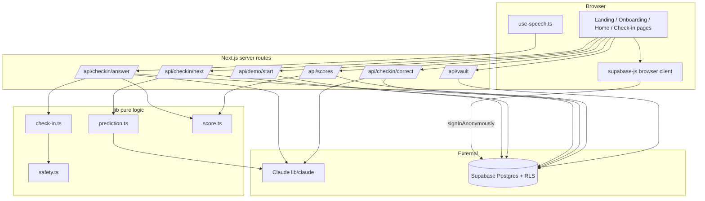
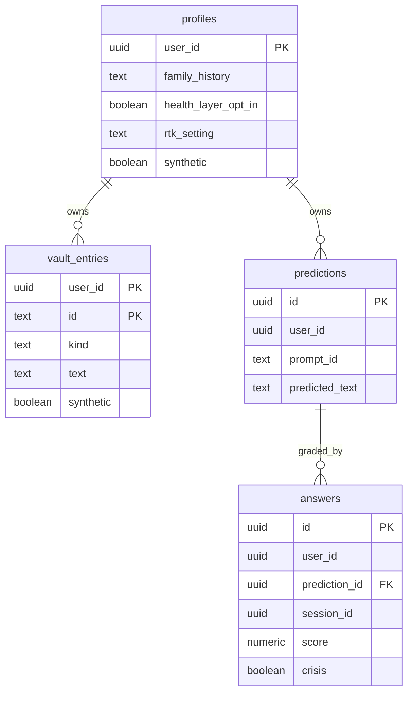
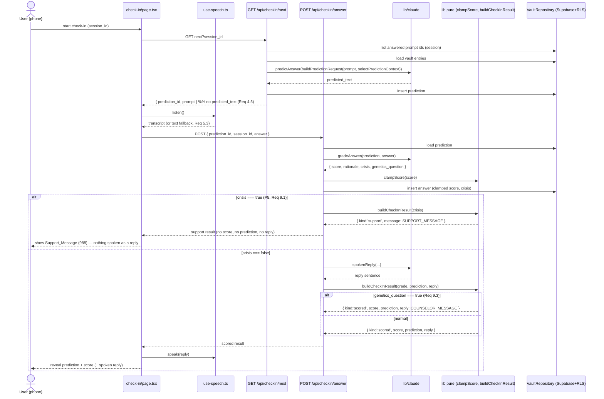

# Design Document

## Overview

`twin-loop` implements the core predict-and-correct loop of iamyou. For each check-in
prompt, the digital twin predicts the user's answer **before** seeing it, grades the
prediction against the real answer, reveals the result with a one-sentence spoken reply,
and learns from an optional one-sentence correction. The feature also covers the
"Try as Maya" demo, onboarding/consent, the per-user vault with row-level security, the
session score, and the weekly trend.

The system is a Next.js (App Router, TypeScript) PWA on Vercel. Persistence is Supabase
Postgres with row-level security and Supabase Auth (including anonymous sign-in for the
demo). Claude (Anthropic API) runs **only** in server routes under `lib/claude/`.
Speech-to-text and text-to-speech run in the phone browser via the Web Speech API and
`speechSynthesis`. Tests use Vitest; invariants that can be universally quantified are
covered by fast-check property tests.

This design is faithful to the non-negotiable rules in `AGENTS.md` and `.kiro/steering/`:
synthetic data only, never diagnose, the right-not-to-know gate, nothing sent without
approval, labelled synthetic screens, and server-side secrets.

### Design goals mapped to the loop

| Loop step | Design element | Requirements |
| --- | --- | --- |
| Enter demo | `POST /api/demo/start` + browser `signInAnonymously()` | 1 |
| Onboard | `app/onboarding/page.tsx` + profile upsert | 2 |
| Store | Vault tables + `VaultRepository` | 3 |
| Predict (blind) | `GET /api/checkin/next`, `buildPredictionRequest`, `predictAnswer` | 4 |
| Speak / hear | `components/use-speech.ts`, `Voice_Service` | 5 |
| Grade | `POST /api/checkin/answer`, `gradeAnswer`, `clampScore` | 6 |
| Correct | `POST /api/checkin/correct`, `screenText` | 7 |
| Score / trend | `GET /api/scores`, `sessionScore`, `weeklyTrend` | 8 |
| Safety gate | `buildCheckInResult`, `safety.ts`, `screenText` | 9 |

## Architecture

The code follows `.kiro/steering/structure.md`. The twin-loop additions are shown in
bold below.

```
app/
  page.tsx                     # [claude-code] landing + "Try as Maya"
  onboarding/page.tsx          # [claude-code] consent & settings
  home/page.tsx                # [claude-code] hub
  check-in/page.tsx            # [claude-code] the loop UI
  api/
    demo/start/route.ts        # anonymous-user seeding (service role)
    checkin/next/route.ts      # blind prediction, returns prompt only
    checkin/answer/route.ts    # grade + clamp + store + reveal
    checkin/correct/route.ts   # screen + store correction
    scores/route.ts            # session score + weekly trend
    vault/route.ts             # DELETE: deleteVault
components/
  use-speech.ts                # [claude-code] Web Speech hook
lib/
  score.ts                     # clampScore, weeklyTrend
  prediction.ts                # **buildPredictionRequest, selectPredictionContext**
  check-in.ts                  # **buildCheckInResult, sessionScore**
  safety.ts                    # **SUPPORT_MESSAGE, COUNSELOR_MESSAGE**
  claude/
    index.ts                   # predictAnswer, gradeAnswer, spokenReply, screenText
    prompts.ts                 # every prompt string
    schemas.ts                 # zod request/response schemas
  db/
    vault-repository.ts        # **VaultRepository + Supabase/InMemory impls**
supabase/migrations/
  0001_twin_loop.sql           # the four Vault tables + RLS
tests/
  pbt/                         # P1..P5
  unit/                        # route + helper unit tests
```

### Layering rules

- **Pure logic (`lib/*.ts`, excluding `lib/claude/` and `lib/db/`)** has no I/O and is
  the primary target of property tests. `clampScore`, `weeklyTrend`,
  `buildPredictionRequest`, `selectPredictionContext`, `buildCheckInResult`,
  `sessionScore` live here.
- **Server-only code** — all Claude calls (`lib/claude/`) and all service-role access
  (`POST /api/demo/start`) — never ships to the client. The Anthropic key and the
  Supabase service-role key are read only in server code (Req 1.4, 4.6, 6.6).
- **Data access** goes through the `VaultRepository` interface. Routes depend on the
  interface; tests inject `InMemoryVaultRepository`; production uses
  `SupabaseVaultRepository`.

### Boundary diagram



## Components and Interfaces

### Pure modules

#### `lib/score.ts`

```ts
/** Maps any raw grade into [0, 1]; NaN maps to 0. (Req 6.2, 6.3 / P1) */
export function clampScore(x: number): number;

/** Mean clamped score per ISO week: one value per week present. (Req 8.2, 8.3 / P3) */
export function weeklyTrend(
  answers: Array<{ createdAt: string; score: number }>
): Record<string, number>; // key = ISO_week, e.g. "2026-W45"
```

`clampScore` is `Number.isNaN(x) ? 0 : Math.min(1, Math.max(0, x))`. `weeklyTrend`
groups answers by ISO-8601 week of `createdAt`, averages the (already-clamped) scores,
and returns one entry per distinct week.

#### `lib/prediction.ts`

```ts
export type VaultEntry = {
  id: string;
  kind: 'conversation' | 'correction' | 'story' | 'opinion' | 'style_example';
  text: string;
  createdAt: string;
};

export type PredictionRequest = {
  prompt: string;
  context: Array<{ kind: VaultEntry['kind']; text: string }>;
};

/**
 * Selects prediction context: EVERY correction, plus the 30 most recent entries
 * of kinds story | opinion | conversation. NEVER includes style_example. (Req 7.4)
 */
export function selectPredictionContext(entries: VaultEntry[]): VaultEntry[];

/**
 * Assembles the prediction request from a prompt and vault context.
 * Takes NO answer parameter, so the answer can never enter the request. (Req 4.3, 4.4 / P2)
 */
export function buildPredictionRequest(
  prompt: string,
  context: VaultEntry[]
): PredictionRequest;
```

`selectPredictionContext` filters out `style_example` entirely (style is for drafting,
not for predicting what someone thinks), keeps all `correction` entries, and appends the
30 most recent of the remaining narrative kinds sorted by `createdAt` descending.
`buildPredictionRequest` has no `answer` parameter in its signature — this is the
structural guarantee behind P2.

#### `lib/safety.ts`

```ts
export const SUPPORT_MESSAGE =
  "It sounds like you're going through something really hard right now, and you " +
  "deserve support from a real person. If you're in the US, you can call or text 988 " +
  "to reach the Suicide & Crisis Lifeline, any time, day or night. If you're in " +
  "immediate danger, please call 911.";

export const COUNSELOR_MESSAGE =
  "Questions about genetic testing and test results are best talked through with a " +
  "genetic counselor, who can walk you through what the options and results actually " +
  "mean for you. I can't interpret any test result myself.";
```

These exact strings are the only user-facing copy for the two safety branches. They are
imported by `buildCheckInResult` and by the correction route.

#### `lib/check-in.ts`

```ts
import { SUPPORT_MESSAGE, COUNSELOR_MESSAGE } from './safety';

export type Grade = {
  score: number;          // already clamped by the route via clampScore
  rationale: string;
  crisis: boolean;
  genetics_question: boolean;
};

export type CheckInResult =
  | { kind: 'support'; message: string }
  | { kind: 'scored'; score: number; prediction: string; reply: string };

/**
 * Turns a clamped grade + prediction + candidate reply into what the user sees.
 *  - crisis === true           -> { kind: 'support', message: SUPPORT_MESSAGE }   (P5)
 *  - genetics_question === true -> scored, but reply replaced by COUNSELOR_MESSAGE (Req 9.3)
 *  - otherwise                  -> scored with the real reply
 */
export function buildCheckInResult(input: {
  grade: Grade;
  prediction: string;
  reply: string;
}): CheckInResult;

/** Session score: mean of this session's clamped scores (0 if none). (Req 8.1) */
export function sessionScore(scores: number[]): number;
```

`buildCheckInResult` checks `crisis` **first** and returns early with the support result,
carrying no score, no prediction and no reply regardless of `genetics_question`. Only
when `crisis` is false does it consider `genetics_question`.

### `lib/db/vault-repository.ts`

```ts
export interface VaultRepository {
  getProfile(userId: string): Promise<Profile | null>;
  upsertProfile(userId: string, profile: Profile): Promise<void>;

  listVaultEntries(userId: string): Promise<VaultEntry[]>;
  addVaultEntry(userId: string, entry: NewVaultEntry): Promise<VaultEntry>;
  upsertVaultEntry(userId: string, entry: VaultEntry): Promise<void>; // demo seed, idempotent

  createPrediction(userId: string, p: NewPrediction): Promise<Prediction>;
  getPrediction(userId: string, predictionId: string): Promise<Prediction | null>;

  createAnswer(userId: string, a: NewAnswer): Promise<Answer>;
  listAnswers(userId: string): Promise<Answer[]>;
  listSessionAnswers(userId: string, sessionId: string): Promise<Answer[]>;

  /** Removes every row owned by userId across all four tables. (Req 3.5, 3.6 / P4) */
  deleteVault(userId: string): Promise<void>;
}
```

Two implementations:

- **`SupabaseVaultRepository`** — uses the request-scoped Supabase server client
  (`@supabase/ssr`), so every statement runs under the caller's `auth.uid()` and RLS
  enforces per-user isolation. `deleteVault` issues one delete per table.
- **`InMemoryVaultRepository`** — backing `Map`s keyed by `userId`. `deleteVault` drops
  the user's buckets in all four maps. This is the implementation exercised by the P4
  property test and by all route unit tests.

### Server routes

All request and response bodies are validated with zod schemas in `lib/claude/schemas.ts`.

#### `POST /api/demo/start` (Req 1)

Pre-condition: the browser has already called
`supabase.auth.signInAnonymously()` with the **publishable** key and holds an anonymous
session.

1. Read the caller via the **server** client (`auth.getUser()`), obtaining `auth.uid()`.
   If there is no user, return 401.
2. Only then create the **service-role** client and **upsert** Maya's
   `profile.json` into `profiles` (with `rtk_setting = 'tell_me'`,
   `health_layer_opt_in = true`, `synthetic = true`) and every row of
   `vault-entries.json` into `vault_entries` for that `user_id`, preserving ids
   `v001`–`v040`.
3. Upserts make repeated calls idempotent (same ids → same rows).
4. On any seeding error, roll back intent by returning a 500 with an error body; the
   client treats a non-200 as "demo unavailable" and shows an error, never a partial
   session (Req 1.6).

Because the anonymous sign-in happens in the browser and the server only ever uses the
service-role key to seed the **caller's own** `auth.uid()`, this satisfies **Requirement
1.1** (sign-in performed in the browser) and **Requirement 1.2–1.4** (server-side seeding
with the service-role key, never exposed to the client).

Request: `{}`. Response: `{ ok: true }` or `{ error: string }`.

#### `GET /api/checkin/next?session_id=...` (Req 4)

1. Load `data/synthetic/checkin-prompts.json` (exactly 20 prompts, Req 4.1).
2. Via the repository, find prompt ids already answered in this session, and pick the
   **lowest-numbered** prompt not yet answered.
3. Build context with `selectPredictionContext`, then `buildPredictionRequest` (no
   answer), call `predictAnswer`, and store the result in `predictions`.
4. Return `{ prediction_id, prompt: { id, text } }`. The response schema has **no**
   `predicted_text` field, so the prediction text is never sent before the user answers
   (Req 4.5).

#### `POST /api/checkin/answer` (Req 6, 8, 9)

Request: `{ prediction_id: string, session_id: string, answer: string }`.

1. Load the stored prediction for the caller.
2. `gradeAnswer(prediction, answer)` → `{ score, rationale, crisis, genetics_question }`.
3. `score = clampScore(raw.score)` (Req 6.2).
4. Store an `answers` row with the clamped score, rationale, crisis, session id (Req 6.4).
5. Compute the candidate reply with `spokenReply` (skipped when crisis, to avoid an
   unnecessary model call).
6. `result = buildCheckInResult({ grade, prediction: predicted_text, reply })`.
7. Respond with `result` (a `CheckInResult`). The client reveals prediction + score +
   reply, or the support message (Req 6.5, 9.1).

#### `POST /api/checkin/correct` (Req 7, 9)

Request: `{ prediction_id: string, text: string }` with `text` max 280 chars (Req 7.2),
at most one correction per check-in (Req 7.1).

1. `screenText(text)` → `{ crisis, genetics_question }`.
2. If `crisis`, respond `{ kind: 'support', message: SUPPORT_MESSAGE }` and store nothing
   (Req 9.2).
3. Else if `genetics_question`, respond `{ kind: 'counselor', message: COUNSELOR_MESSAGE }`
   and store nothing (Req 9.4).
4. Else store the text as a `vault_entries` row with `kind = 'correction'` and respond
   `{ kind: 'stored' }` (Req 7.3). Future predictions include it (Req 7.4) because
   `selectPredictionContext` keeps every correction.

#### `GET /api/scores?session_id=...` (Req 8)

Returns `{ session_score: number, weekly_trend: Record<string, number> }` computed by
`sessionScore` (this session's clamped scores) and `weeklyTrend` (all of the caller's
clamped answers).

#### `DELETE /api/vault` (Req 3.5, 3.6)

Calls `repository.deleteVault(auth.uid())` and returns `{ ok: true }`.

### Claude calls (`lib/claude/`, server-only)

Every prompt string lives in `lib/claude/prompts.ts`; every response schema in
`schemas.ts`. Every call checks `stop_reason === 'refusal'` before reading content and
returns a safe fallback. Model `"claude-opus-5-5"`; no `temperature`/`top_p`/`top_k`;
no assistant prefill.

| Function | API | effort | Output | Notes |
| --- | --- | --- | --- | --- |
| `predictAnswer` | `messages.create` | medium | prediction text | context from `selectPredictionContext`; never style_example |
| `gradeAnswer` | `messages.parse` (zod) | medium | `{score, rationale, crisis, genetics_question}` | compares **meaning**, not wording; genetics_question ⇒ Req 9.3 |
| `spokenReply` | `client.beta.messages.create`, `betas: ["server-side-fallback-2026-07-01"]`, `fallbacks: "default"` | low | one warm, non-diagnostic sentence | Req 6.5 |
| `screenText` | `messages.parse` (zod) | low | `{crisis, genetics_question}` | used by the correction route |

Safe fallbacks: a grading refusal returns a neutral low-confidence grade with
`crisis: false, genetics_question: false` and a rationale explaining the twin couldn't
grade this one; a reply refusal returns a fixed gentle sentence; a screen refusal is
treated as "store nothing" to fail safe. No prompt or reply ever states or implies the
user has a condition (Req 2.6, 6.7; `safety.md`).

### Voice (`components/use-speech.ts`, Req 5)

A client hook wrapping `SpeechRecognition` / `webkitSpeechRecognition` for input and
`speechSynthesis` for output. When recognition is unsupported it exposes
`supported: false` so `check-in/page.tsx` renders a text input fallback (Req 5.3).

## Data Models

Migration `supabase/migrations/0001_twin_loop.sql`.

```sql
create table profiles (
  user_id uuid primary key references auth.users on delete cascade,
  first_name text,
  last_name text,
  date_of_birth date,
  county text,
  family_history text not null default 'prefer_not'
    check (family_history in ('huntington','familial_alzheimers','als','none','prefer_not')),
  health_layer_opt_in boolean not null default false,
  rtk_setting text not null default 'record_only'
    check (rtk_setting in ('tell_me','doctor_only','record_only')),
  digital_will jsonb,
  synthetic boolean not null default false,
  created_at timestamptz not null default now()
);

create table vault_entries (
  user_id uuid not null references auth.users on delete cascade,
  id text not null default gen_random_uuid()::text,
  kind text not null
    check (kind in ('conversation','correction','story','opinion','style_example')),
  text text not null,
  created_at timestamptz not null default now(),
  synthetic boolean not null default false,
  primary key (user_id, id)
);

create table predictions (
  id uuid primary key default gen_random_uuid(),
  user_id uuid not null references auth.users on delete cascade,
  prompt_id text not null,
  predicted_text text not null,
  created_at timestamptz not null default now()
);

create table answers (
  id uuid primary key default gen_random_uuid(),
  user_id uuid not null references auth.users on delete cascade,
  prediction_id uuid not null references predictions on delete cascade,
  session_id uuid not null,
  answer_text text not null,
  score numeric not null check (score between 0 and 1),
  rationale text,
  crisis boolean not null default false,
  created_at timestamptz not null default now()
);
```

The `vault_entries` primary key is the composite `(user_id, id)` with `id` a `text`
column, so Maya's seed ids `v001`–`v040` are valid for **every** demo user without
collision (each demo user owns their own copy). The `genetics_question` flag is a
transient grading result used to shape the response and is not persisted (only `crisis`
is stored on the answer row, for safety auditing).

### Row-level security

Enabled on all four tables, with select / insert / update **and** delete policies keyed
on `user_id = auth.uid()` (Req 3.3, 3.4):

```sql
alter table profiles enable row level security;
alter table vault_entries enable row level security;
alter table predictions enable row level security;
alter table answers enable row level security;

-- Pattern repeated for each table (profiles shown):
create policy profiles_select on profiles for select using (user_id = auth.uid());
create policy profiles_insert on profiles for insert with check (user_id = auth.uid());
create policy profiles_update on profiles for update using (user_id = auth.uid())
  with check (user_id = auth.uid());
create policy profiles_delete on profiles for delete using (user_id = auth.uid());
```

The service-role client in `POST /api/demo/start` bypasses RLS and is the only code that
writes rows on behalf of another context; it writes only to the authenticated caller's
own `user_id`.

### Entity relationships



## Correctness Properties

*A property is a characteristic or behavior that should hold true across all valid
executions of a system — essentially, a formal statement about what the system should do.
Properties serve as the bridge between human-readable specifications and
machine-verifiable correctness guarantees.*

The pure logic of `twin-loop` (`clampScore`, `weeklyTrend`, `buildPredictionRequest`,
`selectPredictionContext`, `buildCheckInResult`, `deleteVault` on the in-memory
repository) has clear input/output behavior and universal invariants, so property-based
testing with fast-check applies. The remaining criteria — Supabase Auth, RLS, the demo
seeding I/O, voice APIs, UI rendering, enum CHECK constraints, and copy-safety strings —
are not universally quantifiable and are covered by unit, integration, snapshot, and
smoke tests in the Testing Strategy.

### Property 1: Score clamping

*For all* numbers `x`, `clampScore(x)` returns a value within `[0, 1]`, and
`clampScore(NaN)` returns `0`.

**Validates: Requirements 6.2, 6.3**

### Property 2: Prediction never sees the answer

*For all* vault contexts and *for all* answer strings that do not appear in that vault
context, the serialized request produced by `buildPredictionRequest(prompt, context)`
does not contain that answer string. (`buildPredictionRequest` takes no answer
parameter, so there is no path for the answer to enter the request.)

**Validates: Requirements 4.3, 4.4**

### Property 3: Weekly trend shape and bounds

*For all* sets of graded answers, `weeklyTrend` returns exactly one value for each
distinct ISO week present in the input (and no key for any absent week), and every
returned value is within `[0, 1]`.

**Validates: Requirements 8.2, 8.3**

### Property 4: Delete leaves nothing

*For all* vault states — any mix of `profiles`, `vault_entries`, `predictions`, and
`answers` rows owned by a user, alongside rows owned by other users — after
`deleteVault(userId)` the in-memory `VaultRepository` holds zero rows owned by `userId`
in each of the four tables, while rows owned by other users are unchanged.

**Validates: Requirements 3.5, 3.6**

### Property 5: Crisis and genetics result shaping

*For all* grading results and predictions and candidate replies passed to
`buildCheckInResult`:

- When `crisis` is `true`, the result is `{ kind: 'support', message: SUPPORT_MESSAGE }`
  and contains no score, no prediction, and no twin reply — regardless of the value of
  `genetics_question`.
- When `crisis` is `false` and `genetics_question` is `true`, the result is a `scored`
  result that retains the clamped score and the prediction, with the reply replaced by
  `COUNSELOR_MESSAGE`.

This verifies the crisis guarantee (unchanged and never weakened) and the genetics branch
in a single property over all inputs.

**Validates: Requirements 6.5, 9.1, 9.3**

### Supporting properties

Two further universals are verified as fast-check tests and tied to their requirements:

- **Context selection.** *For all* sets of vault entries, every `correction` entry
  appears in `selectPredictionContext`'s output and no `style_example` entry does.
  **Validates: Requirements 7.4**
- **Next-response non-leak.** *For all* generated prediction texts, the serialized
  `GET /api/checkin/next` response body does not contain the predicted text.
  **Validates: Requirements 4.5**

## Error Handling

| Failure | Handling | Requirement |
| --- | --- | --- |
| No authenticated caller on a protected route | Return 401; client routes to landing | 1, 3.3, 3.4 |
| Demo seed fails (any step) | Return 500 `{ error }`; client shows an error and never presents a partial session | 1.6 |
| Repeated `POST /api/demo/start` | Upserts by id → idempotent; no duplicate rows | 1.2 |
| Claude grading refusal (`stop_reason === 'refusal'`) | Return a neutral low-confidence grade `{ crisis:false, genetics_question:false }` with a non-diagnostic rationale; still store an answer | 6.1, 6.7 |
| Claude reply refusal | Use a fixed gentle, non-diagnostic sentence | 6.5, 6.7 |
| Claude screen (`screenText`) refusal | Fail safe: treat as "store nothing" and show the Support_Message path is not triggered unless crisis is detected; when uncertain, do not store | 7.3, 9.2 |
| Invalid request body (zod parse fails) | Return 400 with a validation error | all routes |
| Correction over 280 chars | Reject with 400 before any model call | 7.2 |
| Prediction not found / not owned by caller | Return 404 (RLS also prevents cross-user access) | 3.3, 6 |
| Voice recognition unsupported | `use-speech` reports `supported: false`; UI shows text input | 5.3 |
| Claude returns a value outside `[0,1]` | `clampScore` maps it into range; `NaN` → 0 | 6.2, 6.3 |

All Claude fallbacks respect `safety.md`: no fallback string states or implies a
condition, and crisis/genetics handling is applied to the fallback results just as to
real results.

## Testing Strategy

### Dual approach

- **Property tests (`tests/pbt/`, fast-check, min. 100 iterations each)** verify the
  universals above. Each test is tagged
  `// Feature: twin-loop, Property {n}: {property text}` and references the design
  property and its requirement(s).
- **Unit tests (`tests/unit/`)** verify specific examples, enum/boundary edge cases,
  error paths, and route behavior using the `InMemoryVaultRepository` and a mocked Claude
  client. No unit test calls the real Anthropic API or a live Supabase instance.

### Property tests

| Test | Property | Generator sketch | Requirements |
| --- | --- | --- | --- |
| `clampScore` bounds & NaN | P1 | arbitrary doubles + explicit `NaN`, `±Infinity`, large/negative | 6.2, 6.3 |
| prediction request no-leak | P2 | arbitrary vault entries + an answer string guaranteed absent from the vault | 4.3, 4.4 |
| `weeklyTrend` shape & bounds | P3 | arbitrary `{createdAt, score∈[0,1]}` lists spanning multiple ISO weeks | 8.2, 8.3 |
| `deleteVault` leaves nothing | P4 | arbitrary rows across all four tables for the target user + other users | 3.5, 3.6 |
| crisis/genetics shaping | P5 | arbitrary grades (vary `crisis`, `genetics_question`, score, prediction, reply) | 6.5, 9.1, 9.3 |
| context selection | supporting | arbitrary entry sets across all five kinds | 7.4 |
| next-response non-leak | supporting | arbitrary prediction texts | 4.5 |

### Unit / integration / snapshot / smoke tests

- **Routes (unit, in-memory repo + mocked Claude):**
  - `demo/start`: after start the caller owns 1 profile (rtk `tell_me`,
    `health_layer_opt_in true`) and 40 `vault_entries` with ids `v001`–`v040`; a second
    call is idempotent; a forced seed failure returns 500 and seeds nothing partial
    (Req 1.2, 1.6, 1.7).
  - `checkin/next`: a prediction row is created and stored, no answer row yet, response
    body omits `predicted_text`, and the lowest unanswered prompt is chosen (Req 4.2,
    4.5).
  - `checkin/answer`: clamped score stored on the answer row; non-crisis non-genetics
    input yields a `scored` result with prediction + reply (Req 6.4, 6.5).
  - `checkin/correct`: clean text stores a `correction` row; screening→crisis stores
    nothing and returns support; screening→genetics stores nothing and returns counselor
    (Req 7.1, 7.2, 7.3, 9.2, 9.4).
  - `scores`: returns `sessionScore` and `weeklyTrend` for the caller (Req 8.1).
  - `vault` DELETE: calls `deleteVault` (Req 3.5).
- **Migration (integration/snapshot):** migration applies; the four tables and their
  `user_id` columns exist; RLS select/insert/update/delete policies exist; a cross-user
  read/write is denied; invalid `family_history`, `rtk_setting`, and `vault_entries.kind`
  values are rejected by CHECK constraints (Req 2.1, 2.3, 3.1–3.4, 3.2).
- **Onboarding (component/example):** defaults store `health_layer_opt_in=false` and
  `rtk_setting=record_only`; the digital-will placeholder renders; copy never uses
  diagnostic phrasing and the strongest allowed sentence equals the approved wording
  (Req 2.2, 2.4, 2.5, 2.6, 2.7).
- **Synthetic label (component):** any screen rendering synthetic persona/history shows
  "Synthetic data" (Req 1.5).
- **Voice (`use-speech`, with mocks):** uses Web Speech when present, speaks the reply,
  and falls back to text input when unsupported (Req 5.1, 5.2, 5.3).
- **Boundary/smoke:** `checkin-prompts.json` has exactly 20 prompts (Req 4.1); Claude
  imports and the service-role key appear only in server code (Req 1.3, 1.4, 4.6, 6.6).

### Why PBT is scoped the way it is

Property-based testing is applied to pure, input-driven logic where many generated inputs
find edge cases (clamping, trend computation, context selection, result shaping, vault
deletion). It is deliberately **not** applied to the migration/RLS (declarative DB config
→ integration + CHECK-constraint tests), the demo seeding and auth (external I/O →
integration with one representative run), the voice APIs and pages (UI → example/snapshot
tests), or the never-diagnose copy rules (fixed human/model strings → review + example
assertions), per `tech.md` and the workflow's PBT guidance.

## Check-in sequence (with crisis branch)



## Requirements and properties coverage

| Requirement | Design element(s) | Property |
| --- | --- | --- |
| 1 Demo | `POST /api/demo/start` (service role), browser `signInAnonymously`, Synthetic label | — |
| 2 Onboarding | `app/onboarding`, profile upsert, CHECK constraints, safe copy | — |
| 3 Vault & RLS | four tables, RLS policies, `VaultRepository.deleteVault` | P4 |
| 4 Blind prediction | `GET /api/checkin/next`, `buildPredictionRequest`, `selectPredictionContext` | P2, next-response non-leak |
| 5 Voice | `components/use-speech.ts` | — |
| 6 Grading | `POST /api/checkin/answer`, `gradeAnswer`, `clampScore`, `buildCheckInResult` | P1, P5 |
| 7 Correction | `POST /api/checkin/correct`, `screenText`, context inclusion | context selection |
| 8 Score & trend | `GET /api/scores`, `sessionScore`, `weeklyTrend` | P3 |
| 9 Safety | `buildCheckInResult`, `safety.ts`, `screenText` | P5 |
