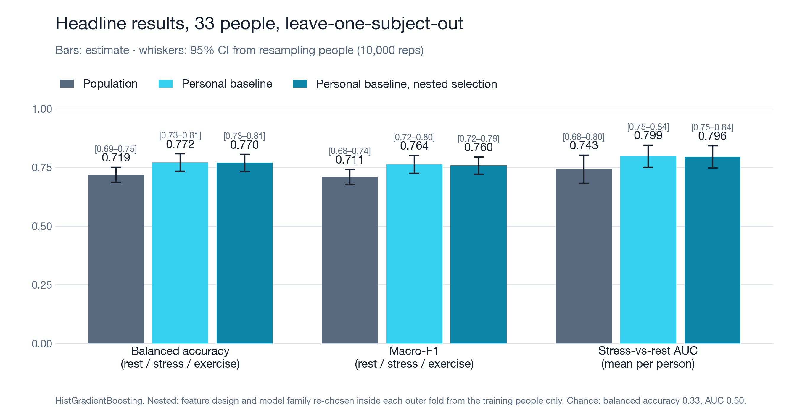
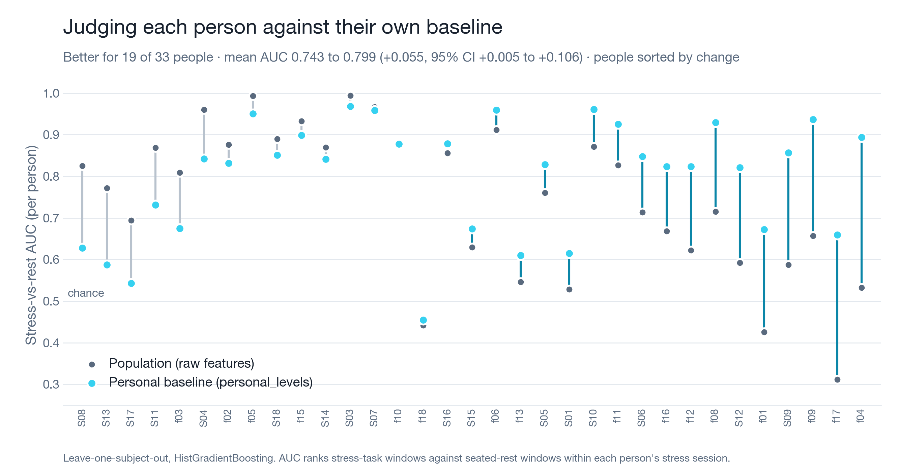
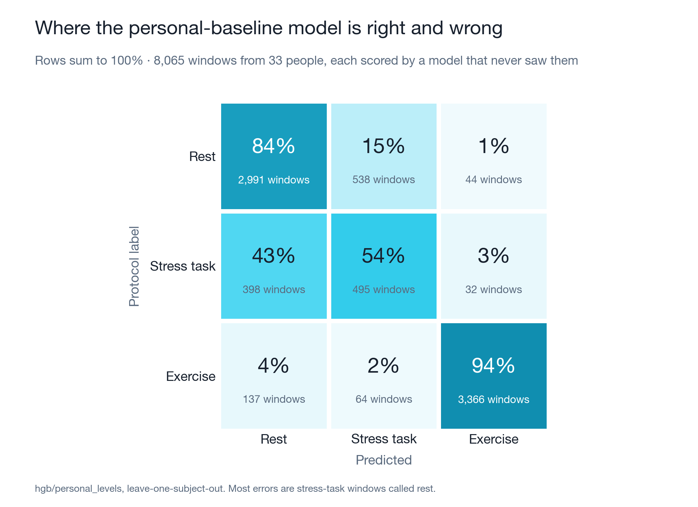
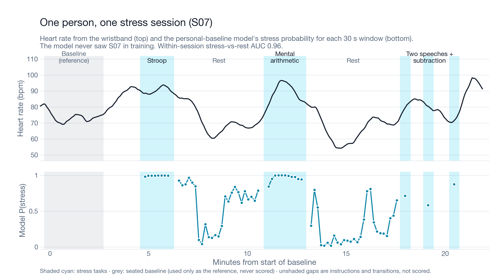

# iamyou Signal: does a personal baseline help a wrist model?

Technical report, October 2026. iamyou Signal is a research prototype and wellness estimate, not a medical device. Nothing here diagnoses, screens for or monitors any condition.

## Question

The question: does judging each person against their own seated resting baseline help a small wrist-signal model separate three states: seated rest, mental-stress tasks and exercise? The comparison is between the same models trained with and without baseline-relative features.

## Data

We used PhysioNet's *Wearable Device Dataset from Induced Stress and Structured Exercise Sessions* v1.0.1 (doi:10.13026/he0v-tf17, ODC-By). It has 36 young adults (ages 18–31) wearing an Empatica E4 research wristband during a stress protocol (two versions: V1, S01–S18; V2, f01–f18), an aerobic cycling session and an anaerobic sprint session. We used heart rate (1 Hz), electrodermal activity (EDA, 4 Hz), skin temperature (4 Hz) and acceleration (32 Hz).

**Exclusions.**
- Sessions flagged in the dataset's `data_constraints.txt`: all of S02 (duplicated signals), f07's stress session (sensors covered by the dock), and split recordings (f14 stress, S11 aerobic, S16 anaerobic).
- Sessions with fewer protocol tags than expected (aerobic S03 and S07, anaerobic S06).
- Windows with less than 80% of the expected samples.

A person is scored only if they have a stress-day baseline, which also removes f07's exercise sessions. That leaves **33 people and 8,065 scored windows**: 3,573 rest, 925 stress and 3,567 exercise. 29 of the 33 contribute exercise windows.

## Labels

Labels come from the protocol timestamps, not from physiology or from how people felt:
- **Stress:** Stroop, mental arithmetic, two opinion speeches, serial subtraction.
- **Rest:** the two seated rests between tasks.
- **Exercise:** cycling stages and sprints.

Instructions, transitions, warm-ups and cool-downs are not used. The **baseline** is the last 180 s of the seated baseline on the stress-protocol day. It is used only as the person's reference and is never scored. Four V1 baselines are shorter than 180 s (163–176 s), so their reference starts up to 17 s before the tagged baseline.

## Features and designs

Windows are 30 s long with a 10 s hop. Each window has 12 features:
- Heart rate: mean, SD, slope.
- EDA: mean, SD, slope, summed rise.
- Temperature: mean, slope.
- Acceleration magnitude: mean, SD, jerk.

Four feature designs:
- **population:** the raw features.
- **personal:** every feature minus the person's baseline mean.
- **hybrid:** both of the above.
- **personal_levels:** heart rate and temperature as differences from baseline, EDA as ln(EDA + 0.05) − ln(baseline EDA + 0.05), the other 9 features raw.

## Models and evaluation

Two model families: logistic regression (standardized, C = 0.5, balanced class weights) and HistGradientBoosting (HGB; depth 4, learning rate 0.06, 300 iterations, balanced). With 4 designs, that makes 8 configurations.

**Leave-one-subject-out (LOSO).** Every person is scored by a model trained only on the other 32.

**Metrics:**
- Pooled 3-class balanced accuracy and macro-F1.
- Stress-vs-rest AUC within each person's stress session, using the score p(stress) / (p(stress) + p(rest)), averaged over people.
- Within-person Spearman correlation between mean predicted stress per phase and the participant's self-reported stress (1–10).

**Uncertainty:**
- 95% CIs from 10,000 bootstrap resamples of people. The trained LOSO models stay fixed, so the intervals describe which people happen to be tested, not retraining noise.
- Paired differences use the same resamples.
- p-values come from a subject-level sign-flip permutation test (100,000 flips; for a flipped person, the two models swap predictions).

**Selection.** personal_levels was picked after seeing LOSO results for all 8 configurations. Two checks address that:
1. A Westfall–Young max-T sign-flip test over all six "personal design vs population" comparisons.
2. A **nested LOSO**: in each outer fold, an inner LOSO over the 32 training people picks one of the 8 configurations by balanced accuracy, and only that configuration scores the held-out person. This took 4,224 inner fits.

## Results

**Table 1.** Results for HGB with 95% subject-bootstrap CIs. p is the two-sided sign-flip test.

| Metric | Population | Personal baseline (personal_levels) | Difference | Nested selection |
|---|---|---|---|---|
| Balanced accuracy | 0.719 [0.687, 0.750] | **0.772** [0.734, 0.808] | +0.053 [+0.018, +0.087], p = 0.006 | 0.770 [0.733, 0.805] |
| Macro-F1 | 0.711 [0.678, 0.742] | **0.764** [0.725, 0.801] | +0.053 [+0.017, +0.089], p = 0.008 | 0.760 [0.721, 0.795] |
| Stress-vs-rest AUC, mean per person | 0.743 [0.683, 0.803] | **0.799** [0.751, 0.845] | +0.055 [+0.005, +0.106], p = 0.044; better for 19/33 | 0.796 [0.748, 0.842] |
| Self-report Spearman, within person | 0.26 [0.15, 0.35] | **0.42** [0.33, 0.51] | +0.16 [+0.07, +0.25], p = 0.001 | 0.41 [0.32, 0.49] |
| Recall: rest / stress / exercise | 0.79 / 0.44 / 0.93 | 0.84 / 0.54 / 0.94 | | 0.82 / 0.55 / 0.94 |

**Selection does not explain the gain.**
- **Nested LOSO.** The inner loop chose personal_levels in 28 of 33 folds and hybrid in 5. It never chose a population design in either family. The nested scores are within 0.004 of the selected model's scores. Nested minus population: balanced accuracy +0.051 [+0.016, +0.086] (p = 0.009); AUC +0.053 [+0.002, +0.104] (p = 0.056).
- **Max-T, adjusted for six comparisons.** Balanced accuracy p = 0.012; macro-F1 p = 0.020; per-person balanced accuracy p = 0.010; per-person AUC p = 0.069.
- **Holm correction** of the 12 Wilcoxon tests in `train.py`: balanced accuracy p = 0.019; AUC p = 0.50.

The 3-class gain holds up. The stress-vs-rest AUC gain is borderline: p ranges from 0.04 to 0.07 depending on the test, and it does not survive Holm.

**Two qualifications.**
1. Logistic regression gains far less from the baseline. Its balanced accuracy changes by +0.005 [−0.019, +0.027], while its AUC improves by +0.023 [+0.007, +0.041].
2. The strongest population model is logistic regression, not HGB: balanced accuracy 0.745 and AUC 0.763. Against it, HGB personal_levels gains:
   - balanced accuracy +0.027 [−0.005, +0.059] (p = 0.11)
   - macro-F1 +0.045 [+0.011, +0.077]
   - AUC +0.036 [−0.004, +0.077]
   - self-report Spearman +0.16 [+0.04, +0.29]

The AUC gain is uneven across people. The biggest gains come from people the population model ranked poorly (f17 0.31 → 0.66, f01 0.43 → 0.67, f04 0.53 → 0.89). A few people the population model already ranked well get worse (S04 0.96 → 0.84, S08 0.83 → 0.63).

Exercise is easy (94% recall). The main weakness is stress: 43% of stress-task windows are called rest.

For S07 (AUC 0.96), the predicted stress probability rises during each task. It often stays high into the first minute of rest, tracking the slow recovery of heart rate.

**Table 2.** Sensitivity of HGB population vs personal_levels. This table is for reporting only and did not change the chosen model.

| Run | Population bacc / AUC | Personal bacc / AUC | Δ bacc | Δ AUC (better/33) | Self-report ρ (personal) |
|---|---|---|---|---|---|
| Reference: 30 s windows, 180 s baseline | 0.719 / 0.743 | 0.772 / 0.799 | +0.053 | +0.055 (19) | 0.42 |
| Baseline 120 s | 0.719 / 0.743 | 0.764 / 0.788 | +0.045 | +0.044 (18) | 0.37 |
| Baseline 60 s | 0.719 / 0.743 | 0.776 / 0.806 | +0.057 | +0.063 (20) | 0.32 |
| Window 60 s* | 0.727 / 0.759 | 0.798 / 0.854 | +0.071 | +0.096 (22) | 0.38 |
| Seeds 1–4 | identical to reference | | | | |
| max_features 0.8, seeds 0–4 | 0.720–0.727 / 0.742–0.756 | 0.766–0.773 / 0.789–0.799 | +0.042 to +0.052 | +0.034 to +0.053 (17–21) | 0.42–0.44 |

\*With 60 s windows (minimum 50 s), the speeches and most subtraction windows drop out. Stress windows fall from 925 to 651, so this run is not directly comparable.

**Seeds.** The configured HGB has no random component here: fewer than 10,000 training rows switches off early stopping, and every feature is used at every split. Seeds therefore change nothing. Adding feature subsampling makes the seed matter, and then the gain ranges from +0.042 to +0.052. The reported +0.053 sits at the top of that range.

**Baseline length.** The gain holds for 60–180 s baselines. Agreement with self-reported stress weakens as the baseline gets shorter.

## Other designs we tried

A separate nested search (outer leave-one-person-out, inner 5-fold grouped by person, 432 configurations, selection criterion fixed in advance) tried heart-rate variability from beat intervals, EDA split into tonic level and skin-conductance responses, heart rate scaled by the baseline's spread, 60-second windows and a small hyperparameter grid.

- Read literally, the 60-second design with every new feature won (+0.072 AUC, p = 0.0016). Most of that gain came from scoring it on different, easier windows: both window sizes stay inside one labeled phase, so the longer window is never penalised for reacting late.
- Scored at the same decision moments (every 5 s, judging the last W seconds, as the app would run), it drops to +0.030 (p = 0.16), and 60-second windows with the shipped features score lower than 30-second ones (−0.019).
- The most promising next step is the 30-second design with the new HRV and EDA features: +0.028 to +0.032 AUC, better for 24–26 of 33 people, p = 0.08–0.12. Consistent, not significant, and its estimates track self-reported stress less well (ρ 0.40 vs 0.45). We kept the shipped design.
- The model reacts slowly to a change: at the same decision moments its stress-vs-rest AUC is 0.57 in the first minute of a phase and 0.85 after it. This is one more reason iamyou asks only about sustained rises.

## Limitations

- **Small sample:** 33 young adults, one dataset, one lab. The CIs are wide; the lower bound of the AUC gain is +0.005.
- **Lab protocol:** stress is short, scripted tasks while seated, and exercise is cycling and sprinting. Daily life mixes posture, movement, caffeine and heat.
- **Device:** the Empatica E4 is a research wristband, not the WHOOP or any consumer device iamyou targets. Sensors, sampling and on-device heart-rate algorithms differ.
- **Labels:** labels mark protocol phases, not felt stress. Self-report agreement is moderate (ρ = 0.42).
- **Baseline timing:** each baseline is a 3-minute seated recording from the stress-protocol day. Exercise sessions were recorded on other days, so their reference comes from a different day.
- **Model and design selection:** we compared 8 configurations. Nested selection and max-T correction leave the 3-class gain intact, but they do not replace an untouched test set.
- **The seated baseline reads as half stressed.** Out of fold, baseline windows average P(stress) 0.47, against 0.25 for the rests between tasks and 0.56 for the tasks. The "rest" label comes from rests after tasks, when heart rate sits below the pre-task baseline. A person sitting at their own baseline therefore gets roughly even odds of rest and stress, so the model must not raise anything on its own (see "How iamyou uses it").
- **Short tasks:** the two speeches and the subtraction last about 30 s, so no 30 s window fits fully inside them.

## What we claim

- On this dataset, judging a person against their own resting baseline improves 3-class balanced accuracy by about 0.05 for gradient boosting (95% CI +0.02 to +0.09). The gain survives subject bootstrap, permutation, max-T correction and nested selection.
- The baseline-relative model's stress estimates track self-reported stress within a person better (ρ 0.42 vs 0.26).
- The model separates exercise from mental-task arousal well: 94% exercise recall, and 1–4% of windows confused between exercise and the other states.

## What we don't claim

- That the stress-vs-rest ranking gain is established. It is borderline after correction.
- That the gain holds against every population model. Against logistic regression it is smaller and its CI includes zero.
- Any performance on WHOOP or other consumer data, in daily life, or for any group beyond young adults.
- That the model measures felt stress, or anything clinical. It is not a diagnostic or medical tool.

## Shipped model

The app ships a smaller version of the same configuration so it fits in the browser: gradient boosting with depth 4, at most 12 leaves and 160 iterations (480 trees, 10,988 nodes, `data/public/signal-model.json`, 237 KB). Its inputs are snapped to a 2^-30 grid so that float rounding never lands on a split; with that, shifting a person's heart rate and temperature together with their baseline leaves the output exactly unchanged. Size was chosen as the smallest model within 0.005 of the reference on balanced accuracy and stress-vs-rest AUC, no worse on log loss and no more than 0.005 lower on macro-F1.

| | Reference (300 iterations) | Shipped (160 iterations, 12 leaves) |
|---|---|---|
| Balanced accuracy (LOSO) | 0.772 | 0.777 |
| Stress-vs-rest AUC per person | 0.799 | 0.804 |
| Macro-F1 | 0.764 | 0.762 |
| Log loss | 0.393 | 0.358 |
| Recall rest / stress / exercise | 0.84 / 0.54 / 0.94 | 0.81 / 0.58 / 0.94 |

The headline claims in this report use the reference numbers, which went through the nested and permutation checks. `ml/signal/ts/signal-model.ts` runs the shipped trees with no dependencies and becomes the app's `lib/signal-model.ts`. On all 8,065 windows it matches scikit-learn's `predict_proba` within 2.6e-11; `ml/signal/ts/test-vectors.json` holds 30 of them for the app's tests.

## How iamyou uses it

- **It explains a rise; it does not raise anything.** A separate, simple detector flags a sustained heart-rate rise against the person's baseline. Signal then says what kind of rise it looks like: exercise (the person was moving), or stress-like arousal while still. The twin asks about the second kind and leaves the first alone.
- **Demo data is out of fold.** `data/public/signal-s07-stress.json` (participant S07's stress session) and `data/public/signal-demo.json` (S10's stress and cycling sessions) carry probabilities from models that never saw that person.
- **Labels on screen.** Every screen that shows these recordings carries "Open research data · PhysioNet" with a link to the dataset.
- **It never diagnoses.** It describes a 30-second window; it says nothing about health.

---
Code and outputs:
- Everything needed to reproduce these numbers is in `ml/signal/` (see its README): download, window building, training, robustness checks, export and demo data.
- Figures: `docs/signal-model/`.
